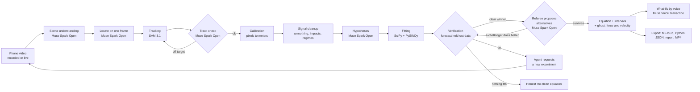

# PhysicsLens

**Point a phone at anything moving. Get the equations that govern it, verified.**

*A simulator is only as good as its physics. PhysicsLens gets physics from reality, proves it, and shows its work.*

PhysicsLens turns a phone video into a verified physics model. SAM 3.1 tracks the moving object, an agent built on Meta's open-weight reasoning model proposes candidate equations, and plain numerical simulation tests every candidate against the real motion. Only an equation that predicts held-out data is accepted. When the data can't tell two models apart, the agent asks you for the experiment that will. The result is a calibrated model you can export straight into a robot simulator, or use to watch a machine wear.

> Built for the **Meta Global AI Developer Hackathon** (Indie track, *Push the Frontier*), Oct 27 to Nov 4, 2026.

| | |
|---|---|
| 🎥 **Demo video (3 min)** | _link coming_ |
| 🌐 **Try it** | [physicslens.vercel.app](https://physicslens.vercel.app): real analyses with the ghost overlay, decision trail and exports. Everything is open, no code needed: analyze your own clip, live camera, voice, studies and the physics audit, whenever the analysis server is online (the home page says so) |
| 🤖 **For AI assistants** | [`llms.txt`](llms.txt) is a compact map of this repository |

---

## In 30 seconds

- **The problem:** robots are trained in simulators and fail when the simulator's physics is wrong (friction, damping, stiffness). Measuring real physics takes lab rigs and an expert.
- **What PhysicsLens does:** film anything moving with a phone. You get the equation that governs it, its parameters with uncertainty, a simulated "ghost" over the real video, and an export a robot simulator can run (MuJoCo, Python, JSON).
- **Why you can trust it:** no equation is accepted unless it forecasts motion it never saw. A second "referee" model tries to break every accepted law, and every step names the model or the math that decided it.
- **Proof it discovers rather than recalls:** from rendered videos of asteroid Apophis and of Jupiter's four large moons it found the inverse-square law, the Sun's GM within 0.023% and Jupiter's within 0.012% of NASA/JPL, and Kepler's third law (exponent 1.4991 ± 0.0032) from the tracks alone.
- **On real footage:** a 0.5 m pendulum gives g within 1%; a thrown paper bag rejects free fall for linear drag; and when the data cannot decide, the agent asks for the experiment that would.
- **Meta models doing real work:** Muse Spark Open (open weights, on Baseten) reasons, SAM 3.1 tracks, Muse Voice Transcribe listens, Muse Image draws setup guides, Muse Wonder writes controllers that only simulation can accept, and Muse Glimmer 30B is the fully offline open-weight path.

## Judging guide (5 minutes)

| Step | Open | What you will see |
|---|---|---|
| 1 | [Asteroid Apophis](https://physicslens.vercel.app/?run=gallery-apophis) | a dot moving around the Sun becomes the inverse-square law; the force arrow points at the Sun in every frame |
| 2 | [Weighing Jupiter](https://physicslens.vercel.app/?run=gallery-jupiter) | Jupiter's GM from Io's orbit, within 0.018% of JPL |
| 3 | [Pendulum](https://physicslens.vercel.app/?run=gallery-pendulum) | the referee proposes damping and the verdict changes, on screen, with the reason |
| 4 | [Paper bag](https://physicslens.vercel.app/?run=gallery-paperbag) | free fall rejected; a drag law accepted on held-out motion |
| 5 | [Open dataset](https://physicslens.vercel.app/dataset) | every verified parameter, with its uncertainty, clip and licence |
| 6 | Your own clip, live mode, a study | open to everyone, no code; [the home page](https://physicslens.vercel.app) shows whether the analysis server is online |

In every result, open the decision trail: each step is tagged with the model (provider and id) or the numerical method behind it, and "What the model thought" shows the reasoning.

## Contents

**Part I: The idea**
- [The problem](#the-problem)
- [What it does](#what-it-does)
- [How it works](#how-it-works)

**Part II: Measure**
- [Systems it identifies](#systems-it-identifies)
- [Proof it discovers, not recalls](#proof-it-discovers-not-recalls)

**Part III: Prove**
- [How an equation is accepted](#how-an-equation-is-accepted)
- [The agent: samples, tools and a referee](#the-agent-samples-tools-and-a-referee)
- [Studies: asking for the experiment that settles it](#studies-asking-for-the-experiment-that-settles-it)
- [Live mode: predictions made before the event](#live-mode-predictions-made-before-the-event)

**Part IV: Use and catch**
- [Applications](#applications)
- [For robotics: exports checked in MuJoCo](#for-robotics-exports-checked-in-mujoco)
- [Sim-to-real gap, made visible](#sim-to-real-gap-made-visible)
- [Controllers written by Muse Wonder, verified in MuJoCo](#controllers-written-by-muse-wonder-verified-in-mujoco)
- [Machine health](#machine-health)
- [Sound as a second sensor](#sound-as-a-second-sensor)
- [For AI agents: PhysicsLens as an MCP server](#for-ai-agents-physicslens-as-an-mcp-server)
- [Physics audit](#physics-audit)
- [Open dataset](#open-dataset)

**Part V: The record**
- [The story: how it was built](#the-story-how-it-was-built)
- [Validation](#validation)
- [Limitations](#limitations)
- [Meta models used](#meta-models-used)
- [Cost and safety controls](#cost-and-safety-controls)

**Part VI: Reference**
- [Roadmap](#roadmap)
- [Acknowledgements](#acknowledgements)
- [License](#license)
- Reference (collapsed): [The pipeline in detail](#the-pipeline-in-detail), [Getting started (Linux)](#getting-started-linux), [Configuration reference](#configuration-reference), [HTTP and WebSocket API](#http-and-websocket-api), [Project structure](#project-structure), [Testing](#testing), [What we built during the hackathon](#what-we-built-during-the-hackathon)

---

# Part I: The idea

## The problem

Robots are trained in simulators, and they fail in the real world when the simulator's physics is wrong: the friction, damping or stiffness doesn't match reality (the "sim-to-real gap"). Measuring those parameters today takes lab rigs, sensors and an expert's afternoon of modeling. PhysicsLens does it from a phone video:

- **Robotics engineers** get dynamics parameters with uncertainty, exported as a MuJoCo model that is replayed in MuJoCo and checked against the measured motion.
- **Maintenance engineers** film a machine part today and again next month. PhysicsLens compares natural frequency and damping across recordings and flags drift, an early sign of wear.
- **Anyone building a mechanism** gets a working dynamics model in minutes instead of an afternoon.

It is system identification, normally a specialist task, made as easy as filming something.

## What it does

1. **Start from a goal, or from a clip.** In a **study** you state what you need ("are this truck's front shocks worn?", "the damping of this cabinet hinge for my robot sim"). The agent plans the deliverable, what to measure and which recordings to make, with filming instructions. Or just upload a clip, or go live with the phone camera.
2. **It reads the scene.** The reasoning model looks at four keyframes, names the moving object, guesses the kind of motion, and finds a reference of known size (A4 or letter sheet, credit card, coin). No reference? Give the pendulum length or the object's size, say it out loud while filming, or skip it: frequency, damping and friction need no scale.
3. **It tracks, then checks what it tracked.** SAM 3.1 follows the object, and the reference, through every frame in one request. The reasoning model then looks at three frames with SAM's box drawn on them; if the box sits on the wrong thing (a clasp, a shadow, a digit drawn on the video), SAM is asked again by the object's name.
4. **It hypothesizes, then proves.** The agent proposes candidate equations from a library or writes its own; regular math fits and simulates each one and keeps only what forecasts held-out data. The simplest adequate model wins (BIC).
5. **It checks the answer is physical.** With no scale in view and a law containing g, Earth's gravity becomes the ruler: lengths follow from the fitted g, and the assumption is stated.
6. **It asks for better data.** If genuinely different laws tie, the agent says which experiment would separate them; in a study it asks for the next recording until the goal is answered, and the recordings are combined (weighted means, and a test that they agree).
7. **You see the proof.** A simulated "ghost" moves over the real video. Every decision appears in an on-screen decision trail, each tagged with the model or the math that made it.
8. **Ask "what if?" out loud.** "What if the string were twice as long?" The fitted equation is re-simulated from the same starting state and drawn as a second ghost.
9. **Export.** A MuJoCo model, a standalone Python simulation, parameters as JSON, a one-page report for a colleague, or a shareable MP4. A study adds its own report, a wear verdict with a maintenance note when that was the goal, and a MuJoCo model with the combined parameters.

When nothing fits, it says so: *"no clean governing equation found."* It never invents an equation, and it refuses clips it can't measure (a flat pendulum arc, a round spinning object, a spin close to the frame-rate limit, a tracked object that never moves) instead of guessing. One limit it cannot see: a spin faster than a quarter turn per frame aliases into a slower one, so film spins with slow motion.

## How it works



**The design principle: Meta's models perceive and reason; math decides.** The language model reads the scene, proposes hypotheses, plans experiments and explains results. It never accepts an equation: only numerical verification on held-out data does, and the simplest model of each family is always tested as a control, so the agent can't hide the baseline.

---

# Part II: Measure

> Film something. Get the law that governs it.

## Systems it identifies

| System | Models compared (ids in `physics/models.py`) | What you get |
|---|---|---|
| Pendulum | simple (`pendulum`), small-angle, linear damping, quadratic (air) damping | g, damping, string length (all with intervals) |
| Spring or elastic oscillator | harmonic, damped harmonic, spring with dry friction (`oscillator_dry`), spring with viscous and dry friction together (`oscillator_mixed`), stiffening spring (`duffing`) | natural frequency, damping ratio, friction or stiffening coefficient |
| Torsional spring (door closer, hinge) | damped torsional spring (`spin_spring`) | stiffness and damping per unit inertia |
| Thrown or dropped object | no drag, linear drag, quadratic drag | g, drag coefficient |
| Ball thrown toward or away from the camera (opt-in 3D mode, one phone) | no drag, linear drag, quadratic drag in three dimensions | the 3D path with a depth error for every frame, g with an interval |
| Bouncing ball | free flight plus restitution (hybrid) | g shared by every flight, coefficient of restitution at each bounce |
| Double pendulum | point-mass double pendulum, fitted on short restarted predictions | g, mass ratio, and how chaotic it is: Lyapunov exponent and how many seconds the motion can be forecast |
| Spinning object slowing down | free spin, dry friction, viscous, air drag, dry plus viscous | the friction law and its coefficients |
| **Anything else that moves** (rolling, sliding, braking, a falling leaf) | constant velocity and constant acceleration (along a line or in the plane) as controls, plus up to three equations **the agent writes itself** | the law that forecasts the motion, its fitted coefficients, and the same ghost, exports and what-ifs |

**Equations the agent writes itself.** For motion outside the named families the agent proposes the acceleration law as text, for example `-mu*9.81*sign(v) - c*v*abs(v)` for a cart slowed by rolling friction and air drag. A small recursive-descent parser over a closed grammar (numbers, declared parameters, the state variables, `+ - * / ^` and a whitelist of functions) turns it into a model; nothing is ever passed to `eval`. The parsed tree drives the ODE solver, the LaTeX shown in the app and the exported Python script, so what you see is exactly what was fitted. Each law must beat "nothing acts on it" and "a constant force" on held-out motion, and a malformed proposal goes back to the agent with the parser's error. On synthetic data an agent-written air-drag law recovers its coefficient within 5% and a wrong spring law is rejected.

Changes during a clip (say, the string is shortened mid-recording) are detected; each regime is fitted separately, and live mode refits on the new motion.

**3D from one phone, balls only.** A ball looks the same from every side, so its apparent size gives its distance: Z = f·D/d, with D the diameter you enter, d the diameter of the disc with the mask's area, and f the camera's focal length in pixels. Its image position then gives X and Y. Frames where the mask is stretched by motion blur (aspect ratio over 1.3), loses over 30% of its area against its neighbours, or touches the frame edge are rejected. One pixel of diameter error on a 40 px ball is 2.5% of the distance, so depth is far noisier than position across the image; the fit weights it accordingly, and every frame's depth error is reported. The three 3D projectile laws then go through the same held-out forecast and BIC rules as the 2D ones. The mode is opt-in (`depth_3d` and `focal_px` on `POST /api/runs`, with the object's size) and runs only for a ball fitted as a projectile; otherwise the 2D result stands and a note says why 3D was skipped. Phone videos record no focal length that ffprobe can read (none of our clips have one), so you measure it once: film an A4 sheet flat at a known distance and use f = d·Z/D (`physics/depth3d.py`, `focal_from_reference`).

## Proof it discovers, not recalls

Nobody films an asteroid. If the pipeline really discovers laws instead of recalling them, it should still find them in a video of one. Both demos below go through the normal pipeline: SAM 3.1 tracks a dot, the agent writes its own laws, and verification decides; NASA/JPL data only draws the video and, afterwards, checks the answer.

### Apophis: the inverse-square law from a video

Can the same pipeline that measures a pendulum rediscover the law of gravity just by watching an asteroid? `scripts/orbit_demo.py` renders four years of 99942 Apophis (2022 to 2026, one frame per 2.5 days) from NASA/JPL Horizons positions, viewed top-down in Apophis's own orbital plane, and runs the normal pipeline on that video: Muse Spark Open reads the scene, SAM 3.1 tracks the dot, the agent writes laws of its own, and numerical verification decides. The JPL data are used only to draw the video and, afterwards, to check the answer.

| | From the video | NASA/JPL | |
|---|---|---|---|
| Force law | exponent 2.99998 in the agent's free power-law form (force proportional to r^-2.00002) | inverse square | |
| GM of the Sun | 2.95981e-4 AU³/day² | 2.95912e-4 AU³/day² (Horizons) | +0.023% |
| 2029 closest approach, time | 2029-04-14 10:48 TDB | 2029-04-13 21:46 TDB (CNEOS close-approach API) | 13 h late, 3.3 years after the last frame |
| 2029 closest approach, distance | 2.19 million km | 38,000 km | not resolved |

What happened, in order: three independent proposals each wrote the inverse-square law (in different notation; verification now recognizes one law written twice). Verification accepted it over a free-exponent version and the controls. The referee then proposed a tiny velocity term (time scale about 11,000 years) that also forecast the held-out motion (0.5% against 0.6%) and fit the whole orbit better by 51 BIC: not air drag, but the data saying that Sun-only gravity is not the whole story (the planets pull on Apophis too). The video shows the law's force arrow pointing at the Sun in every frame.

**Honest limits.** One pixel is about 340,000 km at this scale, and SAM's centroids carry about 2 px of error, so the position error is about 0.8 million km at the end of the video and grows to about 2.2 million km by 2029 (`var/orbit/prediction_error.png`). The prediction is Sun only (no planets, no relativity, no Yarkovsky effect) and lives in Apophis's orbital plane. It is a deterministic prediction compared with JPL's answer, not an impact probability: PhysicsLens does not propagate the uncertainty a "will it hit Earth" verdict needs. The units are AU and days (the expression language bounds parameters, and GM in SI is about 1e20).

Reproduce: `python scripts/orbit_demo.py all` (fetch and render are free; analyze calls SAM 3.1 and Muse Spark Open once; predict is local). Data sources and credits: `data/orbit/SOURCES.md`.

### Jupiter: one planet weighed four ways

`scripts/jupiter_demo.py` does the same for the four Galilean moons: one rendered video per moon (1.25 orbits, top-down in its own orbital plane, from JPL Horizons positions), the normal pipeline on each, and the agent writing its own laws. Lengths are in Jupiter radii (R_J) and time in hours.

| Moon | Law accepted by verification | GM of Jupiter (R_J³/h²) | vs JPL (4.49328) |
|---|---|---|---|
| Io | Keplerian point-mass gravity | 4.4941 ± 0.0011 | +0.018% |
| Europa | point-mass gravity, centre fitted (1.2 px from the drawn centre) | 4.4927 ± 0.0006 | -0.013% |
| Ganymede | Newtonian central gravity | 4.4916 ± 0.0011 | -0.036% |
| Callisto | power-law central gravity, exponent 1.989 ± 0.009 | 4.34 ± 0.12 | -3.5% (within its interval) |
| **Combined** | | **4.49272 ± 0.00047** | **-0.012%** |

Then, across the moons and without any fitted force law: the period and mean distance of each orbit, measured straight from the track, follow **period proportional to distance^1.4991 ± 0.0032** (Kepler's third law is 1.5), with every moon predicted from the other three within 0.7 sigma; its prefactor weighs Jupiter a third way, 0.35% below JPL. The distance carries one pixel of systematic uncertainty in that test. SAM's tracker dropped a plain dot on two of the moons; the pipeline now finds the object by name in every frame before giving up, and that is how Europa was tracked. Data credits: `data/jupiter/SOURCES.md`.

---

# Part III: Prove

> Models propose. Math decides. Nothing is accepted on a model's word.

## How an equation is accepted

Only code decides, never the language model:

- **Held-out forecast.** Each model is fitted on the first 75% of the motion and must forecast the last 25%. The normalized RMS error on that held-out part must be at most 15%, or at most 30% when the error is also within 3 times the measured tracking noise.
- **Model selection by BIC.** Among the models that pass, the lowest Bayesian Information Criterion wins. A winner must beat every other passing model by at least 10 BIC (strong evidence on the Kass and Raftery scale) unless the rival has more parameters.
- **Ties become experiments.** If genuinely different laws are within 10 BIC, the agent is asked which recording would separate them (for a small-angle pendulum tie: "swing it wider"), and the user sees that request.
- **Approximations are named, not rejected.** When a law ties with its own approximation (sin θ versus θ at small angles) the exact law is kept and the other is labeled "Same law: the small-angle approximation", not "Rejected".
- **Controls are always tested.** The simplest model of each family (no damping, no drag, constant velocity or acceleration) is fitted alongside the agent's proposals, so a fancy law must beat the obvious baseline.
- **Nothing fits, nothing shown.** If no model passes, the result is "no clean governing equation found."
- **Scale stated, never hidden.** When gravity is used as the ruler, the assumption and the scale's uncertainty are written into the trail and the result.

## The agent: samples, tools and a referee

- **Plain Python loop, no agent framework.** Every model call goes through `costguard.client`, with a JSON schema per step (`agent/schemas.py`) and Pydantic validation. Agent loops are capped at 4 turns.
- **It looks twice.** The four-frame scene call names the object; a second call on one frame alone boxes it tightly for SAM (`pipeline.locate_precisely`). On a real pendulum clip the four-frame box sat on the stopwatch beside the bob; the single-frame box sat on the bob. If the object is not in view yet (a throw), later frames are tried and SAM starts there.
- **Independent proposals.** The hypotheses step samples the model three times in parallel; the union of the majority family's candidates is fitted, and the result says how many samples proposed the law that won (`agent/reasoning.propose_hypotheses_sampled`).
- **Tools before a decision.** Before its final action the agent may spend up to four steps testing models of its own choosing or inspecting part of the motion; each step records what it expected, what code measured and how the verdict moved (`test_models`, `inspect`). A step budget and a wall-clock limit are enforced in code, and a final action that does not match the verdict is shown, never acted on.
- **A referee tries to break every accepted law.** A second call with a different brief proposes up to three alternatives; each is fitted and judged by the same rule (`agent/skeptic.py`). A challenger takes over only by the same rule as the first candidates: it must forecast the held-out motion within the threshold and then fit better by BIC; the trail says so either way, and a law that holds carries "survived N challenges". On the real Rhetos pendulum clip the referee proposed linear damping; it passed the held-out test (13.8% against 9.9% for the simple pendulum) and fit the whole swing better by BIC, so the verdict changed to it (g = 9.91 m/s² for a 0.5 m string).
- **Reasoning effort per step.** Muse Spark Open thinks harder where it decides more: high for hypotheses and the referee, medium for locating and explaining, low for naming the scene (`config/limits.yaml`).
- **Decision trail.** Every step records who decided (`model` with provider and model id, or `math`), what was decided and why. The UI shows it prominently: candidates proposed, rejections with their held-out error, the track check, the gravity-ruler assumption, experiment requests and study decisions.
- **Spoken settings.** Muse Voice Transcribe turns speech into text; the reasoning model turns "the string is half a meter, film from the left" into validated settings (`agent/notes.py`), and out-of-range values are dropped rather than trusted.
- **What-ifs.** A question ("what if it were on the Moon?") becomes a validated parameter change (`agent/whatif.py`), the fitted law is re-simulated from the same starting state, and a second ghost is drawn. For uncalibrated clips, only relative changes to length-dependent parameters are allowed.
- **Refusal to fake.** If the reasoning server is unavailable in demo or production, the app says it is busy. It never substitutes another model or a canned answer.

## Studies: asking for the experiment that settles it

A study turns a goal into a measurement campaign (`studies.py`, `physics/combine.py`, `app/study` in the frontend):

1. You state a goal. The agent writes a plan: the deliverable, the quantity to measure, and the recordings to make with filming instructions.
2. Each recording is analyzed like any clip. After each one the agent reviews the evidence and either asks for another recording (saying what it should add) or finishes. It cannot finish before at least one recording has a verified equation.
3. Recordings are combined in code: inverse-variance weighted means with a chi-squared agreement test (p < 0.01 means the recordings disagree, which is shown, not hidden).
4. For wear and drift goals the machine-health comparison runs across the recordings, and the agent writes a maintenance note and when to check again.
5. Deliverables: a study report (Markdown) and a MuJoCo model with the combined parameters.

**Laws across recordings (`physics/scaling.py`).** For a goal like "how does the period depend on string length?" the agent plans a sweep: the settings, the response to compare, and the law it expects before any data. Code fits a closed set of laws (no dependence, square root, inverse square root, proportional, inverse, square, a fitted power, a straight line) to the verified recordings and keeps only laws that predict every recording from the others (leave one out within 3 sigma), then BIC; a fitted exponent that agrees with a fixed one counts as that law. The winner then predicts the next planned setting with a 95% interval before it is filmed, and that prediction is judged when the recording arrives. A tie comes with the setting that would separate the tied laws.

**The closed experiment loop.** When a recording leaves two laws tied and the agent asks for a different experiment (a wider swing, a harder push), the new recording does not just get its own verdict: all recordings of that system are fitted together, sharing the physical parameters while each keeps its own starting state, and every recording must forecast its own held-out last quarter. The joint BIC then decides, by the same rules as one clip, and the trail says which law the new experiment ruled out and by how much.

## Live mode: predictions made before the event

- The phone streams JPEG frames over a WebSocket. Each frame carries a small binary header with its capture time (`PLT1` plus a float64 timestamp), so fitting uses real capture times instead of an assumed frame rate.
- An on-server template tracker follows the object instantly; SAM 3.1 refines every second frame in parallel chunks of at least 50 frames (about 2 s), and re-anchors the fast tracker when it drifts. The last box of each chunk is carried into the next request so identity persists.
- Live mode handles anything that **swings**, bounces **on a spring**, is **thrown or falls**, or **rolls or slides**. One tap on that type starts fitting at once; the agent's own proposal arrives in the background and can replace it. Spinning objects and double pendulums need a recorded clip (live mode follows one position): when the agent sees one, or cannot settle the type, the app says so and asks for a tap instead of assuming a pendulum.
- The equation is refitted about every second on a rolling buffer, with a confidence that converges; a residual spike is reported as "dynamics changed" and the new regime is fitted.
- Scale: an A4 sheet in view is read automatically; otherwise give the pendulum length or the moving object's longest side (the object's own size in SAM's masks then sets the scale). A length spoken or typed during the session applies immediately. Without a scale, a nominal scale is used and a notice says so once.
- Live sessions, studies and uploads cost money per use. During judging they are open to everyone with no code, under one spending allowance for the period and a per-visitor allowance (so one visitor or a bot can't use it all); an access code still lifts the per-visitor allowance. The gallery, dataset and machine-health comparisons cost nothing and are always open.
- If a rate limit or budget cap is hit, tracking and fitting continue locally and only the model features pause, with a visible notice.
- **Predict the future, then prove it.** Once the law is verified and its parameters have settled, the app predicts when the swing will next pass its rest point about 20 s ahead (10 s or 5 s if it will have died out), with a 95% timing window from bootstrap refits of the law plus one sample of time resolution. A countdown runs on screen, and when the moment comes the measured track says hit or miss, with the error. Each prediction is written to `predictions.json` with its wall-clock time before the event happens, so the claim is auditable.
- **Control it by hand.** Once a swing's law is verified, set a target ("pump it to 30°" or "stop it") and the phone tells you when to push: three ticks one period apart, then a beep on the push, timed from the law to the moment the bob passes the bottom (where a push changes its energy most), corrected for the device's audio latency. People anticipate a beat far better than they react to a beep. The app also finds each push on the track (where the motion leaves the law's prediction), learns how late this person's pushes land, and moves the beats that much earlier. Fits use only the motion since the last push, because a push is outside the law. Pumping cues a train of three pushes; stopping re-measures after every push.

---

# Part IV: Use and catch

> A verified law is useful: drive a simulator, watch a machine wear, answer another agent. And the same verification, turned outward, catches physics that is wrong.

## Applications

| Who | What they film | What PhysicsLens returns | Instrument it replaces | See it |
|---|---|---|---|---|
| Robotics engineer | a joint, cart or hinge swinging or oscillating freely | damping and stiffness with intervals, as a MuJoCo model replayed and checked in MuJoCo | a force/torque rig or an encoder test | [spring cart, friction with no ruler](https://physicslens.vercel.app/?run=gallery-spring) |
| Robotics engineer | an object dropped or thrown | drag law and coefficient, or bounce restitution exported as MuJoCo contact parameters tuned inside MuJoCo | drop-test bench, high-speed camera plus manual analysis | [paper bag, free fall rejected for drag](https://physicslens.vercel.app/?run=gallery-paperbag) |
| Mechanic, fleet maintenance | a car corner after a push (bounce test), three releases | damping ratio per release, combined with an agreement test, and a wear verdict | a shock dynamometer or suspension tester | Studies tab, goal "are this vehicle's shocks worn?" |
| Maintenance engineer | a fan, motor or flywheel spinning down after switch-off, now and next month | the friction law (dry, viscous, air drag) and a drift flag when it changes | vibration sensors, run-down logging | Health tab: compare two recordings or a trend |
| Anyone checking the measurement chain | a pendulum of known length | g with an interval, a known answer that proves the camera, tracking and fitting are right | a calibration check | [pendulum, g from the period](https://physicslens.vercel.app/?run=gallery-pendulum) |

Every row runs the same loop: the agent proposes laws, numerical fits decide on held-out motion, and the answer comes with an uncertainty and an export.

## For robotics: exports checked in MuJoCo

| Export | What it contains | How it is checked |
|---|---|---|
| MuJoCo MJCF | the body, joint and fitted parameters: hinge damping, `frictionloss` for dry friction, joint stiffness and `springref` for torsional springs, free-joint damping for linear drag, radians throughout | replayed in MuJoCo and compared with the fitted motion (under 0.1 mm for exactly representable models) |
| MuJoCo contact | for bounces, contact parameters tuned by bisection inside MuJoCo until its ball keeps the measured fraction of speed (the textbook damping-ratio formula is about 30% off in MuJoCo's soft contacts) | MuJoCo's own bounce matches the measured restitution |
| Python script | a standalone simulation with the fitted law, including agent-written laws translated from the parsed tree | matches the fitted motion to 1e-9 |
| JSON | parameters, intervals, units, model id, calibration source and scale basis | |
| Report | a one-page Markdown report for a colleague: what was filmed, the law, values, the decision trail, caveats | |
| Shareable MP4 | the clip with the measured trail, the ghost and the typeset equation burned in (ffmpeg) | |

## Sim-to-real gap, made visible

Every accepted result gets a "Sim-to-real" panel (computed on request with local math and MuJoCo, no model calls; `GET /api/runs/{id}/sim2real`):

1. **Against the real video.** The textbook version of the system (no damping, drag or friction; g = 9.81 m/s² when the clip has a scale; the same length or stiffness) and the PhysicsLens model are both fitted on the first three quarters of the clip only, the textbook one getting just its best starting state, and both are compared with the measured motion. The panel overlays measured, textbook and PhysicsLens curves and gives the RMS error of each on the held-out quarter and the whole clip (in millimetres when the clip is calibrated) and their ratio. When the textbook does as well, the panel says so.
2. **Control, in simulation only.** For pendulums, the exported MuJoCo model gets a torque-limited motor at the pivot (30% of the torque that holds the pendulum horizontal), and an energy-shaping controller pumps the swing to 60° and holds it. One controller is tuned on the textbook model, one on the PhysicsLens model; both run on 20 pendulums drawn from the bootstrap refits of the PhysicsLens model, and the panel reports overshoot, settling time and final amplitude error (mean and spread). The panel is labeled: the "real system" there is the verified model, and part 1 is the evidence against real video.

## Controllers written by Muse Wonder, verified in MuJoCo

On an accepted pendulum or spring result, a judge (or a developer) can set a control goal: move to an angle or position and hold it, swing a pendulum up and balance it upright, stop the motion seen in the clip, or follow a sine. Each goal has a tolerance, a motor limit and a time limit; success means the error is inside the tolerance by the time limit and stays there for at least one more second. Everything in this section is **simulation**: the "plant" is the identified model in MuJoCo, never the real object.

1. **Muse Wonder writes the code** (Meta Model API, Responses API, structured output `{code, approach}`, low reasoning effort). The contract is one function, `control(t, q, qdot, params) -> list[float]`, with only `math` and `numpy`.
2. **A static check** (`control/codecheck.py`) parses the code and rejects anything outside a small subset of Python: other imports, `eval`/`exec`/`open`/`getattr` and friends, names or attributes starting with an underscore, attribute assignment, classes, `try`, more than 300 lines.
3. **An isolated process** (`control/harness.py`, `control/worker.py`) runs it: `python -I` with an empty environment and working directory, CPU, memory, file-size and process limits set before the code is compiled, a wall-clock timeout, restricted builtins, and a result channel the code cannot write to. Generated code is never imported into the server. The harness clamps every command to the motor limit and reports how often it saturates.
4. **Robustness set:** the nominal identified parameters plus 50 bootstrap refits (fixed seed, stored with the run), the same spread the result's uncertainty intervals come from. The controller is accepted only if at least 90% of these 51 variants succeed, the nominal one included.
5. **Repair loop** (`control/loop.py`): a failed attempt goes back to the model as a short report (success rate, the three worst variants with their parameters and metrics, truncated error text). At most three attempts; after that the result is the honest "No controller met the goal within the actuator limit", with the best attempt's numbers. When a simple torque or force bound already shows the goal is impossible (holding a pendulum at an angle needs m g L sin(target), more than the motor gives), no model call is made and the bound is shown instead.
6. **Baseline:** a textbook controller (computed-torque PD, or energy pumping then PD for a swing-up) tuned on the textbook model is scored on the same 51 variants, so the panel can say, for example, "Muse Wonder's controller: 49 of 51 succeed; textbook controller: 12 of 51".

The accepted code is saved as `controller.py` in the run directory with a header naming the system, its parameters, the goal, the robustness result and the model that wrote it; every attempt and its metrics are stored beside it. A solved task is cached by the task, the identified parameters and the prompt version, so opening it again is free. Muse Wonder has its own daily cap in the cost guard, at most three calls per task, and is refused for public visitors.

## Machine health

`physics/health.py` and the Health page compare recordings of the same system:

- Each recording is fitted with the damped model of its family, so damping is always measured (zero is a valid answer), and reduced to natural frequency and decay rate with bootstrap uncertainty.
- A change is flagged only when it is beyond 3 standard errors **and** practically meaningful (0.5% for frequency, 10% for decay rate), with repeatability floors that account for re-recording variation (release, temperature, mounting).
- The trend view takes up to 12 recordings and shows each metric with its interval over time.

## Sound as a second sensor

The phone's microphone is an independent instrument, analyzed with local signal processing only (no model calls):

- **Impacts.** Clicks are found by high-pass filtering, an envelope and a threshold that follows the background, and each is timed where it reaches a fixed fraction of its own peak, so loud and quiet clicks are timed alike. For a ball bouncing straight up and down each flight lasts T = 2v/g, so the ratio of consecutive flight times is the coefficient of restitution: **e = T(n+1)/T(n), with no scale and no value of g needed**. Its uncertainty comes from the onset timing resolution.
- **Tones.** The strongest steady tone, from a windowed FFT with peak interpolation, stated with an interval of one over the clip's duration.
- **Spin-down by ear.** A fan's whine falls as it slows. The tone is followed through a spectrogram, its frequency integrated into a phase, and the same five spin-down laws the camera uses are fitted and verified on it. Each law keeps its form when the rate is multiplied by a constant, so the law is identified without knowing how many blades the fan has; given a blade count (`blade_count` on upload), the coefficients are converted to the rotor's own rates.
- **Agreement.** When the camera and the microphone both measure a restitution (or, with a blade count, a spin rate), the two are combined by inverse variance only if they agree within 3 standard deviations; otherwise both are shown and the disagreement is flagged. Slow-motion clips and clips without a sound track get a short note instead, and a problem with the sound never affects the camera's result.

## For AI agents: PhysicsLens as an MCP server

Any MCP client (an AI coding assistant, an agent framework) can call PhysicsLens as a tool, so an agent can measure the physics in a video instead of guessing it. `backend/physicslens/mcp_server.py` uses the official MCP Python SDK and talks to a PhysicsLens server over its HTTP API, so every paid model call still happens on that server behind its cost guard. It only reads video files on the machine it runs on and only talks to the configured server: there is no way to make it fetch an arbitrary URL.

| Tool | What it does |
|---|---|
| `measure_physics(video_path, pendulum_length_m?, object_size_m?, slow_motion?, object_hint?)` | uploads the clip, waits for the analysis, returns the verdict, the equation, parameters with intervals, why each rival law lost, and the decision trail |
| `audit_physics(video_path, object_size_m?)` | the physics audit: consistent, violates physics (each violation in numbers) or can't judge |
| `get_result(run_id)` | an earlier result |
| `export(run_id, kind)` | `json`, `py`, `mjcf`, `contact` or `report` |
| `what_if(run_id, question)` | re-simulates a verified result with a changed parameter |

Client configuration (stdio):

```json
{
  "mcpServers": {
    "physicslens": {
      "command": "/path/to/physicslens/.venv/bin/python",
      "args": ["-m", "physicslens.mcp_server"],
      "env": {"PYTHONPATH": "/path/to/physicslens/backend", "PHYSICSLENS_URL": "https://<analysis server>", "PHYSICSLENS_ACCESS_CODE": "<code>"}
    }
  }
}
```

## Physics audit

Every analysis also asks a sharper question: does this motion break a law that every real object obeys? That makes PhysicsLens a lie detector for AI-generated video and for world models: upload a clip on the **Physics audit** page (or `POST /api/audit`, the same upload as `POST /api/runs`; every result carries `result["audit"]`). The audit is local math on the tracked motion, with no extra model calls, and it reports one of three verdicts:

- **violates physics**, listing each violation with its size and significance, for example "g = 14.2 ± 0.6 m/s² (scale from the A4 sheet in view), against 9.81 m/s²" or a bounce that gains 21% energy (e = 1.10);
- **consistent**, when at least one dynamics check applies and none is violated;
- **can't judge**, the default whenever a precondition fails: under 1.5 s of motion, the object tracked in under 70% of frames, low tracker confidence, a variable frame rate, a camera that moves (the scale reference drifts), or motion too small against the tracking noise.

| Check | What counts as a violation |
|---|---|
| Gravity | with a real scale, g more than 25% from 9.81 m/s²; with none, one flight's g more than 25% from the others', or gravity pointing more than 10° differently |
| Energy | a bounce returning more than 110% of its speed (e > 1.1); a free flight gaining more than 15% of its energy; a passive swing growing more than 20% over the clip |
| Period drift | an oscillator's frequency drifting more than 4% over the clip, after correcting a pendulum for its amplitude, unless a regime change explains it |
| Law | the object moves like a pendulum, spring or projectile, yet no law (the agent's own included) forecasts its held-out motion within 50%; counted only when the motion itself shows that kind (a clean free flight, a steady swing) and only alongside a measured violation: several bodies colliding (a Newton's cradle) have no single law either |
| Kinematics | a one-frame position break larger than 5% of the motion and half the object's size (teleporting), or the mask's size stepping by 1.5 times (morphing). Not counted at an impact (the object slows sharply or turns back at that moment: a ball landing in sand sprays, a tracker can slip to a neighbour), nor when objects like the tracked one are in view (a Newton's cradle passes the motion from ball to identical ball); speeding up from nowhere is never excused |

Each violation also needs at least 5 standard errors (8 for the frame-to-frame checks, which test every frame against a heavy-tailed noise level). Both bars are deliberate: false accusations are worse than misses, and the practical sizes sit above real-world effects the noise model doesn't know about, such as a reference sheet 10 to 20 cm out of the plane of motion (10 to 20% in g). A one- or two-frame tracker glitch that comes straight back is not counted as a teleport.

## Open dataset

Every verified measurement in the gallery also becomes a row of an open dataset of real-world physical parameters (damping ratios, natural frequencies, drag rates, friction, gravity), on the site's **Dataset** page with JSON and CSV downloads (on phones each row is shown as a card). Laws the agent wrote count too when a parameter has the units of GM (length cubed per time squared): the orbit results add the Sun's and Jupiter's gravitational parameters, labelled as the central body's. A row enters only when its result was accepted, its law forecast held-out motion within 15%, and the value was measured rather than given by the user, assumed, or in arbitrary units (`backend/physicslens/export/dataset.py`). Each row carries its uncertainty, the scale basis, the run it came from and the clip's licence, because a damping ratio or friction coefficient only holds for the conditions it was measured in.

---

# Part V: The record

## The story: how it was built

**Day 1 (Oct 27): make it safe, then make it work.** The first thing built was not physics but the cost guard: budgets, an allowlist of models, rate limits, a response cache and a kill switch, so no experiment could run up a bill. Then the core loop: SAM 3.1 tracks the object, the reasoning model proposes equations, and numerical simulation decides on held-out motion. By the end of the day it handled pendulums, springs, thrown and bouncing objects, double pendulums and spin-downs, drew a simulated ghost over the real video, ran live from a phone camera, answered spoken what-ifs, and exported MuJoCo models. The first real clip set the tone: a pendulum where four laws tied, and the agent asked for a bigger swing instead of guessing.

**Day 2 (Oct 28): stop trusting anything, including the model.** A review pass changed the project's character: ties stayed honest ties, units and intervals became explicit, and nothing reported metres when no scale was in view. The agent learned to check its own tracking (a box on a clasp or shadow sends SAM back by name), to use Earth's gravity as a ruler when a law contains g, and to write equations of its own, parsed by a closed grammar and never passed to eval. Reasoning moved to open weights (Muse Glimmer 30B on Kaggle GPUs), and the instrument grew outward: goal-driven studies, the microphone as a second sensor, predictions written down before the event, a physics audit for AI-generated video, the sim-to-real gap made visible, controllers written by Muse Wonder that run only after they pass simulation, setup guides drawn by Muse Image, and an MCP server so other agents can measure physics.

**Day 3 (Oct 29 and 30): a stronger mind, a referee, and the sky.** Reasoning moved to Muse Spark Open on Baseten, an analysis dropped from 5 to 15 minutes to about 2 to 4, and the agent gained three independent hypothesis samples, a single-frame look to box objects precisely, tool steps to test models of its own choosing, and a referee whose only job is to break the accepted law; on the real pendulum it did, and the verdict changed to damping. Real timing runs exposed real bugs (a parser that decoded every mask twice, a fit that ran for minutes on an agent's law), and each was fixed and tested. Then the question that matters most: does it discover laws or look them up? Four years of Apophis and two orbits of each Galilean moon, rendered from NASA/JPL positions, went in as pixels; the inverse-square law, the Sun's and Jupiter's masses and Kepler's third law came out, checked against JPL's numbers fetched at run time. The site went through a production pass: every page tested at phone and desktop width, for judges and for the public.

**Where it is now.** PhysicsLens is an instrument, not a demo: film something moving, and you get the law that governs it with its parameters and their uncertainty, the experiment that would settle any doubt, and an export a robot simulator can run. It says "no clean governing equation found" when that is the truth. Every paid call of the whole build went through the cost guard, so the spend is known to the call (`make report`).

## Validation

**On real footage**, with every reasoning step on Muse Glimmer (open weights) and tracking by SAM 3.1 (clips and licenses in `gallery/README.md`):

- **Pendulum** (0.5 m string, length given): g = 9.79 ± 0.01 m/s² from the period, against 9.81. A small swing can't tell sin θ from θ, so the exact law is kept and the approximation noted. The result rests on the given length: with the pivot out of frame the arc alone can't fix it (two stretches of the same swing gave radii 50% apart), so the app does not re-measure a length you supply.
- **Paper bag thrown across a blackboard** (filmed at 200 fps, analyzed with a slow-motion factor of 20): free fall misses the held-out last quarter by 41% and is rejected; linear air drag forecasts it within 11%, with a velocity time constant of 0.38 s (scale-free); quadratic drag scores 548 BIC worse.
- **Air-track spring cart** (nothing of known size in view): a spring with dry (sliding) friction, ω = 2.7387 ± 0.0012 rad/s; the swing shrinks by about the same amount every cycle, so dry friction forecasts the held-out motion within 5.9% while viscous damping misses by 10.9% and the undamped model by 48%.
- What didn't work, honestly: on 240p Apollo 16 TV footage of an astronaut jumping, with two jumps separated by standing and no usable scale, no equation passed, and the result is not in the gallery.

**Exports:** for every exactly representable model, the MuJoCo export replayed in MuJoCo matches the fitted motion to under 0.1 mm; the generated Python script matches to 1e-9.

**On synthetic data with known answers** (so far; real clips for these are being recorded):

- damped pendulum: g within 0.3%, damping within 2%; tiny swings are refused because the length can't be measured
- bouncing ball: coefficient of restitution within 0.01 and g within about 1% with up to 8 mm tracking noise
- double pendulum: g within 0.4%, mass ratio within 1%, chaos detected (predictable for about 1.6 s at 2 mm noise); random motion is rejected
- spin-down: all four friction laws identified, coefficients within 3%, orientation from masks to 0.004 rad
- free-form laws: an air-drag law written as text recovers its coefficient within 5%; a 2D drag law recovers g within 3%; a wrong law loses to the controls
- machine health: no false alarm when the same system is re-recorded; a 50% rise in damping and a 2% frequency shift are flagged
- sim-to-real gap: on a damped pendulum (0.6 m, damping 0.3/s, 2 mm noise) the textbook pendulum misses the held-out quarter by about 13 cm RMS, more than 20 times the PhysicsLens model's 2 mm. In simulation, the swing-up tuned on the textbook model settles about 2° short of 60° and never within 2% of it; tuned on the PhysicsLens model it settles within 2% in about 2 s with under 0.3° error
- predict the future: on 10 noisy damped pendulums, predictions made from the first 7 s for the rest-point crossing 5 s later land inside their stated 95% window at least 9 times out of 10, with windows under 0.3 s; a system whose period is 3% off misses
- closed experiment loop: a 0.12 rad swing of an air-drag pendulum ties linear and air damping; fitted together with a 1 rad swing, air drag wins by more than 10 BIC and its coefficient is recovered within 15%
- control by hand: a simulated person who pushes 0.22 s late (sd 0.05 s) with varying strength pumps a 5° swing to 30° within 10 pushes and stops a 34° swing within 10; the app recovers the person's lag from the track within 0.08 s; without learning the lag, stopping stalls
- sound: restitution from the timing of synthetic impact clicks (under hum and noise) within 0.005 per bounce, with a clap before the drop left out; a hum's frequency within its stated interval; dry, viscous and air-drag spin-down laws identified from a falling tone, with the tone's coefficients within 3%. Not yet tested on real recordings
- physics audit: g = 14.2 with a real scale, a bounce with e = 1.1, a 15% period drift, a swing growing threefold over 10 s, a 15 cm teleport, a mask that more than doubles in size and a g that changes between flights (no scale) are each caught; of 40 seeded clean clips (bounces, pendulums, springs, 1 to 4 mm noise) none is accused, 39 are judged consistent and 1 can't be judged. **Accuracy on real AI-generated video is being measured** on a public benchmark (VideoPhy-2, MIT licence) against real footage of the same kinds of motion (Physics-IQ, CC BY 4.0) as the control: the first real clips showed tracking artifacts at collisions being read as violations, and the contact rule above came from that.
- 3D from one phone: a ball thrown away from a pinhole camera (2 m to 3.3 m, 1 px noise on its centre and diameter) gives g within 1% over five noise draws; a throw across the image plane gives the same g as the 2D analysis within 1%; blurred and partly hidden frames are rejected. Not yet validated on a real throw.

## Limitations

- 2D motion in the camera plane; best results with the camera side-on and held still.
- The 3D mode works only for balls, needs a focal length you measure yourself, assumes the principal point at the image centre and gravity straight down the image (phone upright and level), and scales every length and g with the diameter you enter. It has been checked on synthetic throws only.
- One object, or two for a double pendulum. Live mode follows one object.
- Deformable and fluid motion (cloth, water, smoke) is reported as "no clean equation," not modeled.
- Accuracy depends on frame rate, lighting and a visible reference of known size (or a known pendulum length).
- The double pendulum assumes point masses on light rods; solid-bar pendulums may fit worse.
- Phone video with a variable frame rate is resampled to a constant rate, which can shift a frame's time by up to half a frame. Live mode uses each frame's capture time instead.
- Laws the agent writes may depend on position and velocity, not explicitly on time, so driven systems (a motor, a push) are out of reach.
- Driven motion (a car under throttle, a person walking) has no single governing law; at most its kinematics can be fitted.
- A full analysis on the open-weight model takes minutes, not seconds; the live mode's one-tap family choice is the fast path.
- Stopping a live session doesn't save it as a result yet; record a clip for something you can keep and export.
- Generated controllers are tested only in simulation, on pendulums and springs (rotation is not supported yet). The sandbox has no network namespace; network access is blocked by the static check and the restricted imports, not by the operating system.

## Meta models used

| Model | Where it runs | What it does in PhysicsLens |
|---|---|---|
| **Muse Spark Open** (open weights, `meta-models/muse-spark-open-1026`) | Served by Baseten (OpenAI-compatible Chat Completions) | The agent's reasoning, primary: scene understanding from keyframes (vision); checking SAM's track on annotated frames (vision) and re-prompting SAM by name; candidate equations and its own free-form laws; planning and reviewing multi-recording studies, with maintenance notes; experiment requests; explanations; turning spoken settings and what-if questions into parameters |
| **Muse Glimmer 30B** (open weights) | Self-hosted with llama.cpp on our own GPU server (two NVIDIA T4) | The same reasoning roles on a second, fully offline open-weight path that anyone can reproduce from the pinned GGUF hashes; the fallback when Baseten is unavailable and a Glimmer server is configured. The first version of the spring-cart gallery entry ran on it (in the git history); every current entry ran on Muse Spark Open |
| **SAM 3.1** | Meta Model API | Box-prompted segmentation and tracking of the moving object(s) and the reference object in one request; re-tracking by name when the first track is off target; in live mode, refinement of an on-server tracker in parallel chunks |
| **Muse Voice Transcribe** | Meta Model API | Hands-free what-if questions and settings spoken while filming ("the string is 50 centimeters"), over the realtime endpoint with automatic end-of-speech detection |
| **Muse Image** | Meta Model API | Draws the requested experiment setup onto the user's own frame; never measures anything. Judges and development only, on request ("Show me"), with its own small allowance |
| **Muse Wonder** | Meta Model API | Writes controller code for an identified system; the code is used only after it passes simulation on the identified model and its uncertainty range. Judges and development only |
| **Muse Spark 1.3** | Meta Model API | Development convenience only, with the same prompts and schemas; demo and production refuse to reason on anything but the open-weight model |

**Open-weight status, stated plainly:** all reasoning about the physics runs on Meta's open-weight models: **Muse Spark Open served by Baseten** first, then **Muse Glimmer 30B** on our own server if Baseten fails and a Glimmer server is configured. Muse Wonder only writes controller code for a model that is already verified, and simulation, not the model, decides whether that code is used. Every entry in the published gallery ran on **Muse Spark Open**. The first version of the spring-cart entry ran on **Muse Glimmer 30B** (kept in the git history), using the official `meta-models/Muse-Glimmer-30B-GGUF` weights (Q4_K_M plus the vision encoder) on llama.cpp, on hardware we control. Each result shows the provider and model id behind every step, and any switch from one open-weight model to the other is written into the decision trail. In demo and production the app refuses to reason on any non open-weight model: if no open-weight model answers it shows a "busy" message instead of switching to the Meta API. During early development the same prompts ran on Muse Spark 1.3; those results are not in the gallery. Exact files, hashes and runtime: [OPEN_WEIGHTS.md](OPEN_WEIGHTS.md).

All reasoning about physics runs on the open-weight model. Muse Image does no reasoning: the open-weight model plans where the marks of a setup guide go, code turns that plan into a fixed edit prompt containing no numbers, and Muse Image only draws. The drawing is shown only if math confirms the scene is unchanged outside the marks (structural similarity) and that something was drawn inside them; the labels and numbers on it are written by code from the simulated experiment design, and the written instruction always comes first.

**Serving details.** llama-server runs with the model's own chat template, `reasoning_strength: "low"` passed through `chat_template_kwargs`, the default sampling (temperature 1.0, top_p 0.95, top_k 64; temperature 0 makes this model loop), and a speculative-decoding drafter. On two T4s it generates about 14 tokens per second, so one full analysis takes about 5 to 15 minutes; this is why the gallery is precomputed and live mode lets you pick the motion family with one tap while the agent's proposal arrives in the background. llama-server binds to localhost only; the analysis server reaches it with a shared key, and only the analysis server is exposed.

**Offline replay.** A machine without a Meta key can still run the full reasoning on Glimmer: SAM 3.1 tracking runs through the cost guard on a machine with the key, and its results reach the GPU machine as cached responses (`PHYSICSLENS_CACHE_ONLY=meta_api` makes the Meta provider answer only from cache, and a miss is an error, never a paid call). Both sides analyze the same frozen clip and keyframe bytes (`perception/media.py`, `save_prepared` / `load_prepared`), so their cache keys agree. `scripts/glimmer_batch.py` runs the handoff:

```bash
# on the GPU machine, after starting llama-server with the Glimmer GGUF (see the script's docstring)
REASONING_PROVIDER=glimmer PHYSICSLENS_CACHE_ONLY=meta_api \
GLIMMER_BASE_URL=http://127.0.0.1:8080/v1 GLIMMER_API_KEY=<llama-server key> \
python scripts/glimmer_batch.py run --bundles bundles --out out
```

To serve the full app on open weights, point `GLIMMER_BASE_URL` at any reachable llama-server running Muse Glimmer and set `REASONING_PROVIDER=glimmer`.

SAM 3.1 is used as a **scientific measurement instrument**: its masks become position and orientation time series that feed differential-equation fitting.

## Cost and safety controls

Every paid call goes through one module, `backend/physicslens/costguard/`. The order for each call is fixed:

1. **Kill switch.** A `.KILL` file in the repo root or `PHYSICSLENS_KILL=1` blocks every paid call (`make kill` / `make unkill`).
2. **Allowlist.** Only model ids listed in `config/models.yaml` can be called; anything else is refused.
3. **Budget reservation.** The estimated cost is reserved against daily, total and per-run caps before the request (`guard.py`), so concurrent calls cannot overshoot. A model with no price entry is refused.
4. **Rate limiter.** A token bucket per model (`config/limits.yaml`), well below the provider limits, which also reads the rate-limit headers and slows down early.
5. **Cache.** Key = hash of model, prompt, media bytes and parameters (`cache.py`). Re-processing the same clip costs nothing.
6. **Request with timeout.** SDK clients are built with `max_retries=0`; retries happen only in our code (429: honor `Retry-After` or back off, at most 3; 5xx: at most 2; 400: never). A circuit breaker pauses a provider after 5 consecutive failures.
7. **Record and commit.** Actual usage from the response (tokens, frames, audio seconds) is priced and written to a SQLite ledger that survives crashes (`ledger.py`).

Other rules: the language model never receives video, only up to four keyframes (chosen where the object moves) and numeric summaries; SAM is used in video mode only, with clips trimmed and downsampled first; reasoning effort is set explicitly per task (`reasoning.baseten_effort_by_task` in `config/limits.yaml`: low for routine steps, high for hypotheses and the referee), never left to the provider's most expensive default; files uploaded for SAM expire after a day and are deleted after the run. `make report` prints spend per provider, model, day and audience (judges, public, development).

**Judging allowance.** Judges get one allowance per provider for the whole judging period instead of a daily limit, so a busy first day cannot lock them out while later days' money sits unused. The judging server restarts every day with an empty ledger, so it reads the judges' spend so far from a private gist at startup (`JUDGE_SPENT_BEFORE`) and writes its own back every few minutes; the caps themselves come from that private gist too, never from this public repository. If the allowance is used up, judges see "temporarily busy, please retry later", never a quota.

**Secrets.** Keys live only in `.env` (gitignored), read from environment variables. The public site never holds a key; it only learns the address of the analysis server at runtime from `/backend.json`.

**Mocks.** `MOCK_MODELS=1` exists for automated tests only. The app refuses to start with mocks in demo or production, and the UI shows a red mock-mode banner whenever they are active.

---

# Part VI: Reference

Everything below is the manual: open a section when you need it.

<details>
<summary><b>The pipeline in detail</b></summary>

### The pipeline in detail

Code: `backend/physicslens/pipeline.py` orchestrates; every step below is a separate module.

1. **Input and preparation** (`perception/media.py`). The clip is probed with ffprobe, trimmed to the analysis window, downsampled to at most 30 fps, and re-encoded as H.264 MP4 (SAM rejects WebM and VP9). Slow-motion clips are told their slow-motion factor so time is real time. Variable-frame-rate phone video is resampled to a constant rate.
2. **Scene understanding** (`agent/reasoning.py`, `understand_scene`). Up to four keyframes, downscaled to 768 px on the long side, go to the reasoning model with a JSON schema. It returns the moving object, the motion type, a short concrete noun phrase for SAM ("metal ball", never a command), and a reference object of known size if one is visible. An optional user hint ("the bob, not the string") is included. Coordinates come back on a 0 to 1000 grid and are mapped to pixels and clamped.
3. **Tracking** (`perception/sam_track.py`). One SAM 3.1 video request tracks the moving object (id 1) and the reference (id 2) with box prompts built by `meta-sam-parser`'s `build_object_prompt`, so one request pays for both. Output lines are keyed by frame index and object id, never by line position; missing frames are allowed, and malformed lines are logged as diagnostics and never used as data. Each frame gives a box, a mask centroid and an orientation from a PCA ellipse fit on the mask.
4. **Track check** (`perception/track_quality.py`, `agent/reasoning.py`, `check_track`). Three frames with SAM's own box drawn on them go back to the reasoning model: "is this box on the object you named?" If not, SAM is asked again by the object's name (a concept prompt) and the better track is kept. Both decisions appear in the decision trail.
5. **Calibration** (`perception/calibration.py`). Pixels per meter come from the reference object's mask (A4 or letter sheet, credit card, coin), from a length the user typed or said, or from the object's own size. With none of these and a law that contains g, **gravity is the ruler**: lengths are scaled so g = 9.81 m/s², the assumption is stated, and the scale's own uncertainty is carried into every length-dependent parameter. Laws without lengths (frequency, damping ratio, friction time constants) need no scale at all.
6. **Signal cleanup** (`sigproc/`). Savitzky-Golay smoothing and derivatives, short-gap interpolation only (long gaps split the clip), impact detection from velocity sign flips, and regime splitting when the residual jumps (`physics/regime.py`).
7. **Hypotheses** (`agent/reasoning.py`). The model sees a numeric summary of the trajectory (never the video): duration, amplitudes, zero crossings, energy trend, impacts. It returns candidate model ids from the library, and optionally up to three free-form laws. Output is validated with Pydantic; a malformed answer is retried once, then the run fails clearly. Echoed schema keywords are stripped before validation. The agent may also mark the free-motion stretch of the clip (leaving out a hand throwing or catching it); code refuses any window that drops more than 30% of the clip, and the whole clip is fitted too, with its verdict kept beside the windowed one, so cutting can't hide a bad fit.
8. **Fitting** (`physics/fit.py`, `physics/sindy.py`). Every candidate, plus the controls of its family, is fitted with `scipy.optimize.least_squares` on the first 75% of the motion and simulated with `solve_ivp` over the whole clip. PySINDy runs separately as model-free regression and is shown as unverified.
9. **Verification** (`physics/verify.py`). See the next section.
10. **Uncertainty** (`physics/uncertainty.py`). A residual block bootstrap refits each accepted model 40 times; intervals are value ± 1.96 standard deviations, with the scale's error added in quadrature for length-dependent parameters.
11. **Output** (`runs.py`, frontend). Equation in KaTeX, parameters with intervals, the ghost overlay, a forecast chart with the held-out band, a short explanation and the decision trail. Results are saved as `result.json` with the clip, so a run can be reopened, shared and exported later.

</details>

<details>
<summary><b>Getting started (Linux)</b></summary>

### Getting started (Linux)

#### Prerequisites

- Python 3.11+, Node.js 20.17+ (or 22.9+), ffmpeg (`sudo apt install ffmpeg`)
- A Meta Model API key ([dev.meta.ai](https://dev.meta.ai)) for SAM 3.1 and Muse Voice Transcribe
- For open-weight reasoning: a Baseten API key (Muse Spark Open), or a GPU machine with about 20 GB of GPU memory (two 16 GB T4s work) running llama.cpp `llama-server` (b10353 or newer) with `meta-models/Muse-Glimmer-30B-GGUF`

#### Setup

```bash
git clone https://github.com/Athmeeya2006/Physicslens.git physicslens
cd physicslens
cp .env.example .env          # fill in your keys; never commit .env
make setup                    # creates .venv, installs backend dependencies, creates config/budget.yaml
(cd frontend && npm install)  # frontend dependencies
make test                     # unit tests with mocked models (no API spend)
```

#### Serve Muse Glimmer

```bash
# weights from meta-models/Muse-Glimmer-30B-GGUF
llama-server -m Muse-Glimmer-30B-KQuant-17GB-Q4_K_M.gguf \
  --mmproj mmproj-Muse-Glimmer-30B-Q4_K_M.gguf \
  -md dflash-Muse-Glimmer-30B-Q4_K_M.gguf -ngld 99 \
  -a muse-glimmer-30b -ngl 99 -c 65536 -np 2 \
  --host 127.0.0.1 --port 8080 --api-key <a long random key> \
  --jinja --temp 1.0 --top-p 0.95 --top-k 64
```

Then set `REASONING_PROVIDER=glimmer`, `GLIMMER_BASE_URL=http://127.0.0.1:8080/v1` and `GLIMMER_API_KEY` in `.env`. This is the exact command the hosted server runs (`scripts/gpu_server/serve.py`): the drafter (`-md`) speeds up generation without changing outputs, and `-np 2` serves two analyses at once with 32k context each.

#### Run

```bash
make dev-backend              # FastAPI on http://localhost:8000
make dev-frontend             # Next.js on http://localhost:3000
```

Open `http://localhost:3000` for the gallery and uploads, `/live` for the camera, `/study` for goal-driven studies, `/health` for machine-health comparisons. Live mode needs HTTPS (or localhost) for camera access.

#### Cost controls

```bash
make report                   # spend so far per provider/model/day and per audience, remaining budget
make kill                     # instantly block every paid API call
make unkill                   # re-enable
make smoke                    # one cheap real call per model (asks before spending); Muse Spark Open on Baseten (text and image), Glimmer if configured
```

Budget caps live in `config/budget.yaml` (created from `config/budget.example.yaml` by `make setup`); prices in `config/prices.yaml`.

#### Hosted judging server

During judging the full app (uploads, live mode, voice, studies) runs on a CPU machine; reasoning goes to Muse Spark Open on Baseten, so the server needs no GPU. Only the backend is exposed, through a Cloudflare tunnel, and the site switches its analysis features on only when that server answers its health check. The home page shows "Analysis server online, reasoning on Muse Spark Open (open weights)" when it does.

- **This machine:** `python scripts/serve_local.py` starts the backend in demo mode, opens the tunnel and points the site's `/backend.json` at it. It restarts a dead backend or tunnel and re-points the site on its own; Ctrl+C points the site back to gallery only. Keys stay in `.env`, and spending is capped by `config/budget.yaml` and the persistent ledger.
- **Kaggle (backup):** `scripts/gpu_server/serve.py` runs the same backend on a Kaggle CPU session (up to 12 hours per run), with `BASETEN_API_KEY`, `MODEL_API_KEY` and `DEMO_ACCESS_CODE` as Kaggle Secrets and its own per-session cap. `scripts/judging_session.py start` uploads the committed code and starts it; `--gpu` also serves Muse Glimmer on llama.cpp (bound to localhost) as the open-weight fallback. `connect --url <address>` points the site at a server whose address you read from its log, `stop` points it back to gallery only, and `schedule <UTC time>` shows the next session's start while no server is running.
- **Check it like a judge:** `python scripts/uptime_check.py` (or `--watch 300`) reads the site's `/backend.json` and the server's health, without any model call.

`scripts/modal_app.py` runs the same backend on Modal (CPU only, one container, scaled to zero) for when Modal credits are available.

#### Static gallery site

The public gallery is a static export that needs no server: `python scripts/build_static_gallery.py` copies each gallery result, clip, poster, report and export into `frontend/public/gallery/` (gitignored), then `cd frontend && STATIC_EXPORT=1 NEXT_PUBLIC_API_BASE="" npx next build` writes the site to `frontend/out/`. New results are promoted with `scripts/add_to_gallery.py` (single runs) and `scripts/study_to_gallery.py` (studies).

</details>

<details>
<summary><b>Configuration reference</b></summary>

### Configuration reference

#### Environment variables

| Variable | Effect |
|---|---|
| `APP_ENV` | `dev`, `demo` or `prod`. In demo and prod: reasoning only on the open-weight model, no development fallback, mocks refused at startup |
| `MODEL_API_KEY` | Meta Model API key (SAM 3.1, Muse Voice Transcribe, development reasoning) |
| `REASONING_PROVIDER` | `baseten` (Muse Spark Open, primary), `glimmer` (self-hosted Muse Glimmer) or `together` (Muse Glimmer hosted by Together AI) |
| `BASETEN_API_KEY` | Baseten key for Muse Spark Open |
| `GLIMMER_BASE_URL`, `GLIMMER_API_KEY` | The llama-server running Muse Glimmer |
| `USE_CONTRIBUTOR_MODEL` | Development only: use the contributor variant of Muse Spark for text calls |
| `MOCK_MODELS` | `1` in tests only |
| `PHYSICSLENS_KILL` | `1` blocks every paid call |
| `PHYSICSLENS_CACHE_ONLY` | Comma-separated providers that may answer only from the cache (offline replay) |
| `DEMO_ACCESS_CODE` | Optional. With `OPEN_ACCESS=1` (as during judging) nobody needs it; a visitor who has it (`?code=...`) skips the per-visitor allowance |
| `OPEN_ACCESS` | `1` gives every visitor uploads, live mode, voice and studies, under the period's spending allowance and a per-visitor allowance |
| `PUBLIC_TRY_ENABLED` | `1` lets visitors without a code analyze a few short clips per day under their own cap; otherwise gallery only |
| `TURNSTILE_SITE_KEY`, `TURNSTILE_SECRET_KEY` | Optional Cloudflare Turnstile check on public uploads |
| `FRONTEND_ORIGINS` | Allowed CORS origins for the backend |
| `TRUST_PROXY` | `1` to read the client address from proxy headers (per-visitor limits behind a tunnel) |
| `NEXT_PUBLIC_API_BASE` | Backend URL baked into a frontend build; the static site uses `/backend.json` at runtime instead |

#### Config files

| File | Contents |
|---|---|
| `config/models.yaml` | the model allowlist, per provider |
| `config/prices.yaml` | price per unit for every allowed model (a model without a price is refused) |
| `config/limits.yaml` | our rate limits, timeouts, token limits, the agent turn cap, and the controller loop's attempt cap, success threshold and sandbox limits |
| `config/budget.example.yaml` | example budget caps; `make setup` copies it to the untracked `config/budget.yaml`, which the app requires |

</details>

<details>
<summary><b>HTTP and WebSocket API</b></summary>

### HTTP and WebSocket API

All routes are in `backend/physicslens/app.py`. Routes that start paid work are open under open access (with a per-visitor allowance), or need the access code, or public try mode.

| Method and path | Purpose |
|---|---|
| `GET /api/health` | status, environment, mock mode, and what this visitor may do |
| `GET /api/gallery` | the curated results |
| `GET /api/budget` | spent and remaining per provider (development UI) |
| `POST /api/runs` | upload a clip with optional settings (length, object size, hint, slow-motion factor, blade count for sound); returns a run id |
| `POST /api/audit` | the same upload as `POST /api/runs`; the result's `audit` field holds the physics audit |
| `GET /api/runs/{id}` | progress and, when done, the full result |
| `GET /api/runs/{id}/clip.mp4`, `/poster.jpg`, `/share.mp4` | media for a run; `POST /api/runs/{id}/share` renders the shareable MP4 |
| `GET /api/runs/{id}/sim2real` | the sim-to-real comparison, computed on first request and cached |
| `POST /api/runs/{id}/control`, `GET /api/runs/{id}/control/{task_id}` | a control goal for an accepted result: Muse Wonder writes a controller, MuJoCo tests it in the background (access code required) |
| `GET /api/runs/{id}/export/{kind}` | `json`, `py` (Python script), `mjcf`, `contact`, `report` |
| `POST /api/runs/{id}/whatif` | a typed what-if question |
| `POST /api/compare`, `POST /api/health/trend` | machine-health comparison and trend |
| `POST /api/studies`, `GET /api/studies/{id}` | create a study from a goal, read it |
| `POST /api/studies/{id}/runs`, `POST /api/studies/{id}/review` | add a recording, ask the agent to review |
| `GET /api/studies/{id}/report`, `GET /api/studies/{id}/mjcf` | study deliverables |
| `WS /ws/live` | live mode: binary frames with a capture-time header, JSON messages for family, length and taps |
| `WS /ws/voice` | spoken what-if questions |
| `WS /ws/voice/notes` | settings spoken while filming |

</details>

<details>
<summary><b>Project structure</b></summary>

### Project structure

```
config/                  model allowlist, prices, rate limits, budget example
backend/physicslens/
  app.py                 FastAPI routes and WebSockets
  settings.py            environment loading, APP_ENV, mock-mode guard
  pipeline.py            the recorded-mode pipeline end to end
  live.py                live mode: frame buffer, fast tracker, SAM chunks, rolling refits
  studies.py             goal-driven studies
  runs.py, public.py     run storage, access code, public limits
  costguard/             ledger, pricing, guard, allowlist, limiter, cache, client, report, mock
  perception/            media preparation, SAM tracking, track check, local tracker, calibration
  sigproc/               trajectories, smoothing, derivatives, summaries
  physics/               models, fitting, verification, uncertainty, SINDy, collisions, double pendulum,
                         rotation, regimes, free-form law parser, combining recordings, joint fits,
                         machine health, forecasts, physics audit, what-ifs
  agent/                 model calls, prompts, JSON schemas, spoken notes, what-ifs
  voice/                 realtime transcription events
  sound.py               the microphone as a second sensor
  export/                MuJoCo, Python script, report, MP4, sim-to-real comparison
  control/               controllers written by Muse Wonder: static check, sandboxed MuJoCo harness, repair loop
frontend/                Next.js app (works in a mobile browser): analyze, live, studies, machine health, physics audit
gallery/                 curated real analyses shown to visitors (clip licenses in gallery/README.md)
samples/                 short public test clips
scripts/                 gallery promotion, static site build, Glimmer batch runs, hosted server setup
tests/                   unit tests (mocked models; recorded real responses as fixtures)
```

</details>

<details>
<summary><b>Testing</b></summary>

### Testing

```bash
make test                     # MOCK_MODELS=1 pytest: no network, no spend
```

The tests need no setup: they build their own temporary config with test-only caps, so a fresh clone runs `make test` (or plain `pytest` with `PYTHONPATH=backend MOCK_MODELS=1`) straight away and never reads your real `config/budget.yaml`. The app itself still refuses to start without that file.

The suite (416 tests) covers:

- **Physics:** synthetic trajectories with known equations plus noise; recovered parameters must land within tolerance (pendulum g within 3%), wrong laws must lose, and unmeasurable clips must be refused.
- **Cost guard:** budget exceeded raises; kill switch blocks; the allowlist blocks unknown models; a cache hit records zero cost; concurrent reservations cannot overshoot; a missing price refuses the call; SDK clients have `max_retries=0`; cache-only mode never makes a request.
- **SAM parsing:** recorded real responses as fixtures, out-of-order and missing frames, malformed lines.
- **Agent:** schema validation, retries on malformed output, echoed schema keywords, refusal to fall back in demo mode.
- **Free-form laws:** the grammar parser, LaTeX and Python generation, rejection of anything outside the grammar.
- **Exports, studies, live mode, voice notes and what-ifs.**
- **Generated controllers:** unsafe code rejected before it runs, an endless loop and a huge allocation stopped by the sandbox limits, a wrong-sign controller fixed through the failure report, the honest result after three failures, infeasible goals reported without a call, no call once the budget cap is reached, and identical metrics from the same seed.

</details>

<details>
<summary><b>What we built during the hackathon (the full checklist)</b></summary>

### What we built during the hackathon

All code in this repository was written during the hackathon building period (Oct 27 to Nov 4, 2026).

- [x] Cost guard: budgets, allowlist, rate limiting, caching, kill switch, persistent spend ledger
- [x] Recorded mode: video → SAM 3.1 tracking → calibrated trajectory
- [x] Hypothesis generation and agent decisions with validated structured outputs, running on open weights (Muse Spark Open on Baseten; Muse Glimmer self-hosted as the offline path and fallback)
- [x] Equations the agent writes itself, parsed by a closed math grammar (no eval) and verified like any built-in model
- [x] Scale from a known object size, slow-motion clips in real time, and a hint for what to track
- [x] Goal-driven studies: agent-planned recordings, combined by weighted means with an agreement test, a wear verdict and maintenance note, a study report and a combined MuJoCo model
- [x] Tracking that checks itself: the reasoning model inspects SAM's box and re-prompts SAM by name when it is off target
- [x] Earth's gravity as the ruler when nothing else gives a scale; per-result engineer reports; settings spoken while filming
- [x] Live mode fitted on each frame's capture time
- [x] Bounces exported as MuJoCo contact parameters, tuned inside MuJoCo until its ball keeps the measured fraction of speed (the textbook damping-ratio formula is about 30% off in MuJoCo's soft contacts)
- [x] More laws: spring with dry friction, stiffening Duffing spring, damped torsional spring (door closers, hinges); a tap in live mode starts fitting at once
- [x] Spring with viscous and dry friction together, fitted from each simpler law's starting point so it can never do worse than either; the referee asked for it on the real spring cart
- [x] Laws the agent writes are shown as typeset equations in the decision trail and the ranking, never as the code it typed
- [x] Keyframes follow the motion: when an object sits still for seconds and moves for one, the reasoning model sees the moment it moves, not four views of a still scene
- [x] Every simulation has its own time limit, so a stiff law an agent writes can never stall an analysis (it once held a batch for an hour)
- [x] Model answers wrapped in leaked chat-template text are still read, and parameter bounds past the fitter's range are clipped, instead of paying for a second call
- [x] Physics audit checked against real footage: a teleport or a sudden size change counts only when the motion is otherwise continuous through it, and "no law fits" never accuses on its own
- [x] Physics audit at scale: a batch runner for public benchmark clips (AI-generated and real), with a free replay of changed rules on every stored run
- [x] Spending as totals for a period, not per day: one judging allowance per provider, carried across the judging server's daily restarts; the server's caps live in a private gist, not in this repository
- [x] Open access switch: the whole site (own videos, live camera, voice, studies) for every visitor, with a per-visitor allowance that reads the real visitor address through the tunnel
- [x] Fitting (SciPy) with BIC model selection, held-out forecasts and bootstrap uncertainty that includes the scale's own error; PySINDy shown separately as unverified model-free regression
- [x] Verification with simulate-and-compare on held-out data
- [x] Ghost overlay on the real video, and an on-screen decision trail showing who decided what
- [x] Live camera mode with converging equations (instant on-server tracking, refined by SAM 3.1 in parallel chunks; tap the object to lock on)
- [x] Experiment requests for ambiguous data
- [x] Joint fitting across recordings: the experiment the agent asked for is fitted together with the clip that tied, so the new data settle the question
- [x] Agent-proposed fit windows (leave out the throw or the catch), refused below 70% of the clip, with the whole-clip verdict kept
- [x] An MCP server, so AI agents can measure physics from video as a tool (measure, audit, export, what-if)
- [x] An open dataset of verified physical parameters (Dataset page, JSON and CSV), with a quality gate and provenance per row
- [x] Setup guides: the requested experiment drawn by Muse Image onto the user's own frame (planned by the open-weight reasoning model, checked by math, labeled by code), with a written-only fallback
- [x] Regime-change detection (live and recorded)
- [x] Voice what-ifs with Muse Voice Transcribe (spoken question, parameter change, re-simulated ghost; typing works too)
- [x] Shareable MP4 with the measured trail, the simulated ghost and the typeset equation burned in
- [x] Exports: MuJoCo MJCF (replayed in MuJoCo and checked against the fitted motion), standalone Python simulation, parameters as JSON
- [x] Machine-health drift comparison and trend view across up to 12 recordings
- [x] Live predictions made before the event and judged against it: a countdown to the next rest-point crossing about 20 s ahead with a 95% window, hit or miss from the measured track, stored with timestamps
- [x] Control by hand: rhythm cues from the verified law to pump a swing to a target or stop it, with the person's own lag learned from the track
- [x] The microphone as a second sensor: impact onsets, restitution from flight times, dominant tone, spin-down law from a falling tone, and an agreement check with the camera
- [x] Sim-to-real gap panel: textbook physics against the identified model on held-out real motion, and a simulated torque-limited swing-up tuned on each, tested on bootstrap-sampled pendulums in MuJoCo
- [x] Controllers written by Muse Wonder and verified in MuJoCo: static checks, a sandboxed process, 51 bootstrap variants, a repair loop of at most three attempts, and a textbook baseline on the same variants (simulation only)
- [x] Bouncing objects: hybrid model with per-impact coefficient of restitution
- [x] Double pendulum: two tracked bobs, short-horizon fitting, chaos measured
- [x] Spin-down of rotating objects: friction law identified, exported to MuJoCo with native dry friction
- [x] Public access: gallery of real analyses, judge access code, per-visitor limits, optional bot check, and open access for everyone during judging
- [x] A static gallery site that finds the analysis server at runtime, and `llms.txt` for AI assistants
- [x] Physics audit, a lie detector for AI-generated video and world models: gravity, energy, period drift, a forecasting law and frame-to-frame continuity, each violation reported with its size and significance, and "can't judge" when the clip can't support a verdict
- [x] 3D from one phone for balls: depth from apparent size, blur and occlusion filters, per-frame depth error, 3D projectile laws verified like the 2D ones
- [x] Muse Spark Open (open weights) on Baseten as the reasoning model, with Glimmer as the open-weight fallback, the model's reasoning one click away in the trail, and the provider of every step recorded
- [x] A referee that tries to break every accepted law, three independent hypothesis samples, single-frame object locating, and agent tool steps (test models, inspect motion) with the verdict always recomputed by code
- [x] Laws across recordings: sweep planning, leave-one-out law selection, and a prediction made before the next recording is filmed
- [x] Orbit mode: the inverse-square law and the Sun's GM rediscovered from a video of Apophis rendered from JPL Horizons data, and its 2029 Earth flyby predicted and compared with JPL
- [x] Weighing Jupiter: four moons, each video giving Jupiter's GM on its own (combined within 0.012% of JPL), and Kepler's third law (exponent 1.4991) found from the measured periods and distances
- [x] Site quality pass: every page checked by script at phone and desktop width for errors, overflow and hover contrast (judge and public views), card layout for wide tables on phones, readable scientific notation, units of the result on every chart, a styled not-found page, and access shown before anyone tries a judge-only feature
- [x] Force and velocity vectors and the law's own prediction drawn on the video, in the web player and the shareable MP4
- [x] Faster analysis: SAM masks decoded in parallel (a 450-frame clip from about 280 s to 10 s), and a time budget per fitted model

</details>

## Roadmap

3D reconstruction from two phones, more coupled multi-body systems, export to more simulators (Isaac Sim, Gazebo), tracking on open weights next to Muse Glimmer, and on-device inference with Muse Glimmer.

## Acknowledgements

- Meta's Muse Spark Open (served by Baseten), Muse Glimmer, SAM 3.1, Muse Voice Transcribe and Muse Spark models, and the `meta-sam-parser` library.
- llama.cpp for serving the open-weight model.
- Gallery footage: credited per clip in `gallery/README.md` (Creative Commons licenses, via Wikimedia Commons).

## License

Code: [MIT](LICENSE). Gallery clips keep their own licenses, listed in `gallery/README.md`.
