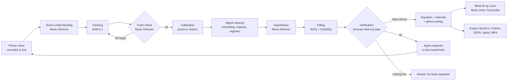

# PhysicsLens

**Point a phone at anything moving. Get the equations that govern it, verified.**

PhysicsLens turns a phone video into a verified physics model. SAM 3.1 tracks the moving object, an agent built on Meta's open-weight reasoning model proposes candidate equations, and plain numerical simulation tests every candidate against the real motion. Only an equation that predicts held-out data is accepted. When the data can't tell two models apart, the agent asks you for the experiment that will. The result is a calibrated model you can export straight into a robot simulator, or use to watch a machine wear.

> Built for the **Meta Global AI Developer Hackathon** (Indie track, *Push the Frontier*), Oct 27 to Nov 4, 2026.

| | |
|---|---|
| 🎥 **Demo video (3 min)** | _link coming_ |
| 🌐 **Try it** | [physicslens.vercel.app](https://physicslens.vercel.app): real analyses with the ghost overlay, decision trail and exports. Analyzing your own clip needs the hosted analysis server (judges: the access code is in the submission notes) |
| 🤖 **For AI assistants** | [`llms.txt`](llms.txt) is a compact map of this repository |

---

## Contents

1. [Why this matters](#why-this-matters)
2. [Applications](#applications)
3. [What it does](#what-it-does)
4. [Systems it identifies](#systems-it-identifies)
5. [How it works](#how-it-works)
6. [Meta models used](#meta-models-used)
7. [The pipeline in detail](#the-pipeline-in-detail)
8. [How an equation is accepted](#how-an-equation-is-accepted)
9. [The agent](#the-agent)
10. [Studies](#studies)
11. [Live mode](#live-mode)
12. [Machine health](#machine-health)
13. [Sound as a second sensor](#sound-as-a-second-sensor)
14. [Exports](#exports)
15. [Sim-to-real gap, made visible](#sim-to-real-gap-made-visible)
16. [Validation](#validation)
17. [Cost and safety controls](#cost-and-safety-controls)
18. [Getting started (Linux)](#getting-started-linux)
19. [Configuration reference](#configuration-reference)
20. [HTTP and WebSocket API](#http-and-websocket-api)
21. [Project structure](#project-structure)
22. [Testing](#testing)
23. [What we built during the hackathon](#what-we-built-during-the-hackathon)
24. [Limitations](#limitations)
25. [Roadmap](#roadmap)
26. [Acknowledgements](#acknowledgements)
27. [License](#license)

---

## Why this matters

Robots are trained in simulators, and they fail in the real world when the simulator's physics is wrong: the friction, damping or stiffness doesn't match reality (the "sim-to-real gap"). Measuring those parameters today takes lab rigs, sensors and an expert's afternoon of modeling. PhysicsLens does it from a phone video:

- **Robotics engineers** get dynamics parameters with uncertainty, exported as a MuJoCo model that is replayed in MuJoCo and checked against the measured motion.
- **Maintenance engineers** film a machine part today and again next month. PhysicsLens compares natural frequency and damping across recordings and flags drift, an early sign of wear.
- **Anyone building a mechanism** gets a working dynamics model in minutes instead of an afternoon.

It is system identification, normally a specialist task, made as easy as filming something.

## Applications

| Who | What they film | What PhysicsLens returns | Instrument it replaces | See it |
|---|---|---|---|---|
| Robotics engineer | a joint, cart or hinge swinging or oscillating freely | damping and stiffness with intervals, as a MuJoCo model replayed and checked in MuJoCo | a force/torque rig or an encoder test | [spring cart, damping with no ruler](https://physicslens.vercel.app/?run=gallery-spring) |
| Robotics engineer | an object dropped or thrown | drag law and coefficient, or bounce restitution exported as MuJoCo contact parameters tuned inside MuJoCo | drop-test bench, high-speed camera plus manual analysis | [paper bag, free fall rejected for drag](https://physicslens.vercel.app/?run=gallery-paperbag) |
| Mechanic, fleet maintenance | a car corner after a push (bounce test), three releases | damping ratio per release, combined with an agreement test, and a wear verdict | a shock dynamometer or suspension tester | Studies tab, goal "are this vehicle's shocks worn?" |
| Maintenance engineer | a fan, motor or flywheel spinning down after switch-off, now and next month | the friction law (dry, viscous, air drag) and a drift flag when it changes | vibration sensors, run-down logging | Health tab: compare two recordings or a trend |
| Anyone checking the measurement chain | a pendulum of known length | g with an interval, a known answer that proves the camera, tracking and fitting are right | a calibration check | [pendulum, g from the period](https://physicslens.vercel.app/?run=gallery-pendulum) |

Every row runs the same loop: the agent proposes laws, numerical fits decide on held-out motion, and the answer comes with an uncertainty and an export.

## What it does

1. **Start from a goal, or from a clip.** In a **study** you state what you need ("are this truck's front shocks worn?", "the damping of this cabinet hinge for my robot sim"). The agent plans the deliverable, what to measure and which recordings to make, with filming instructions. Or just upload a clip, or go live with the phone camera.
2. **It reads the scene.** The reasoning model looks at four keyframes, names the moving object, guesses the kind of motion, and finds a reference of known size (A4 or letter sheet, credit card, coin). No reference? Give the pendulum length or the object's size, say it out loud while filming, or skip it: frequency, damping and friction need no scale.
3. **It tracks, then checks what it tracked.** SAM 3.1 follows the object, and the reference, through every frame in one request. The reasoning model then looks at three frames with SAM's box drawn on them; if the box sits on the wrong thing (a clasp, a shadow, a digit drawn on the video), SAM is asked again by the object's name.
4. **It hypothesizes, then proves.** The agent proposes candidate equations from a library or writes its own; regular math fits and simulates each one and keeps only what forecasts held-out data. The simplest adequate model wins (BIC).
5. **It checks the answer is physical.** With no scale in view and a law containing g, Earth's gravity becomes the ruler: lengths follow from the fitted g, and the assumption is stated.
6. **It asks for better data.** If genuinely different laws tie, the agent says which experiment would separate them; in a study it asks for the next recording until the goal is answered, and the recordings are combined (weighted means, and a test that they agree).
7. **You see the proof.** A simulated "ghost" moves over the real video. Every decision appears in an on-screen decision trail, each tagged with the model or the math that made it.
8. **Ask "what if?" out loud.** "What if the string were twice as long?" The fitted equation is re-simulated from the same starting state and drawn as a second ghost.
9. **Export.** A MuJoCo model, a standalone Python simulation, parameters as JSON, a one-page report for a colleague, or a shareable MP4. A study adds its own report, a wear verdict with a maintenance note when that was the goal, and a MuJoCo model with the combined parameters.

When nothing fits, it says so: *"no clean governing equation found."* It never invents an equation, and it refuses clips it can't measure (a flat pendulum arc, a round spinning object, a spin close to the frame-rate limit, a tracked object that never moves) instead of guessing. One limit it cannot see: a spin faster than a quarter turn per frame aliases into a slower one, so film spins with slow motion.

## Systems it identifies

| System | Models compared (ids in `physics/models.py`) | What you get |
|---|---|---|
| Pendulum | simple (`pendulum`), small-angle, linear damping, quadratic (air) damping | g, damping, string length (all with intervals) |
| Spring or elastic oscillator | harmonic, damped harmonic, spring with dry friction (`oscillator_dry`), stiffening spring (`duffing`) | natural frequency, damping ratio, friction or stiffening coefficient |
| Torsional spring (door closer, hinge) | damped torsional spring (`spin_spring`) | stiffness and damping per unit inertia |
| Thrown or dropped object | no drag, linear drag, quadratic drag | g, drag coefficient |
| Bouncing ball | free flight plus restitution (hybrid) | g shared by every flight, coefficient of restitution at each bounce |
| Double pendulum | point-mass double pendulum, fitted on short restarted predictions | g, mass ratio, and how chaotic it is: Lyapunov exponent and how many seconds the motion can be forecast |
| Spinning object slowing down | free spin, dry friction, viscous, air drag, dry plus viscous | the friction law and its coefficients |
| **Anything else that moves** (rolling, sliding, braking, a falling leaf) | constant velocity and constant acceleration (along a line or in the plane) as controls, plus up to three equations **the agent writes itself** | the law that forecasts the motion, its fitted coefficients, and the same ghost, exports and what-ifs |

**Equations the agent writes itself.** For motion outside the named families the agent proposes the acceleration law as text, for example `-mu*9.81*sign(v) - c*v*abs(v)` for a cart slowed by rolling friction and air drag. A small recursive-descent parser over a closed grammar (numbers, declared parameters, the state variables, `+ - * / ^` and a whitelist of functions) turns it into a model; nothing is ever passed to `eval`. The parsed tree drives the ODE solver, the LaTeX shown in the app and the exported Python script, so what you see is exactly what was fitted. Each law must beat "nothing acts on it" and "a constant force" on held-out motion, and a malformed proposal goes back to the agent with the parser's error. On synthetic data an agent-written air-drag law recovers its coefficient within 5% and a wrong spring law is rejected.

Changes during a clip (say, the string is shortened mid-recording) are detected; each regime is fitted separately, and live mode refits on the new motion.

## How it works



**The design principle: Meta's models perceive and reason; math decides.** The language model reads the scene, proposes hypotheses, plans experiments and explains results. It never accepts an equation: only numerical verification on held-out data does, and the simplest model of each family is always tested as a control, so the agent can't hide the baseline.

## Meta models used

| Model | Where it runs | What it does in PhysicsLens |
|---|---|---|
| **Muse Glimmer 30B** (open weights) | Self-hosted with llama.cpp on our own GPU server (two NVIDIA T4) | The agent's reasoning: scene understanding from keyframes (vision); checking SAM's track on annotated frames (vision) and re-prompting SAM by name; candidate equations and its own free-form laws; planning and reviewing multi-recording studies, with maintenance notes; experiment requests; explanations; turning spoken settings and what-if questions into parameters |
| **SAM 3.1** | Meta Model API | Box-prompted segmentation and tracking of the moving object(s) and the reference object in one request; re-tracking by name when the first track is off target; in live mode, refinement of an on-server tracker in parallel chunks |
| **Muse Voice Transcribe** | Meta Model API | Hands-free what-if questions and settings spoken while filming ("the string is 50 centimeters"), over the realtime endpoint with automatic end-of-speech detection |
| **Muse Spark 1.3** | Meta Model API | Development convenience only, with the same prompts and schemas; demo and production refuse to reason on anything but the open-weight model |

**Open-weight status, stated plainly:** every reasoning step behind the published gallery results ran on **Muse Glimmer 30B**, Meta's open-weight model, using the official `meta-models/Muse-Glimmer-30B-GGUF` weights (Q4_K_M plus the vision encoder) on llama.cpp, on hardware we control, with no per-call charge. Each result shows the model behind every step. In demo and production the app refuses to reason on any other model: if the open-weight server is down it shows a "busy" message instead of switching. During early development the same prompts ran on Muse Spark 1.3; those results are not in the gallery.

**Serving details.** llama-server runs with the model's own chat template, `reasoning_strength: "low"` passed through `chat_template_kwargs`, the default sampling (temperature 1.0, top_p 0.95, top_k 64; temperature 0 makes this model loop), and a speculative-decoding drafter. On two T4s it generates about 14 tokens per second, so one full analysis takes about 5 to 15 minutes; this is why the gallery is precomputed and live mode lets you pick the motion family with one tap while the agent's proposal arrives in the background. llama-server binds to localhost only; the analysis server reaches it with a shared key, and only the analysis server is exposed.

**Offline replay.** A machine without a Meta key can still run the full reasoning on Glimmer: SAM 3.1 tracking runs through the cost guard on a machine with the key, and its results reach the GPU machine as cached responses (`PHYSICSLENS_CACHE_ONLY=meta_api` makes the Meta provider answer only from cache, and a miss is an error, never a paid call). Both sides analyze the same frozen clip and keyframe bytes (`perception/media.py`, `save_prepared` / `load_prepared`), so their cache keys agree. `scripts/glimmer_batch.py` runs the handoff:

```bash
# on the GPU machine, after starting llama-server with the Glimmer GGUF (see the script's docstring)
REASONING_PROVIDER=glimmer PHYSICSLENS_CACHE_ONLY=meta_api \
GLIMMER_BASE_URL=http://127.0.0.1:8080/v1 GLIMMER_API_KEY=<llama-server key> \
python scripts/glimmer_batch.py run --bundles bundles --out out
```

To serve the full app on open weights, point `GLIMMER_BASE_URL` at any reachable llama-server running Muse Glimmer and set `REASONING_PROVIDER=glimmer`.

SAM 3.1 is used as a **scientific measurement instrument**: its masks become position and orientation time series that feed differential-equation fitting.

## The pipeline in detail

Code: `backend/physicslens/pipeline.py` orchestrates; every step below is a separate module.

1. **Input and preparation** (`perception/media.py`). The clip is probed with ffprobe, trimmed to the analysis window, downsampled to at most 30 fps, and re-encoded as H.264 MP4 (SAM rejects WebM and VP9). Slow-motion clips are told their slow-motion factor so time is real time. Variable-frame-rate phone video is resampled to a constant rate.
2. **Scene understanding** (`agent/reasoning.py`, `understand_scene`). Up to four keyframes, downscaled to 768 px on the long side, go to the reasoning model with a JSON schema. It returns the moving object, the motion type, a short concrete noun phrase for SAM ("metal ball", never a command), and a reference object of known size if one is visible. An optional user hint ("the bob, not the string") is included. Coordinates come back on a 0 to 1000 grid and are mapped to pixels and clamped.
3. **Tracking** (`perception/sam_track.py`). One SAM 3.1 video request tracks the moving object (id 1) and the reference (id 2) with box prompts built by `meta-sam-parser`'s `build_object_prompt`, so one request pays for both. Output lines are keyed by frame index and object id, never by line position; missing frames are allowed, and malformed lines are logged as diagnostics and never used as data. Each frame gives a box, a mask centroid and an orientation from a PCA ellipse fit on the mask.
4. **Track check** (`perception/track_quality.py`, `agent/reasoning.py`, `check_track`). Three frames with SAM's own box drawn on them go back to the reasoning model: "is this box on the object you named?" If not, SAM is asked again by the object's name (a concept prompt) and the better track is kept. Both decisions appear in the decision trail.
5. **Calibration** (`perception/calibration.py`). Pixels per meter come from the reference object's mask (A4 or letter sheet, credit card, coin), from a length the user typed or said, or from the object's own size. With none of these and a law that contains g, **gravity is the ruler**: lengths are scaled so g = 9.81 m/s², the assumption is stated, and the scale's own uncertainty is carried into every length-dependent parameter. Laws without lengths (frequency, damping ratio, friction time constants) need no scale at all.
6. **Signal cleanup** (`sigproc/`). Savitzky-Golay smoothing and derivatives, short-gap interpolation only (long gaps split the clip), impact detection from velocity sign flips, and regime splitting when the residual jumps (`physics/regime.py`).
7. **Hypotheses** (`agent/reasoning.py`). The model sees a numeric summary of the trajectory (never the video): duration, amplitudes, zero crossings, energy trend, impacts. It returns candidate model ids from the library, and optionally up to three free-form laws. Output is validated with Pydantic; a malformed answer is retried once, then the run fails clearly. Echoed schema keywords are stripped before validation.
8. **Fitting** (`physics/fit.py`, `physics/sindy.py`). Every candidate, plus the controls of its family, is fitted with `scipy.optimize.least_squares` on the first 75% of the motion and simulated with `solve_ivp` over the whole clip. PySINDy runs separately as model-free regression and is shown as unverified.
9. **Verification** (`physics/verify.py`). See the next section.
10. **Uncertainty** (`physics/uncertainty.py`). A residual block bootstrap refits each accepted model 40 times; intervals are value ± 1.96 standard deviations, with the scale's error added in quadrature for length-dependent parameters.
11. **Output** (`runs.py`, frontend). Equation in KaTeX, parameters with intervals, the ghost overlay, a forecast chart with the held-out band, a short explanation and the decision trail. Results are saved as `result.json` with the clip, so a run can be reopened, shared and exported later.

## How an equation is accepted

Only code decides, never the language model:

- **Held-out forecast.** Each model is fitted on the first 75% of the motion and must forecast the last 25%. The normalized RMS error on that held-out part must be at most 15%, or at most 30% when the error is also within 3 times the measured tracking noise.
- **Model selection by BIC.** Among the models that pass, the lowest Bayesian Information Criterion wins. A winner must beat every other passing model by at least 10 BIC (strong evidence on the Kass and Raftery scale) unless the rival has more parameters.
- **Ties become experiments.** If genuinely different laws are within 10 BIC, the agent is asked which recording would separate them (for a small-angle pendulum tie: "swing it wider"), and the user sees that request.
- **Approximations are named, not rejected.** When a law ties with its own approximation (sin θ versus θ at small angles) the exact law is kept and the other is labeled "Same law: the small-angle approximation", not "Rejected".
- **Controls are always tested.** The simplest model of each family (no damping, no drag, constant velocity or acceleration) is fitted alongside the agent's proposals, so a fancy law must beat the obvious baseline.
- **Nothing fits, nothing shown.** If no model passes, the result is "no clean governing equation found."
- **Scale stated, never hidden.** When gravity is used as the ruler, the assumption and the scale's uncertainty are written into the trail and the result.

## The agent

- **Plain Python loop, no agent framework.** Every model call goes through `costguard.client`, with a JSON schema per step (`agent/schemas.py`) and Pydantic validation. Agent loops are capped at 4 turns.
- **Decision trail.** Every step records who decided (`model` with provider and model id, or `math`), what was decided and why. The UI shows it prominently: candidates proposed, rejections with their held-out error, the track check, the gravity-ruler assumption, experiment requests and study decisions.
- **Spoken settings.** Muse Voice Transcribe turns speech into text; the reasoning model turns "the string is half a meter, film from the left" into validated settings (`agent/notes.py`), and out-of-range values are dropped rather than trusted.
- **What-ifs.** A question ("what if it were on the Moon?") becomes a validated parameter change (`agent/whatif.py`), the fitted law is re-simulated from the same starting state, and a second ghost is drawn. For uncalibrated clips, only relative changes to length-dependent parameters are allowed.
- **Refusal to fake.** If the reasoning server is unavailable in demo or production, the app says it is busy. It never substitutes another model or a canned answer.

## Studies

A study turns a goal into a measurement campaign (`studies.py`, `physics/combine.py`, `app/study` in the frontend):

1. You state a goal. The agent writes a plan: the deliverable, the quantity to measure, and the recordings to make with filming instructions.
2. Each recording is analyzed like any clip. After each one the agent reviews the evidence and either asks for another recording (saying what it should add) or finishes. It cannot finish before at least one recording has a verified equation.
3. Recordings are combined in code: inverse-variance weighted means with a chi-squared agreement test (p < 0.01 means the recordings disagree, which is shown, not hidden).
4. For wear and drift goals the machine-health comparison runs across the recordings, and the agent writes a maintenance note and when to check again.
5. Deliverables: a study report (Markdown) and a MuJoCo model with the combined parameters.

## Live mode

- The phone streams JPEG frames over a WebSocket. Each frame carries a small binary header with its capture time (`PLT1` plus a float64 timestamp), so fitting uses real capture times instead of an assumed frame rate.
- An on-server template tracker follows the object instantly; SAM 3.1 refines every second frame in parallel chunks of at least 50 frames (about 2 s), and re-anchors the fast tracker when it drifts. The last box of each chunk is carried into the next request so identity persists.
- One tap on "swinging / on a spring / falling / spinning / something else" starts fitting at once; the agent's own proposal arrives in the background and can replace it.
- The equation is refitted about every second on a rolling buffer, with a confidence that converges; a residual spike is reported as "dynamics changed" and the new regime is fitted.
- A length spoken or typed during the session applies immediately. Without a scale, a nominal scale is used and a notice says so once.
- If a rate limit or budget cap is hit, tracking and fitting continue locally and only the model features pause, with a visible notice.
- **Predict the future, then prove it.** Once the law is verified and its parameters have settled, the app predicts when the swing will next pass its rest point about 20 s ahead (10 s or 5 s if it will have died out), with a 95% timing window from bootstrap refits of the law plus one sample of time resolution. A countdown runs on screen, and when the moment comes the measured track says hit or miss, with the error. Each prediction is written to `predictions.json` with its wall-clock time before the event happens, so the claim is auditable.

## Machine health

`physics/health.py` and the Health page compare recordings of the same system:

- Each recording is fitted with the damped model of its family, so damping is always measured (zero is a valid answer), and reduced to natural frequency and decay rate with bootstrap uncertainty.
- A change is flagged only when it is beyond 3 standard errors **and** practically meaningful (0.5% for frequency, 10% for decay rate), with repeatability floors that account for re-recording variation (release, temperature, mounting).
- The trend view takes up to 12 recordings and shows each metric with its interval over time.

## Sound as a second sensor

The phone's microphone is an independent instrument, analyzed with local signal processing only (no model calls):

- **Impacts.** Clicks are found by high-pass filtering, an envelope and a threshold that follows the background, and each is timed where it reaches a fixed fraction of its own peak, so loud and quiet clicks are timed alike. For a ball bouncing straight up and down each flight lasts T = 2v/g, so the ratio of consecutive flight times is the coefficient of restitution: **e = T(n+1)/T(n), with no scale and no value of g needed**. Its uncertainty comes from the onset timing resolution.
- **Tones.** The strongest steady tone, from a windowed FFT with peak interpolation, stated with an interval of one over the clip's duration.
- **Spin-down by ear.** A fan's whine falls as it slows. The tone is followed through a spectrogram, its frequency integrated into a phase, and the same five spin-down laws the camera uses are fitted and verified on it. Each law keeps its form when the rate is multiplied by a constant, so the law is identified without knowing how many blades the fan has; given a blade count (`blade_count` on upload), the coefficients are converted to the rotor's own rates.
- **Agreement.** When the camera and the microphone both measure a restitution (or, with a blade count, a spin rate), the two are combined by inverse variance only if they agree within 3 standard deviations; otherwise both are shown and the disagreement is flagged. Slow-motion clips and clips without a sound track get a short note instead, and a problem with the sound never affects the camera's result.

## Exports

| Export | What it contains | How it is checked |
|---|---|---|
| MuJoCo MJCF | the body, joint and fitted parameters: hinge damping, `frictionloss` for dry friction, joint stiffness and `springref` for torsional springs, free-joint damping for linear drag, radians throughout | replayed in MuJoCo and compared with the fitted motion (under 0.1 mm for exactly representable models) |
| MuJoCo contact | for bounces, contact parameters tuned by bisection inside MuJoCo until its ball keeps the measured fraction of speed (the textbook damping-ratio formula is about 30% off in MuJoCo's soft contacts) | MuJoCo's own bounce matches the measured restitution |
| Python script | a standalone simulation with the fitted law, including agent-written laws translated from the parsed tree | matches the fitted motion to 1e-9 |
| JSON | parameters, intervals, units, model id, calibration source and scale basis | |
| Report | a one-page Markdown report for a colleague: what was filmed, the law, values, the decision trail, caveats | |
| Shareable MP4 | the clip with the measured trail, the ghost and the typeset equation burned in (ffmpeg) | |

## Sim-to-real gap, made visible

Every accepted result gets a "Sim-to-real" panel (computed on request with local math and MuJoCo, no model calls; `GET /api/runs/{id}/sim2real`):

1. **Against the real video.** The textbook version of the system (no damping, drag or friction; g = 9.81 m/s² when the clip has a scale; the same length or stiffness) and the PhysicsLens model are both fitted on the first three quarters of the clip only, the textbook one getting just its best starting state, and both are compared with the measured motion. The panel overlays measured, textbook and PhysicsLens curves and gives the RMS error of each on the held-out quarter and the whole clip (in millimetres when the clip is calibrated) and their ratio. When the textbook does as well, the panel says so.
2. **Control, in simulation only.** For pendulums, the exported MuJoCo model gets a torque-limited motor at the pivot (30% of the torque that holds the pendulum horizontal), and an energy-shaping controller pumps the swing to 60° and holds it. One controller is tuned on the textbook model, one on the PhysicsLens model; both run on 20 pendulums drawn from the bootstrap refits of the PhysicsLens model, and the panel reports overshoot, settling time and final amplitude error (mean and spread). The panel is labeled: the "real system" there is the verified model, and part 1 is the evidence against real video.

## Validation

**On real footage**, with every reasoning step on Muse Glimmer (open weights) and tracking by SAM 3.1 (clips and licenses in `gallery/README.md`):

- **Pendulum** (0.5 m string, length given): g = 9.79 ± 0.01 m/s² from the period, against 9.81. A small swing can't tell sin θ from θ, so the exact law is kept and the approximation noted. The result rests on the given length: with the pivot out of frame the arc alone can't fix it (two stretches of the same swing gave radii 50% apart), so the app does not re-measure a length you supply.
- **Paper bag thrown across a blackboard** (filmed at 200 fps, analyzed with a slow-motion factor of 20): free fall misses the held-out last quarter by 41% and is rejected; linear air drag forecasts it within 11%, with a velocity time constant of 0.38 s (scale-free); quadratic drag scores 548 BIC worse.
- **Air-track spring cart** (nothing of known size in view): damped harmonic oscillator, ω = 2.741 ± 0.002 rad/s and damping ratio ζ = 0.022 ± 0.001; the undamped model misses the held-out motion by 48%.
- What didn't work, honestly: on 240p Apollo 16 TV footage of an astronaut jumping, with two jumps separated by standing and no usable scale, no equation passed, and the result is not in the gallery.

**Exports:** for every exactly representable model, the MuJoCo export replayed in MuJoCo matches the fitted motion to under 0.1 mm; the generated Python script matches to 1e-9.

**On synthetic data with known answers** (so far; real clips for these are being recorded):

- damped pendulum: g within 0.3%, damping within 2%; tiny swings are refused because the length can't be measured
- bouncing ball: coefficient of restitution within 0.01 and g within about 1% with up to 8 mm tracking noise
- double pendulum: g within 0.4%, mass ratio within 1%, chaos detected (predictable for about 1.6 s at 2 mm noise); random motion is rejected
- spin-down: all four friction laws identified, coefficients within 3%, orientation from masks to 0.004 rad
- free-form laws: an air-drag law written as text recovers its coefficient within 5%; a 2D drag law recovers g within 3%; a wrong law loses to the controls
- machine health: no false alarm when the same system is re-recorded; a 50% rise in damping and a 2% frequency shift are flagged
- sim-to-real gap: on a damped pendulum (0.6 m, damping 0.3/s, 2 mm noise) the textbook pendulum misses the held-out quarter by about 13 cm RMS, more than 20 times the PhysicsLens model's 2 mm. In simulation, the swing-up tuned on the textbook model settles about 2° short of 60° and never within 2% of it; tuned on the PhysicsLens model it settles within 2% in about 2 s with under 0.3° error
- predict the future: on 10 noisy damped pendulums, predictions made from the first 7 s for the rest-point crossing 5 s later land inside their stated 95% window at least 9 times out of 10, with windows under 0.3 s; a system whose period is 3% off misses
- sound: restitution from the timing of synthetic impact clicks (under hum and noise) within 0.005 per bounce, with a clap before the drop left out; a hum's frequency within its stated interval; dry, viscous and air-drag spin-down laws identified from a falling tone, with the tone's coefficients within 3%. Not yet tested on real recordings

## Cost and safety controls

Every paid call goes through one module, `backend/physicslens/costguard/`. The order for each call is fixed:

1. **Kill switch.** A `.KILL` file in the repo root or `PHYSICSLENS_KILL=1` blocks every paid call (`make kill` / `make unkill`).
2. **Allowlist.** Only model ids listed in `config/models.yaml` can be called; anything else is refused.
3. **Budget reservation.** The estimated cost is reserved against daily, total and per-run caps before the request (`guard.py`), so concurrent calls cannot overshoot. A model with no price entry is refused.
4. **Rate limiter.** A token bucket per model (`config/limits.yaml`), well below the provider limits, which also reads the rate-limit headers and slows down early.
5. **Cache.** Key = hash of model, prompt, media bytes and parameters (`cache.py`). Re-processing the same clip costs nothing.
6. **Request with timeout.** SDK clients are built with `max_retries=0`; retries happen only in our code (429: honor `Retry-After` or back off, at most 3; 5xx: at most 2; 400: never). A circuit breaker pauses a provider after 5 consecutive failures.
7. **Record and commit.** Actual usage from the response (tokens, frames, audio seconds) is priced and written to a SQLite ledger that survives crashes (`ledger.py`).

Other rules: the language model never receives video, only up to four keyframes and numeric summaries; SAM is used in video mode only, with clips trimmed and downsampled first; reasoning effort is set explicitly and low; files uploaded for SAM expire after a day and are deleted after the run. `make report` prints spend per provider, model, day and audience (judges, public, development).

**Secrets.** Keys live only in `.env` (gitignored), read from environment variables. The public site never holds a key; it only learns the address of the analysis server at runtime from `/backend.json`.

**Mocks.** `MOCK_MODELS=1` exists for automated tests only. The app refuses to start with mocks in demo or production, and the UI shows a red mock-mode banner whenever they are active.

## Getting started (Linux)

### Prerequisites

- Python 3.11+, Node.js 20.17+ (or 22.9+), ffmpeg (`sudo apt install ffmpeg`)
- A Meta Model API key ([dev.meta.ai](https://dev.meta.ai)) for SAM 3.1 and Muse Voice Transcribe
- For open-weight reasoning: a GPU machine with about 20 GB of GPU memory (two 16 GB T4s work) running llama.cpp `llama-server` (b10353 or newer) with `meta-models/Muse-Glimmer-30B-GGUF`

### Setup

```bash
git clone https://github.com/Athmeeya2006/Physicslens.git physicslens
cd physicslens
cp .env.example .env          # fill in your keys; never commit .env
make setup                    # creates .venv, installs backend dependencies, creates config/budget.yaml
(cd frontend && npm install)  # frontend dependencies
make test                     # unit tests with mocked models (no API spend)
```

### Serve Muse Glimmer

```bash
# weights from meta-models/Muse-Glimmer-30B-GGUF
llama-server -m Muse-Glimmer-30B-KQuant-17GB-Q4_K_M.gguf \
  --mmproj mmproj-Muse-Glimmer-30B-Q4_K_M.gguf \
  -md dflash-Muse-Glimmer-30B-Q4_K_M.gguf -ngld 99 \
  -a muse-glimmer-30b -ngl 99 -c 65536 -np 2 \
  --host 127.0.0.1 --port 8080 --api-key <a long random key> \
  --jinja --temp 1.0 --top-p 0.95 --top-k 64
```

Then set `REASONING_PROVIDER=glimmer`, `GLIMMER_BASE_URL=http://127.0.0.1:8080/v1` and `GLIMMER_API_KEY` in `.env`. This is the exact command the hosted server runs (`scripts/gpu_server/serve.py`): the drafter (`-md`) speeds up generation without changing outputs, and `-np 2` serves two analyses at once with 32k context each.

### Run

```bash
make dev-backend              # FastAPI on http://localhost:8000
make dev-frontend             # Next.js on http://localhost:3000
```

Open `http://localhost:3000` for the gallery and uploads, `/live` for the camera, `/study` for goal-driven studies, `/health` for machine-health comparisons. Live mode needs HTTPS (or localhost) for camera access.

### Cost controls

```bash
make report                   # spend so far per provider/model/day and per audience, remaining budget
make kill                     # instantly block every paid API call
make unkill                   # re-enable
make smoke                    # one cheap real call per model (asks before spending); checks Glimmer if configured
```

Budget caps live in `config/budget.yaml` (created from `config/budget.example.yaml` by `make setup`); prices in `config/prices.yaml`.

### Hosted judging server

During judging the full app (uploads, live mode, voice, studies) runs on our GPU server: `scripts/gpu_server/serve.py` starts Muse Glimmer on llama.cpp (bound to localhost, never exposed) and the backend in demo mode next to it, then exposes only the backend through a Cloudflare tunnel. `scripts/judging_session.py` deploys the committed code, waits for the tunnel and points the site's `/backend.json` at it; `stop` points the site back to gallery only. The site switches its analysis features on only when that server answers its health check. Each session has its own spending cap, and keys stay on the server.

### Static gallery site

The public gallery is a static export that needs no server: `python scripts/build_static_gallery.py` copies each gallery result, clip, poster, report and export into `frontend/public/gallery/` (gitignored), then `cd frontend && STATIC_EXPORT=1 NEXT_PUBLIC_API_BASE="" npx next build` writes the site to `frontend/out/`. New results are promoted with `scripts/add_to_gallery.py` (single runs) and `scripts/study_to_gallery.py` (studies).

## Configuration reference

### Environment variables

| Variable | Effect |
|---|---|
| `APP_ENV` | `dev`, `demo` or `prod`. In demo and prod: reasoning only on the open-weight model, no development fallback, mocks refused at startup |
| `MODEL_API_KEY` | Meta Model API key (SAM 3.1, Muse Voice Transcribe, development reasoning) |
| `REASONING_PROVIDER` | `glimmer` to reason on self-hosted Muse Glimmer |
| `GLIMMER_BASE_URL`, `GLIMMER_API_KEY` | The llama-server running Muse Glimmer |
| `USE_CONTRIBUTOR_MODEL` | Development only: use the contributor variant of Muse Spark for text calls |
| `MOCK_MODELS` | `1` in tests only |
| `PHYSICSLENS_KILL` | `1` blocks every paid call |
| `PHYSICSLENS_CACHE_ONLY` | Comma-separated providers that may answer only from the cache (offline replay) |
| `DEMO_ACCESS_CODE` | Judges append `?code=...` to the URL for uploads, live mode, voice and studies |
| `PUBLIC_TRY_ENABLED` | `1` lets visitors without a code analyze a few short clips per day under their own cap; otherwise gallery only |
| `TURNSTILE_SITE_KEY`, `TURNSTILE_SECRET_KEY` | Optional Cloudflare Turnstile check on public uploads |
| `FRONTEND_ORIGINS` | Allowed CORS origins for the backend |
| `TRUST_PROXY` | `1` to read the client address from proxy headers (per-visitor limits behind a tunnel) |
| `NEXT_PUBLIC_API_BASE` | Backend URL baked into a frontend build; the static site uses `/backend.json` at runtime instead |

### Config files

| File | Contents |
|---|---|
| `config/models.yaml` | the model allowlist, per provider |
| `config/prices.yaml` | price per unit for every allowed model (a model without a price is refused) |
| `config/limits.yaml` | our rate limits, timeouts, token limits and the agent turn cap |
| `config/budget.example.yaml` | example budget caps; `make setup` copies it to the untracked `config/budget.yaml`, which the app requires |

## HTTP and WebSocket API

All routes are in `backend/physicslens/app.py`. Routes that start paid work need the access code (or public try mode).

| Method and path | Purpose |
|---|---|
| `GET /api/health` | status, environment, mock mode, and what this visitor may do |
| `GET /api/gallery` | the curated results |
| `GET /api/budget` | spent and remaining per provider (development UI) |
| `POST /api/runs` | upload a clip with optional settings (length, object size, hint, slow-motion factor, blade count for sound); returns a run id |
| `GET /api/runs/{id}` | progress and, when done, the full result |
| `GET /api/runs/{id}/clip.mp4`, `/poster.jpg`, `/share.mp4` | media for a run; `POST /api/runs/{id}/share` renders the shareable MP4 |
| `GET /api/runs/{id}/sim2real` | the sim-to-real comparison, computed on first request and cached |
| `GET /api/runs/{id}/export/{kind}` | `json`, `py` (Python script), `mjcf`, `contact`, `report` |
| `POST /api/runs/{id}/whatif` | a typed what-if question |
| `POST /api/compare`, `POST /api/health/trend` | machine-health comparison and trend |
| `POST /api/studies`, `GET /api/studies/{id}` | create a study from a goal, read it |
| `POST /api/studies/{id}/runs`, `POST /api/studies/{id}/review` | add a recording, ask the agent to review |
| `GET /api/studies/{id}/report`, `GET /api/studies/{id}/mjcf` | study deliverables |
| `WS /ws/live` | live mode: binary frames with a capture-time header, JSON messages for family, length and taps |
| `WS /ws/voice` | spoken what-if questions |
| `WS /ws/voice/notes` | settings spoken while filming |

## Project structure

```
config/                  model allowlist, prices, rate limits, budget example
backend/physicslens/
  app.py                 FastAPI routes and WebSockets
  settings.py            environment loading, APP_ENV, mock-mode guard
  pipeline.py            the recorded-mode pipeline end to end
  live.py                live mode: frame buffer, fast tracker, SAM chunks, rolling refits
  studies.py             goal-driven studies
  runs.py, public.py     run storage, access code, public limits
  costguard/             ledger, pricing, guard, allowlist, limiter, cache, client, report, mock
  perception/            media preparation, SAM tracking, track check, local tracker, calibration
  sigproc/               trajectories, smoothing, derivatives, summaries
  physics/               models, fitting, verification, uncertainty, SINDy, collisions, double pendulum,
                         rotation, regimes, free-form law parser, combining recordings, machine health, what-ifs
  agent/                 model calls, prompts, JSON schemas, spoken notes, what-ifs
  voice/                 realtime transcription events
  export/                MuJoCo, Python script, report, MP4
frontend/                Next.js app (works in a mobile browser): analyze, live, studies, machine health
gallery/                 curated real analyses shown to visitors (clip licenses in gallery/README.md)
samples/                 short public test clips
scripts/                 gallery promotion, static site build, Glimmer batch runs, hosted server setup
tests/                   unit tests (mocked models; recorded real responses as fixtures)
```

## Testing

```bash
make test                     # MOCK_MODELS=1 pytest: no network, no spend
```

The suite (230+ tests) covers:

- **Physics:** synthetic trajectories with known equations plus noise; recovered parameters must land within tolerance (pendulum g within 3%), wrong laws must lose, and unmeasurable clips must be refused.
- **Cost guard:** budget exceeded raises; kill switch blocks; the allowlist blocks unknown models; a cache hit records zero cost; concurrent reservations cannot overshoot; a missing price refuses the call; SDK clients have `max_retries=0`; cache-only mode never makes a request.
- **SAM parsing:** recorded real responses as fixtures, out-of-order and missing frames, malformed lines.
- **Agent:** schema validation, retries on malformed output, echoed schema keywords, refusal to fall back in demo mode.
- **Free-form laws:** the grammar parser, LaTeX and Python generation, rejection of anything outside the grammar.
- **Exports, studies, live mode, voice notes and what-ifs.**

## What we built during the hackathon

All code in this repository was written during the hackathon building period (Oct 27 to Nov 4, 2026).

- [x] Cost guard: budgets, allowlist, rate limiting, caching, kill switch, persistent spend ledger
- [x] Recorded mode: video → SAM 3.1 tracking → calibrated trajectory
- [x] Hypothesis generation and agent decisions with validated structured outputs, running on Muse Glimmer (open weights, self-hosted)
- [x] Equations the agent writes itself, parsed by a closed math grammar (no eval) and verified like any built-in model
- [x] Scale from a known object size, slow-motion clips in real time, and a hint for what to track
- [x] Goal-driven studies: agent-planned recordings, combined by weighted means with an agreement test, a wear verdict and maintenance note, a study report and a combined MuJoCo model
- [x] Tracking that checks itself: the reasoning model inspects SAM's box and re-prompts SAM by name when it is off target
- [x] Earth's gravity as the ruler when nothing else gives a scale; per-result engineer reports; settings spoken while filming
- [x] Live mode fitted on each frame's capture time
- [x] Bounces exported as MuJoCo contact parameters, tuned inside MuJoCo until its ball keeps the measured fraction of speed (the textbook damping-ratio formula is about 30% off in MuJoCo's soft contacts)
- [x] More laws: spring with dry friction, stiffening Duffing spring, damped torsional spring (door closers, hinges); a tap in live mode starts fitting at once
- [x] Fitting (SciPy) with BIC model selection, held-out forecasts and bootstrap uncertainty that includes the scale's own error; PySINDy shown separately as unverified model-free regression
- [x] Verification with simulate-and-compare on held-out data
- [x] Ghost overlay on the real video, and an on-screen decision trail showing who decided what
- [x] Live camera mode with converging equations (instant on-server tracking, refined by SAM 3.1 in parallel chunks; tap the object to lock on)
- [x] Experiment requests for ambiguous data
- [x] Regime-change detection (live and recorded)
- [x] Voice what-ifs with Muse Voice Transcribe (spoken question, parameter change, re-simulated ghost; typing works too)
- [x] Shareable MP4 with the measured trail, the simulated ghost and the typeset equation burned in
- [x] Exports: MuJoCo MJCF (replayed in MuJoCo and checked against the fitted motion), standalone Python simulation, parameters as JSON
- [x] Machine-health drift comparison and trend view across up to 12 recordings
- [x] Live predictions made before the event and judged against it: a countdown to the next rest-point crossing about 20 s ahead with a 95% window, hit or miss from the measured track, stored with timestamps
- [x] The microphone as a second sensor: impact onsets, restitution from flight times, dominant tone, spin-down law from a falling tone, and an agreement check with the camera
- [x] Sim-to-real gap panel: textbook physics against the identified model on held-out real motion, and a simulated torque-limited swing-up tuned on each, tested on bootstrap-sampled pendulums in MuJoCo
- [x] Bouncing objects: hybrid model with per-impact coefficient of restitution
- [x] Double pendulum: two tracked bobs, short-horizon fitting, chaos measured
- [x] Spin-down of rotating objects: friction law identified, exported to MuJoCo with native dry friction
- [x] Public access: gallery of real analyses, judge access code, per-visitor limits, optional bot check
- [x] A static gallery site that finds the analysis server at runtime, and `llms.txt` for AI assistants

## Limitations

- 2D motion in the camera plane; best results with the camera side-on and held still.
- One object, or two for a double pendulum. Live mode follows one object.
- Deformable and fluid motion (cloth, water, smoke) is reported as "no clean equation," not modeled.
- Accuracy depends on frame rate, lighting and a visible reference of known size (or a known pendulum length).
- The double pendulum assumes point masses on light rods; solid-bar pendulums may fit worse.
- Phone video with a variable frame rate is resampled to a constant rate, which can shift a frame's time by up to half a frame. Live mode uses each frame's capture time instead.
- Laws the agent writes may depend on position and velocity, not explicitly on time, so driven systems (a motor, a push) are out of reach.
- Driven motion (a car under throttle, a person walking) has no single governing law; at most its kinematics can be fitted.
- A full analysis on the open-weight model takes minutes, not seconds; the live mode's one-tap family choice is the fast path.
- Stopping a live session doesn't save it as a result yet; record a clip for something you can keep and export.

## Roadmap

3D reconstruction from two phones, more coupled multi-body systems, export to more simulators (Isaac Sim, Gazebo), tracking on open weights next to Muse Glimmer, and on-device inference with Muse Glimmer.

## Acknowledgements

- Meta's Muse Glimmer, SAM 3.1, Muse Voice Transcribe and Muse Spark models, and the `meta-sam-parser` library.
- llama.cpp for serving the open-weight model.
- Gallery footage: credited per clip in `gallery/README.md` (Creative Commons licenses, via Wikimedia Commons).

## License

Code: [MIT](LICENSE). Gallery clips keep their own licenses, listed in `gallery/README.md`.
