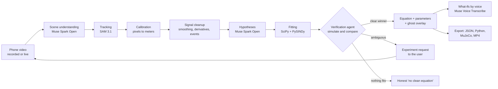

# PhysicsLens

**Point a phone at anything moving. Get the equations that govern it, verified, in seconds.**

PhysicsLens turns a phone video (recorded or live) into a verified physics model. It tracks the moving object with SAM 3.1, lets an agent built on Muse Spark Open propose candidate equations, fits and simulates every candidate, and accepts only the one that actually predicts the motion. When the data can't tell two models apart, the agent asks you to run the experiment that will. The result is a calibrated simulation you can export straight into a robotics simulator.

> Built for the **Meta Global AI Developer Hackathon** (Indie track, *Push the Frontier*), Oct 27 to Nov 4, 2026.

| | |
|---|---|
| 🎥 **Demo video (3 min)** | _link coming_ |
| 🌐 **Try it** | _link coming_ |
| 🧵 **Post on X** | _link coming_ |

**Status:** in active development during the hackathon. See [What we built during the hackathon](#what-we-built-during-the-hackathon) for what works today.

---

## Why this matters

Robots are trained in simulators, and they fail in the real world when the simulator's physics is wrong: the friction, mass, damping or stiffness doesn't match reality (the "sim-to-real gap"). Measuring those parameters today means lab rigs, sensors and an expert's afternoon of modeling.

PhysicsLens replaces that with a phone video:

- **Robotics engineers** get calibrated dynamics parameters, with uncertainty, exported as a MuJoCo model.
- **Maintenance engineers** record a machine part today and again next month; PhysicsLens flags when its damping or natural frequency drifts, an early sign of wear.
- **Hardware prototypers** get a working dynamics model of a mechanism in seconds instead of hours.

It is system identification, normally a specialist task, made as easy as filming something.

## What it does

1. **Record or go live.** Upload a clip or point your phone's camera at the motion.
2. **It understands the scene.** Muse Spark Open identifies what is moving and finds a reference object (a ruler, an A4 sheet) for real-world scale.
3. **It tracks precisely.** SAM 3.1 segments and tracks the object through every frame.
4. **It hypothesizes, then proves.** The agent proposes candidate equations; regular math fits and simulates each one; only an equation that predicts the real motion is accepted.
5. **It asks for better data.** If two models fit equally well, the agent tells you which experiment would separate them ("swing it with a larger angle").
6. **You see the proof.** A simulated "ghost" of the object moves on top of the real video. If the ghost and the real object move together, the equation is right.
7. **Ask "what if?" out loud.** "What if the string were twice as long?" The model re-simulates and shows the new motion.
8. **Export.** Parameters (JSON), a standalone Python simulation, a MuJoCo MJCF model, or a shareable video with the equation overlaid.

When nothing fits (water, cloth, crowds), it says so: *"no clean governing equation found."* It never invents an equation.

## How it works



**The key design principle: Meta's models perceive and reason; math decides.** The language model proposes hypotheses and chooses experiments, but an equation is only accepted when numerical simulation reproduces the measured trajectory on held-out data. Model selection uses a complexity penalty (BIC), so the simplest equation that explains the data wins.

## Meta models used

| Model | Where it runs | What it does in PhysicsLens |
|---|---|---|
| **Muse Spark Open** (open weights) | Baseten | The agent's brain: scene understanding from keyframes, proposing candidate physics models, deciding which experiment to request, explaining results |
| **SAM 3.1** | Meta Model API | Text- and box-prompted segmentation and tracking of the moving object and the reference object across every frame, with stable object identity |
| **Muse Voice Transcribe** | Meta Model API | Hands-free "what-if" questions with automatic speech-turn detection |
| **Muse Spark 1.3** | Meta Model API | Writes custom simulation code for unusual systems (run in a sandbox), and serves as fallback reasoning |
| **Muse Glimmer** (stretch goal) | Self-hosted | Offline mode on local hardware |

SAM 3.1 is used here as a **scientific measurement instrument**: its masks become position and orientation time series that feed differential-equation fitting.

## Engineering highlights

- **Verified, not generated.** Every accepted equation passes a simulate-and-compare check against real data.
- **Active experimentation.** The agent detects when the data is ambiguous and requests the experiment that resolves it.
- **Live mode.** Equations converge on screen in real time; if the dynamics change mid-recording (say, the string is shortened), PhysicsLens detects the regime change and refits.
- **Uncertainty, not just numbers.** Parameters come with bootstrap confidence intervals.
- **Cost-safe by construction.** Every paid API call goes through a cost guard with hard budget caps, a model allowlist, rate limiting, caching, and a kill switch. Identical clips hit a response cache, so re-processing costs nothing.

## Tech stack

Python 3.11 · FastAPI · NumPy / SciPy · PySINDy · OpenCV · MuJoCo · SQLite · ffmpeg · Modal (sandboxes) · Next.js + TypeScript · KaTeX · Canvas

## Getting started (Linux)

### Prerequisites

- Python 3.11+, Node.js 20.17+ (or 22.9+), ffmpeg (`sudo apt install ffmpeg`)
- A Meta Model API key ([dev.meta.ai](https://dev.meta.ai)); a Baseten API key for Muse Spark Open
- Optional: a Modal account (`pip install modal && modal token new`)

### Setup

```bash
git clone <this-repo-url> physicslens
cd physicslens
cp .env.example .env        # then fill in your keys; never commit .env
make setup                  # creates .venv and installs backend dependencies
(cd frontend && npm install) # frontend dependencies
make test                   # unit tests with mocked models (no API spend)
```

### Run

```bash
make dev-backend            # FastAPI on http://localhost:8000
make dev-frontend           # Next.js on http://localhost:3000
```

### Cost controls

```bash
make report                 # spend so far per provider/model/day, remaining budget
make kill                   # instantly block every paid API call
make unkill                 # re-enable
make smoke                  # one cheap real call per model (asks before spending)
```

Budget caps live in `config/budget.yaml` (created from `config/budget.example.yaml` by `make setup`); prices in `config/prices.yaml`.

## Project structure

```
config/        model allowlist, prices, budgets, rate limits
backend/       FastAPI app: costguard, perception, sigproc, physics, agent, voice, export
frontend/      Next.js web app (works in a mobile browser)
samples/       short public test clips
tests/         unit tests (run with mocked models)
```

## What we built during the hackathon

All code in this repository was written during the hackathon building period (Oct 27 to Nov 4, 2026). This list is updated as features land.

- [x] Cost guard: budgets, allowlist, rate limiting, caching, kill switch, persistent spend ledger (tested with mocked models)
- [x] Recorded mode: video → SAM 3.1 tracking → calibrated trajectory
- [ ] Hypothesis generation with Muse Spark Open
- [x] Fitting (SciPy + PySINDy) with BIC model selection and bootstrap uncertainty
- [x] Verification agent with simulate-and-compare on held-out data
- [x] Ghost overlay on the real video (web UI)
- [x] Live camera mode with converging equations (instant on-server tracking, refined by SAM 3.1 in parallel chunks; tap the object to lock on)
- [x] Experiment requests for ambiguous data, with the agent's full decision trail on screen
- [x] Regime-change detection (live and recorded: refits on the new motion, reports each regime separately)
- [ ] Voice what-ifs with Muse Voice Transcribe
- [ ] Exports: JSON, Python simulation, MuJoCo MJCF, shareable MP4
- [ ] Machine-health drift comparison

## Limitations

- 2D motion in the camera plane; best results with the camera side-on and held still.
- Single rigid objects first; collisions, rotation and coupled systems are stretch goals.
- Deformable and fluid motion (cloth, water, smoke) is detected as "no clean equation," not modeled.
- Accuracy depends on frame rate, lighting and a visible reference object for scale.

## Roadmap

3D reconstruction from two phones, coupled multi-body systems, direct export to more simulators (Isaac Sim, Gazebo), and on-device inference with Muse Glimmer.

## Acknowledgements

- Meta's Muse Spark Open, SAM 3.1, Muse Voice Transcribe and Muse Spark models, and the `meta-sam-parser` library.
- Baseten and Modal for inference and sandbox infrastructure.

## License

[MIT](LICENSE)
