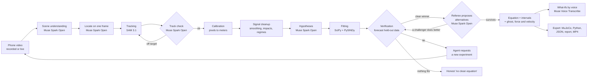
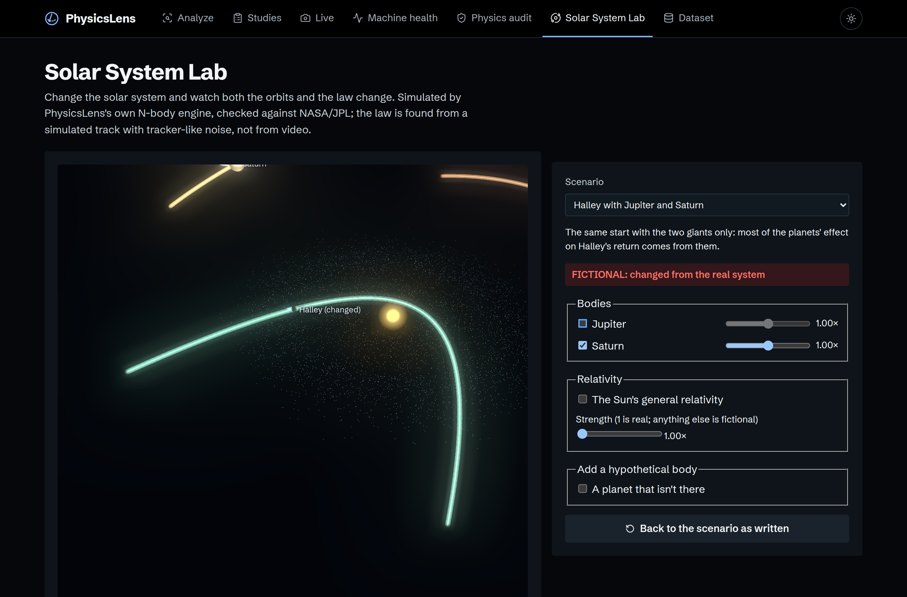

# PhysicsLens

[](https://github.com/Athmeeya2006/Physicslens/actions/workflows/ci.yml) [](LICENSE)  

**Point a phone at anything moving. Get the equations that govern it, verified.**

*A simulator is only as good as its physics. PhysicsLens gets physics from reality, proves it, and shows its work.*

PhysicsLens turns a phone video into a verified physics model. SAM 3.1 tracks the moving object, an agent built on Meta's open-weight reasoning model proposes candidate equations, and plain numerical simulation tests every candidate against the real motion. Only an equation that predicts held-out data is accepted. When the data can't tell two models apart, the agent asks you for the experiment that will. The result is a calibrated model you can export straight into a robot simulator, or use to watch a machine wear.

> Built for the **Meta Global AI Developer Hackathon** (Indie track, *Push the Frontier*), Oct 27 to Nov 4, 2026.

| | |
|---|---|
| 🎥 **Demo video (3 min)** | _link coming_ |
| 🌐 **Try it** | [physicslens.vercel.app](https://physicslens.vercel.app): real analyses with the ghost overlay, decision trail and exports. Everything is open, no code needed: analyze your own clip, live camera, voice, studies and the physics audit, whenever the analysis server is online (the home page says so) |
| 🪐 **Solar System Lab** | [physicslens.vercel.app/sky](https://physicslens.vercel.app/sky): a 3D solar system to change and rediscover, free and in the browser |
| 🤖 **For AI assistants** | [`llms.txt`](llms.txt) is a compact map of this repository |

## How to read this README

- **Judging (5 minutes):** [In 30 seconds](#in-30-seconds), then the [Judging guide](#judging-guide-5-minutes): six links, each a real result with its decision trail.
- **Using it (15 minutes):** [What it does](#what-it-does), [Systems it identifies](#systems-it-identifies), [How an equation is accepted](#how-an-equation-is-accepted), [Applications](#applications) and [Limitations](#limitations); then film something, using the bubble level and the tips under the upload button.
- **Building on it (everything):** Parts IV to VII: the acceptance rules, the agent, the pipeline in detail, the API, configuration, structure and tests. Every number in this file is recomputed from its source by `make numbers`.

---

## In 30 seconds

- **The problem:** robots are trained in simulators and fail when the simulator's physics is wrong (friction, damping, stiffness). Measuring real physics takes lab rigs and an expert.
- **What PhysicsLens does:** film anything moving with a phone. You get the equation that governs it, its parameters with uncertainty, a simulated "ghost" over the real video, and an export a robot simulator can run (MuJoCo, Python, JSON).
- **Why you can trust it:** no equation is accepted unless it forecasts motion it never saw. A second "referee" model tries to break every accepted law, and every step names the model or the math that decided it.
- **Proof it discovers rather than recalls:** from rendered videos of asteroid Apophis and of Jupiter's four large moons it found the inverse-square law, the Sun's GM within 0.023% and Jupiter's within 0.012% of NASA/JPL, and Kepler's third law (exponent 1.4991 ± 0.0032) from the tracks alone; on Halley's comet a force law with the exponent left free fitted 1.9998.
- **On real footage:** a 0.5 m pendulum gives g = 9.91 ± 0.04 m/s² (0.99% from 9.81); a thrown paper bag rejects free fall for linear drag; and when the data cannot decide, the agent asks for the experiment that would.
- **Real-world cases, each checked against an independent answer:** the Winchcombe meteorite fall (its orbit within 0.4 sigma of the published one, every recovered stone on the simulated fall line), WASP-12b's shrinking orbit (28.6 ± 2.1 ms per year against the published 29 ± 2), the Sun's rotation from real SDO images, Uranus's moon Umbriel sized from a star's disappearance, and how much one more night helped track asteroid 2024 YR4. Each is a page that also says what it cannot do.
- **Meta models doing real work:** Muse Spark Open (open weights, on Baseten) reasons, SAM 3.1 tracks, Muse Voice Transcribe listens, Muse Image draws setup guides, Muse Wonder writes controllers that only simulation can accept, and Muse Glimmer 30B is the fully offline open-weight path.

## Judging guide (5 minutes)

| Step | Open | What you will see |
|---|---|---|
| 0 | [Home page](https://physicslens.vercel.app) | the discovery playing: Apophis around the Sun with the law it wrote, typeset, and the numbers it measured |
| 1 | [Asteroid Apophis](https://physicslens.vercel.app/?run=gallery-apophis) | a dot moving around the Sun becomes the inverse-square law; the force arrow points at the Sun in every frame |
| 1b | [Halley's comet](https://physicslens.vercel.app/?run=gallery-halley) | the 1986 hairpin around the Sun: inverse-square gravity, the exponent left free fits 1.9998 |
| 2 | [Weighing Jupiter](https://physicslens.vercel.app/?run=gallery-jupiter) | Jupiter's GM from Io's orbit, within 0.018% of JPL |
| 3 | [Pendulum](https://physicslens.vercel.app/?run=gallery-pendulum) | damping fits better but forecasts worse, so it is not confirmed; both laws give the same g, and the agent designs the swing that would decide |
| 4 | [Paper bag](https://physicslens.vercel.app/?run=gallery-paperbag) | free fall rejected; a drag law accepted on held-out motion |
| 4b | [Physics audit at scale](https://physicslens.vercel.app/audit) | 149 clips: real motion has a forecasting law 47% of the time, AI-generated 17%; no real clip falsely accused |
| 4c | [Real-world cases](https://physicslens.vercel.app/cases) | ten cases, each ending in something to act on (a search map, a transit calendar, a return date, a report), with a status computed from its result and what it cannot do |
| 5 | [Open dataset](https://physicslens.vercel.app/dataset) | every verified parameter, with its uncertainty, clip and licence |
| 5b | [Solar System Lab](https://physicslens.vercel.app/sky) | a 3D solar system from JPL data: make Jupiter ten times heavier, switch Neptune off, turn relativity on, and watch the target's orbit and its perturbation equations change; with the analysis server online, "Find the law" runs discovery on the simulated track |
| 6 | Your own clip, live mode, a study | open to everyone, no code; [the home page](https://physicslens.vercel.app) shows whether the analysis server is online |

In every result, read the decision trail beside the video: each step is tagged with the model (provider and id) or the numerical method behind it, and "What the model thought" shows the reasoning.

## Contents

**Part I: The idea**
- [The problem](#the-problem)
- [What it does](#what-it-does)
- [How it works](#how-it-works)

**Part II: Measure**
- [Systems it identifies](#systems-it-identifies)
- [Equations the agent writes itself](#equations-the-agent-writes-itself)
- [Time-dependent and driven laws](#time-dependent-and-driven-laws)
- [3D from one phone, balls only](#3d-from-one-phone-balls-only)

**Part III: The solar system**
- [Proof it discovers, not recalls](#proof-it-discovers-not-recalls)
- [Our own solar-system engine, checked against JPL](#our-own-solar-system-engine-checked-against-jpl)
- [Is something else pulling? Perturbation discovery](#is-something-else-pulling-perturbation-discovery)
- [Solar System Lab](#solar-system-lab)
- [Real sky data: telescope frames, sky videos and light curves](#real-sky-data-telescope-frames-sky-videos-and-light-curves)
- [Real-world cases on public data](#real-world-cases-on-public-data)

**Part IV: Prove**
- [How an equation is accepted](#how-an-equation-is-accepted)
- [The agent: samples, tools and a referee](#the-agent-samples-tools-and-a-referee)
- [Studies: asking for the experiment that settles it](#studies-asking-for-the-experiment-that-settles-it)
- [Live mode: predictions made before the event](#live-mode-predictions-made-before-the-event)

**Part V: Use and catch**
- [Applications](#applications)
- [For robotics: exports checked in MuJoCo](#for-robotics-exports-checked-in-mujoco)
- [Sim-to-real gap, made visible](#sim-to-real-gap-made-visible)
- [Controllers written by Muse Wonder, verified in MuJoCo](#controllers-written-by-muse-wonder-verified-in-mujoco)
- [Machine health](#machine-health)
- [Sound as a second sensor](#sound-as-a-second-sensor)
- [For AI agents: PhysicsLens as an MCP server](#for-ai-agents-physicslens-as-an-mcp-server)
- [Physics audit](#physics-audit)
- [Open dataset](#open-dataset)

**Part VI: The record**
- [The story: how it was built](#the-story-how-it-was-built)
- [Validation](#validation)
- [Limitations](#limitations)
- [Meta models used](#meta-models-used)
- [Cost and safety controls](#cost-and-safety-controls)

**Part VII: Reference**
- [The pipeline in detail](#the-pipeline-in-detail)
- [Getting started (Linux)](#getting-started-linux)
- [Configuration reference](#configuration-reference)
- [HTTP and WebSocket API](#http-and-websocket-api)
- [Project structure](#project-structure)
- [Testing](#testing)
- [What we built during the hackathon](#what-we-built-during-the-hackathon)
- [Roadmap](#roadmap)
- [Acknowledgements](#acknowledgements)
- [License](#license)

---

# Part I: The idea

## The problem

Robots are trained in simulators, and they fail in the real world when the simulator's physics is wrong: the friction, damping or stiffness doesn't match reality (the "sim-to-real gap"). Measuring those parameters today takes lab rigs, sensors and an expert's afternoon of modeling. PhysicsLens does it from a phone video:

- **Robotics engineers** get dynamics parameters with uncertainty, exported as a MuJoCo model that is replayed in MuJoCo and checked against the measured motion.
- **Maintenance engineers** film a machine part today and again next month. PhysicsLens compares natural frequency and damping across recordings and flags drift, an early sign of wear.
- **Anyone building a mechanism** gets a working dynamics model in minutes instead of an afternoon.

It is system identification, normally a specialist task, made as easy as filming something.

## What it does

1. **Start from a goal, or from a clip.** In a **study** you state what you need ("are this truck's front shocks worn?", "the damping of this cabinet hinge for my robot sim"). The agent plans the deliverable, what to measure and which recordings to make, with filming instructions. Or just upload a clip, or go live with the phone camera.
2. **It reads the scene.** The reasoning model looks at four keyframes, names the moving object, guesses the kind of motion, and finds a reference of known size (A4 or letter sheet, credit card, coin). No reference? Give the pendulum length or the object's size, say it out loud while filming, or skip it: frequency, damping and friction need no scale.
3. **It tracks, then checks what it tracked.** SAM 3.1 follows the object, and the reference, through every frame in one request. The reasoning model then looks at three frames with SAM's box drawn on them; if the box sits on the wrong thing (a clasp, a shadow, a digit drawn on the video), SAM is asked again by the object's name.
4. **It hypothesizes, then proves.** The agent proposes candidate equations from a library or writes its own; regular math fits and simulates each one and keeps only what forecasts held-out data. The simplest adequate model wins (BIC).
5. **It checks the answer is physical.** With no scale in view and a law containing g, Earth's gravity becomes the ruler: lengths follow from the fitted g, and the assumption is stated.
6. **It asks for better data.** If genuinely different laws tie, the agent says which experiment would separate them; in a study it asks for the next recording until the goal is answered, and the recordings are combined (weighted means, and a test that they agree).
7. **You see the proof.** A simulated "ghost" moves over the real video. Every decision appears in an on-screen decision trail, each tagged with the model or the math that made it.
8. **Ask "what if?" out loud.** "What if the string were twice as long?" The fitted equation is re-simulated from the same starting state and drawn as a second ghost.
9. **Export.** A MuJoCo model, a standalone Python simulation, parameters as JSON, a one-page report for a colleague, or a shareable MP4. A study adds its own report, a wear verdict with a maintenance note when that was the goal, and a MuJoCo model with the combined parameters.

When nothing fits, it says so: *"no clean governing equation found."* It never invents an equation, and it refuses clips it can't measure (a flat pendulum arc, a round spinning object, a spin close to the frame-rate limit, a tracked object that never moves) instead of guessing. One limit it cannot see: a spin faster than a quarter turn per frame aliases into a slower one, so film spins with slow motion.

## How it works



**The design principle: Meta's models perceive and reason; math decides.** The language model reads the scene, proposes hypotheses, plans experiments and explains results. It never accepts an equation: only numerical verification on held-out data does, and the simplest model of each family is always tested as a control, so the agent can't hide the baseline.

---

# Part II: Measure

> Film something. Get the law that governs it.

## Systems it identifies

| System | Models compared (ids in `physics/models.py`) | What you get |
|---|---|---|
| Pendulum | simple (`pendulum`), small-angle, linear damping, quadratic (air) damping | g, damping, string length (all with intervals) |
| Spring or elastic oscillator | harmonic, damped harmonic, spring with dry friction (`oscillator_dry`), spring with viscous and dry friction together (`oscillator_mixed`), stiffening spring (`duffing`) | natural frequency, damping ratio, friction or stiffening coefficient |
| Torsional spring (door closer, hinge) | damped torsional spring (`spin_spring`) | stiffness and damping per unit inertia |
| Thrown or dropped object | no drag, linear drag, quadratic drag | g, drag coefficient |
| Ball thrown toward or away from the camera (opt-in 3D mode, one phone) | no drag, linear drag, quadratic drag in three dimensions | the 3D path with a depth error for every frame, g with an interval |
| Bouncing ball | free flight plus restitution (hybrid) | g shared by every flight, coefficient of restitution at each bounce |
| Double pendulum | point-mass double pendulum, fitted on short restarted predictions | g, mass ratio, and how chaotic it is: Lyapunov exponent and how many seconds the motion can be forecast |
| Spinning object slowing down | free spin, dry friction, viscous, air drag, dry plus viscous | the friction law and its coefficients |
| **Anything else that moves** (rolling, sliding, braking, a falling leaf) | constant velocity and constant acceleration (along a line or in the plane) as controls, plus up to three equations **the agent writes itself** | the law that forecasts the motion, its fitted coefficients, and the same ghost, exports and what-ifs |

### Equations the agent writes itself

For motion outside the named families the agent proposes the acceleration law as text, for example `-mu*9.81*sign(v) - c*v*abs(v)` for a cart slowed by rolling friction and air drag. A small recursive-descent parser over a closed grammar (numbers, declared parameters, the state variables, `+ - * / ^` and a whitelist of functions) turns it into a model; nothing is ever passed to `eval`. The parsed tree drives the ODE solver, the LaTeX shown in the app and the exported Python script, so what you see is exactly what was fitted. Each law must beat "nothing acts on it" and "a constant force" on held-out motion, and a malformed proposal goes back to the agent with the parser's error. On synthetic data an agent-written air-drag law recovers its coefficient within 5% and a wrong spring law is rejected.

**Units are checked before anything is fitted.** Every state variable, input, parameter and `t` carries a unit (length, time and mass, with fractional powers allowed), and the law's terms must each come out as an acceleration. Sums need equal units, the arguments of `sin`, `exp`, `log` and the like must be pure numbers, and a power needs a constant exponent unless its base is a pure number. A law that fails is rejected before fitting, with a message the agent can act on, for example "term 1 has units L T^-1, expected L T^-2: did you mean it multiplied by a rate (a parameter in 1/s), as in c*v?". Unit text the checker does not know, and literal constants such as 9.81 that stand for a physical constant, leave their term unchecked rather than rejected. Ten library laws written in this language pass and eleven wrong ones are rejected (`tests/test_driven.py`). Everyday clips allow up to 4 fitted parameters; orbit mode, with thousands of clean samples, allows 6.

### Time-dependent and driven laws

A law may also use the time `t` (seconds from the start of the track) and named *known inputs*: signals that are measured, never fitted. They come from a second object in the same video that you name as the known mover (SAM tracks it too, and its path becomes `x2`, `y2` in the measured object's coordinates), from a CSV you upload with the clip (a column `t` in seconds from the clip's start, then up to six named columns with optional units, e.g. `u[N]`, such as a robot's logged motor command), or from a simulation (labelled "simulation, no pixels"). Each input's source is recorded in the result and the decision trail. A law is evaluated only where its inputs were measured: asked for a time outside that span it fails with a clear error, never an extrapolation. On synthetic data a driven oscillator `-w^2*s - 2*z*w*v + A*cos(W*t)` recovers its drive's amplitude and frequency within 2%, and a law pulled toward a moving point given as inputs recovers its stiffness within 2% (`tests/test_driven.py`); the exported Python script carries the inputs and reproduces the fitted motion to 1e-6.

### Changes during a clip

Changes during a clip (say, the string is shortened mid-recording) are detected; each regime is fitted separately, and live mode refits on the new motion.

### 3D from one phone, balls only

A ball looks the same from every side, so its apparent size gives its distance: Z = f·D/d, with D the diameter you enter, d the diameter of the disc with the mask's area, and f the camera's focal length in pixels. Its image position then gives X and Y. Frames where the mask is stretched by motion blur (aspect ratio over 1.3), loses over 30% of its area against its neighbours, or touches the frame edge are rejected. One pixel of diameter error on a 40 px ball is 2.5% of the distance, so depth is far noisier than position across the image; the fit weights it accordingly, and every frame's depth error is reported. The three 3D projectile laws then go through the same held-out forecast and BIC rules as the 2D ones. The mode is opt-in (a checkbox on the Analyze page once the phone's lens is calibrated, or `depth_3d` with `focal_px` or `lens` on `POST /api/runs`, with the ball's diameter as the object size) and runs only for a ball fitted as a projectile; otherwise the 2D result stands and a note says why 3D was skipped. Phone videos record no focal length that ffprobe can read, so it comes from a lens calibration (film the printed board once: `perception/lens.py`) or from an A4 sheet filmed flat at a known distance, f = d·Z/D (`focal_from_reference`). When the phone's tilt was saved with the clip (the bubble level on the Analyze page), the positions are turned so the accelerometer's "down" is down before fitting: on a synthetic throw filmed by a phone rolled 8° and pitched 5°, no 3D law holds without it and g comes back within 5% with it (`tests/test_depth3d.py`).

---

# Part III: The solar system

> Nobody films an asteroid, so this is where discovery can't be recall: the laws of the planets, found from rendered videos of real orbits, then a simulator of our own to predict what comes next, find what else is pulling, and play with it.

## Proof it discovers, not recalls

Nobody films an asteroid. If the pipeline really discovers laws instead of recalling them, it should still find them in a video of one. Both demos below go through the normal pipeline: SAM 3.1 tracks a dot, the agent writes its own laws, and verification decides; NASA/JPL data only draws the video and, afterwards, checks the answer.

### Apophis: the inverse-square law from a video

Can the same pipeline that measures a pendulum rediscover the law of gravity just by watching an asteroid? `scripts/orbit_demo.py` renders four years of 99942 Apophis (2022 to 2026, one frame per 2.5 days) from NASA/JPL Horizons positions, viewed top-down in Apophis's own orbital plane, and runs the normal pipeline on that video: Muse Spark Open reads the scene, SAM 3.1 tracks the dot, the agent writes laws of its own, and numerical verification decides. The JPL data are used only to draw the video and, afterwards, to check the answer.

| | From the video | NASA/JPL | |
|---|---|---|---|
| Force law | exponent 2.99998 in the agent's free power-law form (force proportional to r^-2.00002) | inverse square | |
| GM of the Sun | 2.95981e-4 AU³/day² | 2.95912e-4 AU³/day² (Horizons) | +0.023% |
| 2029 closest approach, time | 2029-04-14 10:48 TDB | 2029-04-13 21:46 TDB (CNEOS close-approach API) | 13 h late, 3.3 years after the last frame |
| 2029 closest approach, distance | 2.19 million km | 38,000 km | not resolved |

What happened, in order: three independent proposals each wrote the inverse-square law (in different notation; verification now recognizes one law written twice). Verification accepted it over a free-exponent version and the controls. The referee then proposed a tiny velocity term (time scale about 11,000 years) that also forecast the held-out motion (0.5% against 0.6%) and fit the whole orbit better by 51 BIC: not air drag, but the data saying that Sun-only gravity is not the whole story (the planets pull on Apophis too). Tested on simulated tracks (`scripts/apophis_drag_check.py`): the same term comes out at 2.3e-7 per day when the planets pull on Apophis and at zero, with plain Kepler winning, when they don't. The video shows the law's force arrow pointing at the Sun in every frame.

**Honest limits.** One pixel is about 340,000 km at this scale, and SAM's centroids carry about 2 px of error, so the position error is about 0.8 million km at the end of the video and grows to about 2.2 million km by 2029 (`var/orbit/prediction_error.png`). The prediction is Sun only (no planets, no relativity, no Yarkovsky effect) and lives in Apophis's orbital plane. It is a deterministic prediction compared with JPL's answer, not an impact probability: PhysicsLens does not propagate the uncertainty a "will it hit Earth" verdict needs. The units are AU and days (the expression language bounds parameters, and GM in SI is about 1e20).

**Where the miss comes from.** The same check as for Halley, each source switched on alone, all from JPL's 3D position and velocity of Apophis on the video's last day (`physics/nbody.py`, Newton's pull of the Sun, every planet and the Moon, positions and masses from JPL Horizons):

| Integrated from 2026-01-01 to the 2029 flyby | Time against JPL | Closest distance (JPL: 38,011 km) |
|---|---|---|
| The Sun alone, JPL's GM | 2.8 h late | 93,400 km |
| The Sun alone, the GM measured from the video | 9.0 h late | 1.83 million km |
| The Sun, planets and Moon, JPL's GM | **within a minute** | **37,654 km** |
| The Sun, planets and Moon, the GM measured from the video | 8.2 h late | 1.85 million km |

With the planets and the Moon, the integration lands the flyby within a minute of JPL's time and 360 km (under 1%) from its distance after 3.3 years; the rest is what JPL also models (the Yarkovsky push of sunlight, relativity) and we do not. Earth's own pull is what bends the pass: without Earth and the Moon the same integration misses by 3.5 hours. What remains in the video's prediction is the Sun's GM, measured to 0.023%, and a 2D track that cannot show the planets' pull from outside the orbital plane. `tests/test_apophis.py` checks the within-a-minute result offline.

**The law found from the video, with the planets added** (`data/orbit/prediction_table.json`, `python scripts/orbit_demo.py prediction`). Starting instead from what the video measured (its GM, its small velocity term, its fitted starting state) and adding the planets as known forcing from JPL:

| Integrated to the 2029 flyby | Time against JPL | Closest distance (JPL: 38,011 km) |
|---|---|---|
| The discovered law alone | 13.0 h late | 2.18 million km |
| The discovered law with the planets added | 14.3 h late | 4.47 million km |

Here the planets do not help, and the error budget says why: the video's GM alone, plus or minus one standard deviation, is worth 2.2 hours and 3.0 million km at the flyby, more than the planets' whole effect over these years (the detectability check above: at most 3.2 px in the video). Relativity is worth a minute and 263 km; from JPL's own state the integration lands 543 km from JPL's distance, the rest being the Yarkovsky push of sunlight, which JPL models and we do not. For Apophis the limit is the measurement, not missing physics.

**The flyby changes Apophis's orbit** (`data/orbit/aftermath.json`, `python scripts/orbit_demo.py aftermath`). Its year goes from 324 days to 421 in our engine and to 423 in JPL's ephemeris (a change of 97.6 days against JPL's 99.6, the difference following from our pass being 806 km wider), and its semi-major axis goes from 0.92 to 1.10 AU: it crosses 1 AU and changes class, from an Aten to an Apollo asteroid.

Reproduce: `python scripts/orbit_demo.py all` (fetch and render are free; analyze calls SAM 3.1 and Muse Spark Open once; predict is local), then `fetch-planets` and `planets` (free). Data sources and credits: `data/orbit/SOURCES.md`.

### Jupiter: one planet weighed four ways

`scripts/jupiter_demo.py` does the same for the four Galilean moons: one rendered video per moon (1.25 orbits, top-down in its own orbital plane, from JPL Horizons positions), the normal pipeline on each, and the agent writing its own laws. Lengths are in Jupiter radii (R_J) and time in hours.

| Moon | Law accepted by verification | GM of Jupiter (R_J³/h²) | vs JPL (4.49328) |
|---|---|---|---|
| Io | Keplerian point-mass gravity | 4.4941 ± 0.0011 | +0.018% |
| Europa | point-mass gravity, centre fitted (1.2 px from the drawn centre) | 4.4927 ± 0.0006 | -0.013% |
| Ganymede | Newtonian central gravity | 4.4916 ± 0.0011 | -0.036% |
| Callisto | power-law central gravity, exponent 1.989 ± 0.009 | 4.34 ± 0.12 | -3.5% (within its interval) |
| **Combined** | | **4.49272 ± 0.00047** | **-0.012%** |

Then, across the moons and without any fitted force law: the period and mean distance of each orbit, measured straight from the track, follow **period proportional to distance^1.4991 ± 0.0032** (Kepler's third law is 1.5), with every moon predicted from the other three within 0.7 sigma; its prefactor weighs Jupiter a third way, 0.35% below JPL. The distance carries one pixel of systematic uncertainty in that test. SAM's tracker dropped a plain dot on two of the moons; the pipeline now finds the object by name in every frame before giving up, and that is how Europa was tracked. Data credits: `data/jupiter/SOURCES.md`.

### Halley's comet: the hairpin around the Sun

[Open the result](https://physicslens.vercel.app/?run=gallery-halley). Halley's orbit is a long ellipse (eccentricity 0.967): over the 28 months of the 1986 passage shown in the video, the Sun's pull on it grows about 80-fold and the comet moves more than three times faster at perihelion than at the edges of the frame. A law that is even slightly wrong in its exponent bends that hairpin visibly. Rendered from NASA/JPL Horizons positions (small-body record 90000030), one frame per 1.44 days; the analysis saw only the moving dot.

| Result | Value |
|---|---|
| Accepted law | inverse-square gravity, written by the agent; held-out forecast error 0.2% |
| A rival law with the exponent left free | exponent **1.9998** (Newton: 2) |
| The Sun's GM | **0.095% below JPL's value** (plus or minus 0.067%) |
| The referee | proposed three alternatives; none could be tested (it wrote `pow(...)`, which the law grammar then lacked and now accepts), so the law stands on its own verification |
| Physics audit | consistent |

The honest limit: carried 75 years forward with the Sun alone, the law brings Halley back in **November 2063, not JPL's July 2061**. Where that miss comes from was then measured, each source switched on alone, all from JPL's 1985 position and velocity of the comet (the planets pull from outside the comet's plane, which a video of that plane cannot show):

| Integrated from 1985 to the 2061 perihelion | Error against JPL's date |
|---|---|
| The Sun alone, JPL's GM | 263 days late |
| The Sun alone, the GM measured from the video | 509 days late |
| The Sun and the four giant planets, JPL's GM | **3.8 days early** |
| The Sun and the four giant planets, the GM measured from the video | 236 days late |

So the planets account for most of the miss: Newton's pull of Jupiter, Saturn, Uranus and Neptune (positions and masses from JPL Horizons) brings our integration within four days of JPL's date after 76 years, at JPL's perihelion distance (0.5927 AU against 0.5928); the four days are about what the comet's own outgassing shifts it, which JPL models and we do not. What remains is the Sun's GM: the video measured it to 0.095%, and so long an ellipse turns that into about eight months over one orbit. Reproduce: `python scripts/halley_demo.py fetch|render|analyze|predict|planets` (`tests/test_halley.py` checks the four-day result offline). Data credits: `data/halley/SOURCES.md`.

**The law found from the video, with the planets added** (`data/halley/prediction_table.json`, `python scripts/halley_demo.py prediction`). The table above starts from JPL's state; this one starts from what the video measured (its own GM for the Sun and its own fitted starting state, lifted back from the video's plane) and adds the planets as known forcing, their paths and masses from JPL, labelled "planets added from JPL, not discovered from the video":

| Integrated to the 2061 perihelion | Against JPL's date |
|---|---|
| The discovered law alone | 838 days late |
| The discovered law with the planets added | 560 days late |
| JPL | 2061-07-29 |

Error budget for what remains: the video's GM, plus or minus one standard deviation of its bootstrap interval, moves the date by 174 days either way; a Monte Carlo of the fit's own covariance of GM and starting state (12 draws) spreads it by 43 days (smaller, because that covariance treats the residuals as independent, the bootstrap does not); relativity moves it by less than the 0.05-day search step; and from JPL's own state with every planet the integration lands within 0.3 days, the rest being the comet's outgassing. So with the planets in, the 2061 miss is the video's own measurement of the Sun's GM, about three of its standard deviations. The gallery result shows both curves, with the planets as a toggle.

**Why one passage cannot do better** (`data/halley/apparitions.json`, `python scripts/halley_demo.py apparitions`). Carried backward and forward from JPL's J2000 state with every planet, our engine puts Halley's perihelia of 1986 and 2061 within 0.01 days of JPL's, 1910's 4.1 days early and 1835's 7.7 days early (the outgassing JPL models accumulates over centuries); in between, the orbit-to-orbit period ranges from 74.4 to 75.8 years. The planets change Halley's period by more than a year from one orbit to the next, which is why no single passage can pin down the next return better than the planets allow.

## Our own solar-system engine, checked against JPL

The planets' part of the Apophis and Halley results needs an N-body simulator, so PhysicsLens has its own (`backend/physicslens/sky/`), built from scratch and checked against NASA/JPL rather than trusted because it "looks right". Newtonian gravity in AU and days, integrated with SciPy's DOP853 at a relative tolerance of 1e-12; massive bodies pull on each other in one vectorised pairwise sum, and test particles (asteroids, comets) feel every massive body and pull on none. Two frames: centred on the Sun, with the indirect term (every planet pulls the Sun too, and the frame moves with it), or around the barycentre. Optional terms, each off by default: the Sun's general relativity at first post-Newtonian order, the central body's oblateness J2 (for Jupiter's moons), bodies on a prescribed path (a passing star), a hypothetical extra body, and per-body mass scaling. Energy and angular momentum are monitored, and a run that drifts more than 1e-9 per century says so. REBOUND is supported as an optional backend when installed, never required.

The catalogue: the Sun, every planet (outer planets as system barycentres, with system masses that add the planet and its major moons, each from JPL Horizons' physical data), the Moon, Pluto, Ceres, Apophis, Halley, and the Galilean moons around Jupiter. Initial states at J2000 and every mass are cached in `data/sky/` with their sources (`data/sky/SOURCES.md`), so everything runs offline.

**Checked against JPL** (numbers from `data/sky/validation_results.json`, written by `python scripts/sky_demo.py validate`; every one is also a test in `tests/test_sky.py`):

| Check | Result |
|---|---|
| Earth, Jupiter and Saturn, 10 years from JPL's J2000 states, Newton only | largest error 4.1e-6 AU (Earth), 4.3e-7 AU (Jupiter), 9.9e-8 AU (Saturn) |
| The same with the Sun's relativity switched on | 1.3e-8 AU (Earth, about 2 km), 3.1e-8 AU (Jupiter), 3.3e-9 AU (Saturn) |
| Sun-centred against barycentric frame, 10 years | agree to 2.0e-10 AU |
| Mercury's perihelion advance from relativity alone, over a century | 43.02 arcseconds per century (Einstein's value: 42.98) |
| Apophis from its J2000 state to the 2029 Earth flyby, every planet and the Moon | closest approach 1 minute from JPL's time, at 38,817 km (JPL: 38,011 km) |
| Halley from its J2000 state to its 2061 perihelion | within 0.01 days of JPL's perihelion time with every planet (0.30 days against the nearest day of JPL's daily table); 153 days late with the Sun alone |
| Eight planets and ten test particles for a century, daily output | 22.6 s on one core of an i7-13620H when idle (the plan's budget was 20 s; the same run measured 39 s while other jobs ran) |

The Earth row is worth reading twice: Newton alone leaves 4 parts in a million after ten years, and that is exactly relativity's share; with it, the integration stays within a few kilometres of JPL's ephemeris.

**Scenarios** (`data/sky/scenarios/*.yaml`, run with `python scripts/sky_demo.py`). Each is a system, a clip and what to compare with, with a paragraph of physics in the file: Apophis under the Sun alone and with every planet; Halley under the Sun alone, with Jupiter and Saturn, and with every planet; Jupiter ten and a hundred times heavier (fictional); Mercury with relativity made 20,000 times stronger (fictional, so the precession shows within a few years of video); Uranus from 1780 to 1846 with Neptune pulling but not drawn (Le Verrier's problem); a star of half the Sun's mass passing at 200 AU (fictional); and Io, Europa and Ganymede in their resonance with Jupiter's J2. A real scenario starts where the body really was: JPL's J2000 states carried to the scenario's start with every planet, and only then switched to the scenario's own physics. Fictional ones say so in their title, their video and their results.

**One renderer, two modes.** The Apophis, Halley and Jupiter demos and every scenario now draw their videos with one renderer (`sky/render.py`: discs drawn at 8x and averaged down, H.264 at crf 16), which places each dot within 1/16 of a pixel of its projection (`tests/test_sky_scenarios.py`); the three demos' frames are unchanged by the move. A scenario can then be analysed two ways, kept apart on purpose: *pixel mode* renders it and runs the normal pipeline (SAM 3.1 and Muse Spark Open, paid, and the script asks first), and *direct-track mode* fits the simulated track on the frames the video would have (at most 590, evenly strided), with Gaussian noise the size of a video tracker's (2 px at the video's scale), through the same fitting, rolling-origin forecasts and BIC, from a fixed list of laws instead of the reasoning model's proposals, so it is free and instant. Every direct-track result carries "simulation, no pixels". On Apophis under the Sun alone it recovers the Sun's GM to 1.5e-7 with no noise and to 0.032% (plus or minus 0.058%) with tracker noise.

**Detectability, before any video.** Before rendering, the engine compares the target's path with and without the effect in question, at the video's scale, against the tracker's noise, and says plainly whether a video could show it (`sky/render.py`, `detectability`): the planets move Apophis's 2022 to 2026 track by at most 3.2 px (cannot see, with about 2 px of noise), a hundred-times-heavier Jupiter moves Mars by 87 px (can see), Neptune moves Uranus by 0.34 px over 66 years (cannot see).

## Is something else pulling? Perturbation discovery

The Apophis run already hinted at it: the referee's tiny velocity term was the data saying the Sun is not the whole story. Now that is deliberate. When a law in the plane is accepted, its residuals are split into radial, along-track and cross-track components and searched for periodic structure (a Lomb-Scargle periodogram, the three strongest peaks with their false-alarm probabilities) and for a secular drift (`physics/residuals.py`). Significant peaks are matched with periods of known bodies (their own, half, and synodic with the target) as hints, never verdicts. The agent can call this as a tool ("residual_spectrum"), the referee receives it, and its prompt describes the three kinds of perturbing law to try: a known body with a known path (its position as an input, one fitted GM), a hidden body on a circular orbit (mass, radius and phase fitted; its speed follows from Kepler's third law), or a small constant push along the motion. The indirect term is spelled out in the prompt, and a written law that pulls toward a known body without it gets a warning in the trail. Acceptance is unchanged: held-out forecast, rolling origins, BIC with the effective sample size. When a perturbation is accepted, the result carries an *equation diff*: the law before and after, the terms added, each parameter's shift with its interval, the forecast error before and after, and one sentence made from those numbers by a template, not by the language model.

**Le Verrier's test** (`data/sky/leverrier.json`, `python scripts/sky_demo.py leverrier`). Uranus from 1780 to 1846, with Jupiter and Saturn known (as they were to Le Verrier) and Neptune pulling but hidden. At a phone tracker's noise (2 px) Neptune moves Uranus by a third of a pixel, and the system says the data cannot show a perturbation rather than inventing a planet. At astrometric precision (0.02 px at the same scale) the residuals of "Kepler plus the known planets" are strongly structured, and the hidden-body law is accepted on held-out motion: it puts the unseen planet at 30.3 plus or minus 0.5 AU from the Sun, where Neptune is (30.2 AU on average over those years). Its fitted mass, though, is 4.6 times Neptune's and its phase is off by about 220 degrees: over 66 years, less than half the two planets' synodic period, mass and position along the orbit trade against each other, so only the distance is pinned down. Stated, not tuned away.

**No planet from noise.** A pure Sun-only orbit with tracker noise must end with "no perturbation needed": it does for all 20 of 20 noise seeds (`tests/test_perturbation.py` requires at least 19).

## Solar System Lab



[physicslens.vercel.app/sky](https://physicslens.vercel.app/sky): change the solar system and watch both the orbits and the law change. Pick a scenario, switch bodies off or hide them from the "video", scale a body's mass from a hundredth to a hundred times, add a planet that isn't there, turn on the Sun's relativity and exaggerate it (marked FICTIONAL whenever the system is no longer the real one), and play the result in 3D (three.js): glowing orbits, the Sun as the light source, lit planets with their own colouring, and an illustrative swarm of asteroids on Kepler orbits; drag to turn, scroll or pinch to zoom, right-drag to pan, with a timeline, a speed control and a camera that can follow any body. Sizes are not to scale (at scale every planet would be smaller than a pixel); positions are. The scenario as written stays on screen, solid, under the changed run, dashed, in the same visual language as a video result's ghost.

- **Every force, term by term:** the target's equation of motion written out, one term per body with its own formula (each with the indirect term, because every body also pulls the Sun), its GM, its distance and its pull as a share of the Sun's at this moment, plus the relativistic term with its size when relativity is on. Change a mass, switch a body off or add one, and its row changes.

- **What changed:** the target's semi-major axis, eccentricity, perihelion longitude and period over time, original against changed, and the perihelion's precession in arcseconds per century.
- **The law:** with the analysis server online, every change also finds the target's law from its simulated track with tracker-like noise (the direct-track mode above: free, labelled "simulation, no pixels", not a video discovery), with its parameters and intervals, a table of how the law was chosen (every candidate law with its held-out forecast error, how far behind it was by BIC, and the verdict with its reason), the residual search and, when a perturbation is accepted, how the equation changed. "Film it" renders the scenario and runs the normal, paid video analysis on it, only when the server offers uploads.
- **Detectability:** a badge says whether a phone-video tracker would see the change, in pixels.
- **Offline too:** every scenario is precomputed into the static site (`scripts/build_sky_static.py`), and a change is re-integrated in the browser (a small RK4 integrator with the indirect term, optional relativity and the added planet, placed exactly as the server places it) as an instant preview; with a server, its run replaces the preview. Each scenario as written also carries its law, found in advance at 2 px of noise, so "Find the law" answers without a server; finding the law of a changed system needs the server, and the page says so.
- **Questions it answers:** six presets load a scenario with the change a real question needs: will a comet come back on time (Halley with Jupiter switched off), how a near miss reshapes an asteroid (Apophis), is there a planet nobody has seen (Uranus with a hidden Neptune), is Newton enough (Mercury's precession), would the inner planets survive a heavier Jupiter, and the Galilean moons' resonance.
- **Links:** `#halley_all_planets` opens a scenario; every change is kept in a short `?s=` parameter, so a link reproduces exactly what you see.
- **Accessible:** every control is labelled and works from the keyboard, the view has a text description, a live region announces the law when it changes, and motion waits for a press of Play when the system asks for reduced motion.

`scripts/lab_smoke.py` checks it in a real browser against a mocked API (pick Halley with Jupiter and Saturn, switch Jupiter off, see the law), and `scripts/lab_screenshots.py` takes the screenshots above.

## Real sky data: telescope frames, sky videos and light curves

The orbit results above come from videos rendered from JPL positions. To work on real astronomical data,
PhysicsLens has a second measurement chain (`backend/physicslens/astro/`) that never uses SAM, because a star or an
asteroid is a point of light, not an object with an outline:

- **Times you can trust, with their uncertainty** (`astro/io.py`). Every frame carries a UTC time and its
  uncertainty, from the most trusted source available: a FITS header (DATE-OBS plus half the exposure, or
  DATE-AVG), a GPS-stamped video, the camera's EXIF time, or, flagged as low trust, a start time you type plus the
  frame rate. The uncertainty is carried into every result (a transit or occultation time adds it in quadrature),
  and dynamics uses TDB.
- **Centroids from the light profile** (`astro/centroid.py`). A 2D Gaussian fitted to each star gives its position
  with a formal uncertainty; on synthetic stars at random sub-pixel positions the error is 0.127 px at a
  signal-to-noise ratio of 20 and 0.029 px at 100, where the centre of a thresholded mask (what a segmentation
  tracker gives) is off by 0.26 px and 0.17 px on the same frames. Streaks (satellites, fast asteroids, meteors)
  are fitted as a blurred line segment: midpoint, length, angle, and the brightness along the trail.
- **Plate solving** (`astro/platesolve.py`): which piece of sky each frame shows, as a WCS with its RMS in
  arcseconds. Blind solving uses astrometry.net's `solve-field` (arguments checked and passed without a shell), or
  its web service with your own key (`ASTROMETRY_NET_API_KEY` in `.env`; the image is uploaded, so never use it for
  anything private). From a rough pointing (a FITS header), the solution is refined against Gaia DR3 stars: the
  common shift is found by letting every nearby source-star pair vote, then matched stars fit the WCS; on a
  synthetic field pointed 25 arcsec, 1% and half a degree off, it recovers the centre to under 0.1 arcsec. Gaia
  queries are cached under `data/astro/cache/` (Gaia data: CC BY-NC 3.0 IGO).
- **Moving objects** (`astro/moving.py`): sources that stay put in most frames are stars or hot pixels and are
  removed; a detection in one frame only (a cosmic ray) can never make a track; what is left is linked into tracks
  of constant rate.
- **The observer** (`astro/observer.py`): a site as latitude, longitude and height; altitude and azimuth; and where
  a solar-system body appears from that site, with the light-travel time iterated and the observer's aberration
  (up to about 20.5 arcsec) applied by astropy.
- **Brightness over time** (`astro/photometry.py`): aperture photometry with uncertainties, comparison stars to
  divide out clouds and airmass, and the mid-time of a dip (transit, eclipse, occultation) from a trapezoid fit.
- **The same verification** (`astro/analysis.py`). Sky positions over time (mode `astro_frames`, on the tangent
  plane in arcseconds) or one quantity over time (mode `series`) go to Muse Spark Open for laws, and the same
  held-out forecast, rolling origins and BIC decide. No SAM call is made in these modes (a test checks it). Every
  result carries its provenance: data source, licence, time source and uncertainty, plate-solution RMS.

**Installing the plate solver.** On Debian or Ubuntu: `sudo apt install astrometry.net`, then index files covering
your field size: for fields of about 0.1 to 2 degrees, the 4200 series (`astrometry-data-tycho2` for wide fields,
or the files from http://data.astrometry.net/4200/ into `/usr/share/astrometry`). Without it, refinement from a
FITS header's pointing still works, and the web service is the fallback.

## Real-world cases on public data

Each case ends in something a person can act on (a calendar of transits, a search map), is tested on public data and
validated against an independent published answer, and says on the same page what it cannot do. Nothing is trained:
each case is fitted from scratch. The astronomy cases are local math on free data, with no model calls. Data sources, licences and the values compared against are listed beside the data
(`data/astro/timing/SOURCES.md`, `data/astro/fireball/SOURCES.md`).

Every case at a glance (the status comes from each result file by a written rule, never set by hand; the same cards are on the site's `/cases` page):

<!-- cases:start (generated by scripts/build_cases.py) -->

| Case | Who has the problem | What PhysicsLens gives them | Against an independent truth | Status | What it can't do |
|---|---|---|---|---|---|
| [Robotics: sim-to-real](https://physicslens.vercel.app/?run=gallery-paperbag) | robotics engineers | a calibrated model with intervals, exported to MuJoCo, URDF and SDF, checked by replaying it in MuJoCo | on flight it never saw, the calibrated model of a thrown paper bag lands 11.5 times closer to the real track than the textbook (drag-free) one | proven | one rigid body at a time, filmed side-on; the control comparison runs in simulation only |
| [Lab measurement](https://physicslens.vercel.app/?run=gallery-pendulum) | students, teachers, anyone checking an experiment | the constant with a 95% interval, the law it follows, and the recording that would settle what is still open | g = 9.907 m/s² against 9.81 (0.99% off) | not yet validated | it needs a known length (or another scale) in the picture; the arc alone cannot fix the length when the pivot is out of view |
| [Exoplanet transit timing](https://physicslens.vercel.app/timing) | observatories, amateur transit-timing networks, exoplanet researchers | refreshed transit windows (calendar and CSV), a list of stale ephemerides, and the law behind the timings | WASP-12b's orbit shrinks by 28.6 ms/yr against the published 29 ± 2; Kepler-88's unseen planet: partial | proven | timing inversions are degenerate (mass against eccentricity); the Kepler-88 fit forecasts to 15 min, not the 3 min its data allow |
| [Fireballs and meteorite falls](https://physicslens.vercel.app/fireball) | fireball networks, meteorite hunters | whether anything survived, the orbit it came from, and a strewn-field map (GeoJSON, KML) | Winchcombe: within 563 m of all 9 recovered stones across the track, 9 of 9 along it | proven | it starts from a triangulated trajectory, not one video; masses carry a factor-of-two uncertainty from shape and density |
| [The Sun's rotation](https://physicslens.vercel.app/sun) | space-weather watchers, radio operators, aurora chasers | the differential rotation law from real images, and return dates for active regions | 14.46 + (-3.11) sin² φ °/day against the published sunspot profile 14.44 − 3.0 sin² φ; 7 regions back a median 1.5 days from the forecast | proven | not new science; spots do not rotate exactly like the plasma; whether a region flares is out of scope |
| [Stellar occultations](https://physicslens.vercel.app/occultation) | occultation observers (IOTA and amateur networks) | edge times with honest errors, and the outline from every observer's chord, misses included | Umbriel's radius 582.1 ± 0.9 km against the published 582.4 ± 0.8 km | proven | uses published timings, not raw videos; diffraction is not modelled |
| [Asteroid follow-up](https://physicslens.vercel.app/asteroids) | amateur astronomers following up new objects | a submittable ADES report, and how much your night shrinks the orbit's uncertainty | 2024 YR4: one more night shrinks the uncertainty a month ahead from 2.3″ to 0.4″; observations three weeks later fell 0.6″ from the forecast (median) | proven | the core astrometry is already done well by free tools; one night cannot detect the Yarkovsky drift |
| [Satellites](https://physicslens.vercel.app/satellites) | amateur trackers, space-safety analysts | which object a streak is, how far it is from its catalogue orbit, manoeuvre alerts, IOD reports | ISS catalogue offset 0.11 ± 0.01 s from one pass (NASA's trajectory: 0.11 s); no false manoeuvre on the real orbit, 2 of 2 injected found | partial | needs frame times good to a fraction of a second (a GPS-synced clock); one pass constrains an orbit weakly |
| [Physics audit of video](https://physicslens.vercel.app/audit) | video-model builders and anyone checking footage | a verdict per clip (consistent, violates physics, or cannot judge) with the measured reason | real footage: 0 of 13 judged clips flagged; AI-generated: 2 of 14 | partial | most clips cannot be judged (no clean single object or too short); a clean audit is not proof a clip is real |
| [Machine health](https://physicslens.vercel.app/health) | maintenance engineers | drift alerts when two recordings of the same machine disagree beyond their intervals | no result yet | not yet validated | no validation on a real machine with known wear yet: the drift test is checked on simulated recordings only |

<!-- cases:end -->

### Transit timing: a shrinking orbit and an unseen planet (`/timing`)

Telescopes schedule exoplanet observations from predicted transit times, and those predictions go stale.
`scripts/timing_demo.py` fits four laws for transit times against orbit number (constant period, a steadily
changing period, a turning eccentric orbit, a periodic wobble; forms from Yee et al. 2020), each on the earlier 75%
of the events, and each must forecast the rest (held-out chi-square per event at most 4, every law's errors scaled
by the same factor) before BIC decides.

- **WASP-12b** (158 published mid-times, 2008 to 2019): only the changing period forecasts the later transits
  (held-out chi-square 1.79 per event; a constant period 10.6). The orbit shrinks by 28.6 ± 2.1 ms per year, against
  the published 29 ± 2 (Yee et al. 2020). The page gives the next transits as a calendar file and a CSV.
- **Kepler-88 b** (KOI-142): 74 transit times measured here from the Kepler light curves arrive up to 11.0 hours
  early or late, repeating every 598 days. No simple law forecasts them (a sine misses the later transits by 200
  min). An N-body fit with a second planet near the 2:1 resonance (REBOUND, starting periods from the TTV
  super-period formula of Lithwick, Xie and Wu 2012) forecasts them to 15 min and puts the unseen planet at
  22.265 ± 0.007 days and 244 ± 10 Earth masses, against the published 22.338 days and 216 ± 8 (Nesvorny et al.
  2013, later confirmed by radial velocities). The status is partial, and the page says why: the forecast misses
  by more than the 3-minute timing errors allow.
- **Ephemeris rot:** of 4,770 transiting planets in the NASA Exoplanet Archive with uncertainties, the published
  ephemeris predicts the transit on 2027-01-01 to worse than 10 minutes for 3,248 and worse than an hour for
  1,363 (224 of those around stars brighter than V = 12).

### Fireballs: from a bright flight to where the meteorites landed (`/fireball`)

`scripts/fireball_demo.py` runs the published trajectory of the Winchcombe fireball (28 February 2021; the
UK Fireball Alliance's data, CC BY 4.0) through the whole chain and checks every step against what is known:

- **Did anything survive?** The alpha-beta method (Gritsevich; Sansom et al. 2019) from heights and speeds alone
  places it below the 50 g line: a likely meteorite dropper (602 g were found). On the Desert Fireball Network's
  example event the same fit reaches a lower value of the objective than the notebook's printed answer, on the
  same side of the lines.
- **Where it came from:** the orbit before it met the Earth, from the radiant and entry speed with the Earth's pull
  undone exactly (the geocentric hyperbola followed back to its asymptote), matches every published element within
  0.4 sigma (perihelion 0.986841 AU against 0.986839 ± 0.000012).
- **Where to search:** dark flight with a drag coefficient that changes with the Mach number (Carter et al. 2011
  curves, sphere to cube), NRLMSIS 2.1 air density for that night and the nearest radiosonde's winds reproduces the
  published model's stones (the 0.32 kg main mass hits at 46 m/s after 4.5 minutes, published 46 to 49 m/s after
  about 4.5). A Monte Carlo strewn field (GeoJSON and KML) runs within 563 m of all 9 recovered stones across
  the track (Russell et al. 2024; a tenth find is a piece of the main mass that bounced 10 m into a neighbour's
  driveway on impact, so it counts with it). Along it, 5 match stones released at the luminous end and 4 more match
  release after the last flare at 34.9 km.

### The Sun's rotation from real images (`/sun`)

`scripts/sun_demo.py` tracks sunspots across SDO/HMI continuum images (Helioviewer, one every 6 hours over five
14-day periods from 2011 to 2024) and places them on the Sun with sunpy, using each image's own header for the
observer's position. A spot's sidereal rate is the Carrington frame's 14.1844°/day plus its drift in Carrington
longitude. Laws for the rate against latitude must forecast the last quarter of each period's positions:

- Differential rotation wins over a rigid Sun by 296 BIC. From 119 sunspots, ω = 14.46 ± 0.02 + (−3.11 ± 0.18) sin² φ
  degrees per day, within 0.022°/day of the published sunspot profile (Allen, as in sunpy) at 0, 15 and 30 degrees.
  Spots rotate faster than the gas around them, and Howard, Harvey and Forgach's magnetic-feature profile is slower at
  the equator, as expected. A law linear in |φ| ties with sin² φ (sunspots stay below about 30 degrees, where the two
  shapes agree), and the page says so.
- The synodic rate (what the Earth sees) is the sidereal one minus the Earth's own motion, taken from the sub-Earth
  Carrington longitude for each date: 0.968 to 1.014°/day over these periods, not a fixed 0.9856.
- Return forecasts: of 24 regions still on the disc at the end of a period, 7 came back and were numbered by NOAA;
  they rounded the east limb a median 1.5 days from the forecast (at most 1.9). NOAA's own "due to return" lists, for
  6 of them, were 2.1 days off (median).

### Stellar occultations: Umbriel's size (`/occultation`)

`scripts/occultation_demo.py` rebuilds the 2020 September 21 occultation by Uranus's moon Umbriel from the published
timings (Assafin et al. 2023): every observer projected onto the plane perpendicular to the star, Umbriel's position
from JPL Horizons, a weighted circle and ellipse fitted to the 19 chords, and the 5 observers who saw nothing kept as
constraints. Radius 582.1 ± 0.9 km against the published 582.4 ± 0.8; the limb roughness that makes chi-square per
degree of freedom 1 comes out at 4.2 km, as in the paper. Edge times from light curves model each frame's
integration; on synthetic curves the stated one-sigma error holds 66 to 70% of the time (68% expected).

### Asteroid follow-up: did my observation matter? (`/asteroids`)

`scripts/asteroid_demo.py` fits 2024 YR4's orbit (Sun, planets and Moon, light-time, each observation weighted by its
stated uncertainty) to the first two nights of Minor Planet Center observations (17 positions), then adds one
observatory's next night (4 positions from ATLAS Chile). The 1-sigma uncertainty a month ahead shrinks from 2.3 to
0.4 arcsec, and the observations made three weeks later fell 0.6 arcsec from the forecast (median), all within three
of the stated sigmas. Started 30,000 km away, the fit lands on the same orbit. The night is also written as an ADES
report (version 2022) for the observer to submit with their own MPC code.

### Satellites: is it where its catalogue says, and did it move? (`/satellites`)

`scripts/satellite_demo.py` tests on the International Space Station: NASA's published trajectory (OEM) against its
public catalogue orbit (CelesTrak, propagated with SGP4), seen by eight observers around the world with 30 arcsec
camera errors (the satellite sunlit, the observer in darkness).

- One pass identifies it (the ISS; its docked modules, catalogued separately with the same orbit, are one answer)
  and measures the catalogue orbit 0.110 ± 0.009 s behind, where NASA's trajectory says 0.108 s. Every second of
  clock error moves the object about 7.7 km along its track, so the page tells observers when their clock is good
  enough.
- Manoeuvres: one orbit (two-body, the Earth's J2, J3 and J4 about the true pole of date, drag) against one orbit
  with an impulse in each gap between passes. On the real orbit no manoeuvre is called; impulses of 0.5 and 2 m/s
  added to it are found in the right gap, with along-track parts of 0.55 and 2.05 m/s. Over four days the model
  still misses NASA's trajectory by more than the camera's noise, so an impulse may also count when it forecasts the
  later passes at least four times better than one orbit (which then cannot forecast them at all), and the verdict
  says so. No real recorded manoeuvre has been reproduced yet: NASA's current ephemeris lists none, and past
  catalogue orbits need a Space-Track account.
- Observations are written as IOD lines (the format checked against its specification), and a tumbling object's
  period comes from its light curve with the half-period alias checked (synthetic: 37.2 ± 1.2 s, true 37.2).

---

# Part IV: Prove

> Models propose. Math decides. Nothing is accepted on a model's word.

## How an equation is accepted

Only code decides, never the language model:

- **Held-out forecast.** Each model is fitted on the first 75% of the motion and must forecast the last 25%. The normalized RMS error on that held-out part must be at most 15%, or at most 30% when the error is also within 3 times the measured tracking noise.
- **Rolling-origin forecasts.** One 75/25 split can be lucky, so each law that passes it is also restarted from four later points of the clip (55%, 65%, 75% and 85%), with its fitted parameters fixed and only the starting state refitted on the data before each point, and must forecast the following 15%. The median of those four errors must pass the same rule. The accepted law's trail line reports them, and a law that forecasts the last quarter but not from the later starting points is rejected with that reason (`physics/rigor.py`, `tests/test_rigor.py`). Live mode, which refits every second, skips them.
- **Model selection by BIC, with honest evidence.** Among the models that pass, the lowest Bayesian Information Criterion wins. Residuals of a smooth model are correlated frame to frame, so N samples carry far fewer than N independent pieces of evidence: BIC is computed with the effective sample size n_eff = N(1 - rho)/(1 + rho) from the best model's residual lag-1 autocorrelation rho, the same n_eff for every law (the raw-N BIC stays in the result as `bic_raw`). A winner must beat every other passing model by at least 10 BIC (strong evidence on the Kass and Raftery scale) unless the rival has more parameters. An extra term must also earn its place in the forecast: a law that wins on BIC but forecasts the held-out motion clearly worse (by a fifth and by more than a percent of the motion) than a simpler passing law is not accepted; the two tie and the verdict says the term is not confirmed. When laws tie, the parameters they share and agree on (each law's bootstrap interval overlapping the others') are still reported, since they are measured whichever law is right. On a barely damped spring under smoothly wandering tracking error, raw-N BIC calls the damping term decisive (142 BIC) while n_eff BIC leaves it ambiguous (5 BIC), which is the honest answer (`tests/test_rigor.py`).
- **A law never loses to its own special case.** Each law in the library declares which simpler law it becomes when a term is switched off (a spring with both frictions becomes the damped spring at f = 0). Special cases are fitted first, and each larger law also starts from their solutions, so it can only match or beat them; if it still could not, the trail says so (`ModelSpec.nests`, `tests/test_nesting.py`). Friction corners (sign of the velocity) are smoothed on the fit's first, short windows and exact on the last, so the solver's gradients stay usable.
- **Ties become experiments.** If genuinely different laws are within 10 BIC, the agent is asked which recording would separate them (for a small-angle pendulum tie: "swing it wider"), and the user sees that request.
- **Approximations are named, not rejected.** When a law ties with its own approximation (sin θ versus θ at small angles) the exact law is kept and the other is labeled "Same law: the small-angle approximation", not "Rejected".
- **Controls are always tested.** The simplest model of each family (no damping, no drag, constant velocity or acceleration) is fitted alongside the agent's proposals, so a fancy law must beat the obvious baseline.
- **Nothing fits, nothing shown, and fast.** If no model passes, the result is "no clean governing equation found." Motion that looks like noise is recognised before any simulation: when no candidate law explains more than 20% of the measured acceleration, the velocity's spectrum is flat (white-noise-like) and no smooth trend explains the track, the fits are skipped. A random walk that took four minutes of fits now gets its honest answer in about a second, while every physical synthetic track, including constant velocity and free fall, goes on to the full fits (`physics/prescreen.py`, `tests/test_prescreen.py`).
- **Parameters the clip cannot separate are named.** Every interval comes from bootstrap refits (40 targeted, at least 8 under the time limit; the result states how many). When two parameters' refits move together (correlation above 0.9), the result and the trail say so, with the recording that would separate them: for viscous against dry friction, "film a larger first swing and let it decay to rest: viscous damping shrinks the swings by a fixed ratio, dry friction by a fixed amount". A study passes that advice to its agent as the next experiment to ask for.
- **Scale stated, never hidden.** When gravity is used as the ruler, the assumption and the scale's uncertainty are written into the trail and the result.

## The agent: samples, tools and a referee

- **Plain Python loop, no agent framework.** Every model call goes through `costguard.client`, with a JSON schema per step (`agent/schemas.py`) and Pydantic validation. Agent loops are capped at 4 turns.
- **It looks twice.** The four-frame scene call names the object; a second call on one frame alone boxes it tightly for SAM (`pipeline.locate_precisely`). On a real pendulum clip the four-frame box sat on the stopwatch beside the bob; the single-frame box sat on the bob. If the object is not in view yet (a throw), later frames are tried and SAM starts there.
- **Independent proposals.** The hypotheses step samples the model three times in parallel; the union of the majority family's candidates is fitted, and the result says how many samples proposed the law that won (`agent/reasoning.propose_hypotheses_sampled`).
- **Tools before a decision.** Before its final action the agent may spend up to four steps testing models of its own choosing or inspecting part of the motion; each step records what it expected, what code measured and how the verdict moved (`test_models`, `inspect`). A step budget and a wall-clock limit are enforced in code, and a final action that does not match the verdict is shown, never acted on.
- **A referee tries to break every accepted law.** A second call with a different brief proposes up to three alternatives; each is fitted and judged by the same rule (`agent/skeptic.py`). A challenger takes over only by the same rule as the first candidates: it must forecast the held-out motion within the threshold and then fit better by BIC; the trail says so either way, and a law that holds carries "survived N challenges". On the real Rhetos pendulum clip, linear damping fits the whole swing slightly better but forecasts the held-out quarter worse than the simple pendulum, so it is not confirmed (next point).
- **Reasoning effort per step.** Muse Spark Open thinks harder where it decides more: high for hypotheses and the referee, medium for locating and explaining, low for naming the scene (`config/limits.yaml`).
- **Decision trail.** Every step records who decided (`model` with provider and model id, or `math`), what was decided and why. The UI shows it prominently: candidates proposed, rejections with their held-out error, the track check, the gravity-ruler assumption, experiment requests and study decisions.
- **Spoken settings.** Muse Voice Transcribe turns speech into text; the reasoning model turns "the string is half a meter, film from the left" into validated settings (`agent/notes.py`), and out-of-range values are dropped rather than trusted.
- **What-ifs.** A question ("what if it were on the Moon?") becomes a validated parameter change (`agent/whatif.py`), the fitted law is re-simulated from the same starting state, and a second ghost is drawn. For uncalibrated clips, only relative changes to length-dependent parameters are allowed. Changing the object itself ("twice as heavy", "a bigger ball") needs no language model: each fitted parameter is per unit mass or inertia, so it scales with the object's mass and size by its physics (a spring's frequency as one over the square root of the mass, quadratic air drag as area over mass), and when nothing depends on them (a pendulum's period, a fall without drag) the result says so.
- **Refusal to fake.** If the reasoning server is unavailable in demo or production, the app says it is busy. It never substitutes another model or a canned answer.

## Studies: asking for the experiment that settles it

A study turns a goal into a measurement campaign (`studies.py`, `physics/combine.py`, `app/study` in the frontend):

1. You state a goal. The agent writes a plan: the deliverable, the quantity to measure, and the recordings to make with filming instructions.
2. Each recording is analyzed like any clip. After each one the agent reviews the evidence and either asks for another recording (saying what it should add) or finishes. It cannot finish before at least one recording has a verified equation.
3. Recordings are combined in code: inverse-variance weighted means with a chi-squared agreement test (p < 0.01 means the recordings disagree, which is shown, not hidden).
4. For wear and drift goals the machine-health comparison runs across the recordings, and the agent writes a maintenance note and when to check again.
5. Deliverables: a study report (Markdown) and a MuJoCo model with the combined parameters.

**Laws across recordings (`physics/scaling.py`).** For a goal like "how does the period depend on string length?" the agent plans a sweep: the settings, the response to compare, and the law it expects before any data. Code fits a closed set of laws (no dependence, square root, inverse square root, proportional, inverse, square, a fitted power, a straight line) to the verified recordings and keeps only laws that predict every recording from the others (leave one out within 3 sigma), then BIC; a fitted exponent that agrees with a fixed one counts as that law. The winner then predicts the next planned setting with a 95% interval before it is filmed, and that prediction is judged when the recording arrives. A tie comes with the setting that would separate the tied laws.

**The closed experiment loop.** When a recording leaves two laws tied and the agent asks for a different experiment (a wider swing, a harder push), the new recording does not just get its own verdict: all recordings of that system are fitted together, sharing the physical parameters while each keeps its own starting state, and every recording must forecast its own held-out last quarter. The joint BIC then decides, by the same rules as one clip, and the trail says which law the new experiment ruled out and by how much.

## Live mode: predictions made before the event

- The phone streams JPEG frames over a WebSocket. Each frame carries a small binary header with its capture time (`PLT1` plus a float64 timestamp), so fitting uses real capture times instead of an assumed frame rate.
- An on-server template tracker follows the object instantly; SAM 3.1 refines every second frame in parallel chunks of at least 50 frames (about 2 s), and re-anchors the fast tracker when it drifts. The last box of each chunk is carried into the next request so identity persists.
- Live mode handles anything that **swings**, bounces **on a spring**, is **thrown or falls**, or **rolls or slides**. One tap on that type starts fitting at once; the agent's own proposal arrives in the background and can replace it. Spinning objects and double pendulums need a recorded clip (live mode follows one position): when the agent sees one, or cannot settle the type, the app says so and asks for a tap instead of assuming a pendulum.
- The equation is refitted on a rolling buffer as fast as the laws allow, with a confidence that converges; a residual spike is reported as "dynamics changed" and the new regime is fitted (a family you tapped is kept: the dynamics changed, not the object). Quick laws are fitted and shown first; laws with dry friction take seconds per fit, so they join the next message, marked "still refining" until then (a spring used to show nothing for most of a minute; now its first verified law arrives in about 10 s). The live prediction's bootstrap runs in a worker process, so refits keep coming while it is computed.
- A tap is matched to what was on screen: the newest of the last half second of frames that has something at the tapped point (a fast object has often moved on by the time the tap arrives), and a tap on bare background asks for another tap instead of following nothing. For rolling or sliding objects, only the moving stretch is fitted, not the object lying still before or after it, and a slide needs 1.2 s of motion.
- Checked end to end in a real browser with a fake camera playing synthetic clips of each family, against the backend in mock mode (`tests/` cover the pieces): a spring's ω within 0.1%, a throw's law (no drag) and g within the scale's 3%, a slide's deceleration within 2%, a pendulum's g within 2% across runs.
- Scale: an A4 sheet in view is read automatically; otherwise give the pendulum length or the moving object's longest side (the object's own size in SAM's masks then sets the scale). A length spoken or typed during the session applies immediately. Without a scale, a nominal scale is used and a notice says so once.
- Live sessions, studies, uploads and what-if or voice questions cost money per use. During judging they are open to everyone with no code, under one spending allowance for the period and a per-visitor allowance (so one visitor or a bot can't use it all); an access code still lifts the per-visitor allowance. The gallery, dataset and machine-health comparisons cost nothing and are always open.
- If a rate limit or budget cap is hit, tracking and fitting continue locally and only the model features pause, with a visible notice.
- **Save and stop** turns a session into a normal result with its own `?run=` link, exports and what-ifs: the track, its capture times and the last accepted law with its trail. The frames are kept only if you tick "keep the video" (otherwise the result has the track and no clip).
- On a phone, a bubble level shows the tilt from the accelerometer and says "hold still" or "tilted 4°: turn left" until the phone is still and within 3° of level, because the measured limits assume exactly that.
- **Predict the future, then prove it.** Once the law is verified and its parameters have settled, the app predicts when the swing will next pass its rest point about 20 s ahead (10 s or 5 s if it will have died out), with a 95% timing window from bootstrap refits of the law plus one sample of time resolution. A countdown runs on screen, and when the moment comes the measured track says hit or miss, with the error. Each prediction is written to `predictions.json` with its wall-clock time before the event happens, so the claim is auditable.
- **Control it by hand.** Once a swing's law is verified, set a target ("pump it to 30°" or "stop it") and the phone tells you when to push: three ticks one period apart, then a beep on the push, timed from the law to the moment the bob passes the bottom (where a push changes its energy most), corrected for the device's audio latency. People anticipate a beat far better than they react to a beep. The app also finds each push on the track (where the motion leaves the law's prediction), learns how late this person's pushes land, and moves the beats that much earlier. Fits use only the motion since the last push, because a push is outside the law. Pumping cues a train of three pushes; stopping re-measures after every push.

---

# Part V: Use and catch

> A verified law is useful: drive a simulator, watch a machine wear, answer another agent. And the same verification, turned outward, catches physics that is wrong.

## Applications

| Who | What they film | What PhysicsLens returns | Instrument it replaces | See it |
|---|---|---|---|---|
| Robotics engineer | a joint, cart or hinge swinging or oscillating freely | damping and stiffness with intervals, as a MuJoCo model replayed and checked in MuJoCo | a force/torque rig or an encoder test | [spring cart, friction with no ruler](https://physicslens.vercel.app/?run=gallery-spring) |
| Robotics engineer | an object dropped or thrown | drag law and coefficient, or bounce restitution exported as MuJoCo contact parameters tuned inside MuJoCo | drop-test bench, high-speed camera plus manual analysis | [paper bag, free fall rejected for drag](https://physicslens.vercel.app/?run=gallery-paperbag) |
| Mechanic, fleet maintenance | a car corner after a push (bounce test), three releases | damping ratio per release, combined with an agreement test, and a wear verdict | a shock dynamometer or suspension tester | Studies tab, goal "are this vehicle's shocks worn?" |
| Maintenance engineer | a fan, motor or flywheel spinning down after switch-off, now and next month | the friction law (dry, viscous, air drag) and a drift flag when it changes | vibration sensors, run-down logging | Health tab: compare two recordings or a trend |
| Anyone checking the measurement chain | a pendulum of known length | g with an interval, a known answer that proves the camera, tracking and fitting are right | a calibration check | [pendulum, g from the period](https://physicslens.vercel.app/?run=gallery-pendulum) |

Every row runs the same loop: the agent proposes laws, numerical fits decide on held-out motion, and the answer comes with an uncertainty and an export.

## For robotics: exports checked in MuJoCo

| Export | What it contains | How it is checked |
|---|---|---|
| MuJoCo MJCF | the body, joint and fitted parameters: hinge damping, `frictionloss` for dry friction, joint stiffness and `springref` for torsional springs, free-joint damping for linear drag, radians throughout | replayed in MuJoCo and compared with the fitted motion (under 0.1 mm for exactly representable models) |
| MuJoCo contact | for bounces, contact parameters tuned by bisection inside MuJoCo until its ball keeps the measured fraction of speed (the textbook damping-ratio formula is about 30% off in MuJoCo's soft contacts) | MuJoCo's own bounce matches the measured restitution |
| Python script | a standalone simulation with the fitted law, including agent-written laws translated from the parsed tree | matches the fitted motion to 1e-9 |
| JSON | parameters, intervals, units, model id, calibration source and scale basis | |
| Report | a one-page Markdown report for a colleague: what was filmed, the law, values, the decision trail, caveats | |
| URDF | the pendulum, spring or projectile as links and a joint with the fitted damping and friction; what URDF cannot hold (gravity, a joint spring, drag) is written in the file as a comment with the fitted value | parsed back, required elements checked |
| SDF | the same as a Gazebo world, with the measured gravity and, for springs, `spring_stiffness` and `spring_reference` | parsed back, gravity and links checked |
| Shareable MP4 | the clip with the measured trail, the ghost and the typeset equation burned in (ffmpeg) | |
| Share image | a 1200 x 630 picture for link previews: the clip's frame, the typeset law and its first parameter with its interval; each gallery result also has a share page, `/r/<id>`, that carries it and opens the result | |

## Sim-to-real gap, made visible

Every accepted result gets a "Sim-to-real" panel (computed on request with local math and MuJoCo, no model calls; `GET /api/runs/{id}/sim2real`):

1. **Against the real video.** The textbook version of the system (no damping, drag or friction; g = 9.81 m/s² when the clip has a scale; the same length or stiffness) and the PhysicsLens model are both fitted on the first three quarters of the clip only, the textbook one getting just its best starting state, and both are compared with the measured motion. The panel overlays measured, textbook and PhysicsLens curves and gives the RMS error of each on the held-out quarter and the whole clip (in millimetres when the clip is calibrated) and their ratio. When the textbook does as well, the panel says so.
2. **Control, in simulation only.** For pendulums, the exported MuJoCo model gets a torque-limited motor at the pivot (30% of the torque that holds the pendulum horizontal), and an energy-shaping controller pumps the swing to 60° and holds it. One controller is tuned on the textbook model, one on the PhysicsLens model; both run on 20 pendulums drawn from the bootstrap refits of the PhysicsLens model, and the panel reports overshoot, settling time and final amplitude error (mean and spread). The panel is labeled: the "real system" there is the verified model, and part 1 is the evidence against real video.

## Controllers written by Muse Wonder, verified in MuJoCo

On an accepted pendulum or spring result, a judge (or a developer) can set a control goal: move to an angle or position and hold it, swing a pendulum up and balance it upright, stop the motion seen in the clip, or follow a sine. Each goal has a tolerance, a motor limit and a time limit; success means the error is inside the tolerance by the time limit and stays there for at least one more second. Everything in this section is **simulation**: the "plant" is the identified model in MuJoCo, never the real object.

1. **Muse Wonder writes the code** (Meta Model API, Responses API, structured output `{code, approach}`, low reasoning effort). The contract is one function, `control(t, q, qdot, params) -> list[float]`, with only `math` and `numpy`.
2. **A static check** (`control/codecheck.py`) parses the code and rejects anything outside a small subset of Python: other imports, `eval`/`exec`/`open`/`getattr` and friends, names or attributes starting with an underscore, attribute assignment, classes, `try`, more than 300 lines. numpy and math are reached only through an allowlist of full paths (`np.clip`, `np.linalg.norm`, `math.sin`: elementwise maths, reductions and small linear algebra), and a module can never be stored in a variable, so nothing like `np.lib` or `np.ctypeslib` is reachable.
3. **An isolated process** (`control/harness.py`, `control/worker.py`) runs it: `python -I` with an empty environment and working directory, CPU, memory, file-size and process limits set before the code is compiled, a wall-clock timeout, restricted builtins, and a result channel the code cannot write to. Where the machine allows it, bubblewrap adds the operating system's wall: new namespaces with no network, only the system libraries and Python install visible (read-only), and the project, its keys and the home directory absent (tested by running a probe inside it). Generated code is never imported into the server. The harness clamps every command to the motor limit and reports how often it saturates.
4. **Robustness set:** the nominal identified parameters plus 50 bootstrap refits (fixed seed, stored with the run), the same spread the result's uncertainty intervals come from. The controller is accepted only if at least 90% of these 51 variants succeed, the nominal one included.
5. **Repair loop** (`control/loop.py`): a failed attempt goes back to the model as a short report (success rate, the three worst variants with their parameters and metrics, truncated error text). At most three attempts; after that the result is the honest "No controller met the goal within the actuator limit", with the best attempt's numbers. When a simple torque or force bound already shows the goal is impossible (holding a pendulum at an angle needs m g L sin(target), more than the motor gives), no model call is made and the bound is shown instead.
6. **Baseline:** a textbook controller (computed-torque PD, or energy pumping then PD for a swing-up) tuned on the textbook model is scored on the same 51 variants, so the panel can say, for example, "Muse Wonder's controller: 49 of 51 succeed; textbook controller: 12 of 51".

The accepted code is saved as `controller.py` in the run directory with a header naming the system, its parameters, the goal, the robustness result and the model that wrote it; every attempt and its metrics are stored beside it. A solved task is cached by the task, the identified parameters and the prompt version, so opening it again is free. Muse Wonder has its own daily cap in the cost guard, at most three calls per task, and is refused for public visitors.

## Machine health

`physics/health.py` and the Health page compare recordings of the same system:

- Each recording is fitted with the damped model of its family, so damping is always measured (zero is a valid answer), and reduced to natural frequency and decay rate with bootstrap uncertainty.
- A change is flagged only when it is beyond 3 standard errors **and** practically meaningful (0.5% for frequency, 10% for decay rate), with repeatability floors that account for re-recording variation (release, temperature, mounting).
- The trend view takes up to 12 recordings and shows each metric with its interval over time.

## Sound as a second sensor

The phone's microphone is an independent instrument, analyzed with local signal processing only (no model calls):

- **Impacts.** Clicks are found by high-pass filtering, an envelope and a threshold that follows the background, and each is timed where it reaches a fixed fraction of its own peak, so loud and quiet clicks are timed alike. For a ball bouncing straight up and down each flight lasts T = 2v/g, so the ratio of consecutive flight times is the coefficient of restitution: **e = T(n+1)/T(n), with no scale and no value of g needed**. Its uncertainty comes from the onset timing resolution.
- **Tones.** The strongest steady tone, from a windowed FFT with peak interpolation, stated with an interval of one over the clip's duration.
- **Spin-down by ear.** A fan's whine falls as it slows. The tone is followed through a spectrogram, its frequency integrated into a phase, and the same five spin-down laws the camera uses are fitted and verified on it. Each law keeps its form when the rate is multiplied by a constant, so the law is identified without knowing how many blades the fan has; given a blade count (`blade_count` on upload), the coefficients are converted to the rotor's own rates.
- **Agreement.** When the camera and the microphone both measure a restitution (or, with a blade count, a spin rate), the two are combined by inverse variance only if they agree within 3 standard deviations; otherwise both are shown and the disagreement is flagged. Slow-motion clips and clips without a sound track get a short note instead, and a problem with the sound never affects the camera's result.

## For AI agents: PhysicsLens as an MCP server

Any MCP client (an AI coding assistant, an agent framework) can call PhysicsLens as a tool, so an agent can measure the physics in a video instead of guessing it. `backend/physicslens/mcp_server.py` uses the official MCP Python SDK and talks to a PhysicsLens server over its HTTP API, so every paid model call still happens on that server behind its cost guard. It only reads video files on the machine it runs on and only talks to the configured server: there is no way to make it fetch an arbitrary URL.

| Tool | What it does |
|---|---|
| `measure_physics(video_path, pendulum_length_m?, object_size_m?, slow_motion?, object_hint?)` | uploads the clip, waits for the analysis, returns the verdict, the equation, parameters with intervals, why each rival law lost, and the decision trail |
| `audit_physics(video_path, object_size_m?)` | the physics audit: consistent, violates physics (each violation in numbers) or can't judge |
| `get_result(run_id)` | an earlier result |
| `export(run_id, kind)` | `json`, `py`, `mjcf`, `contact` or `report` |
| `what_if(run_id, question)` | re-simulates a verified result with a changed parameter |
| `list_sky_scenarios()` | the Solar System Lab's scenarios, real or fictional |
| `simulate_system(scenario, mass_scale?, disabled?, relativity_scale?, years?)` | runs a scenario in our N-body engine, optionally changed; returns the target's orbital elements over time, its precession and whether a video could see the change (free) |
| `discover_orbit_law(scenario, noise_px?, mass_scale?, disabled?)` | finds the target's law from its simulated track (free, "simulation, no pixels"), with the residual search for something else pulling |

Client configuration (stdio):

```json
{
  "mcpServers": {
    "physicslens": {
      "command": "/path/to/physicslens/.venv/bin/python",
      "args": ["-m", "physicslens.mcp_server"],
      "env": {"PYTHONPATH": "/path/to/physicslens/backend", "PHYSICSLENS_URL": "https://<analysis server>", "PHYSICSLENS_ACCESS_CODE": "<code>"}
    }
  }
}
```

## Physics audit

Every analysis also asks a sharper question: does this motion break a law that every real object obeys? That makes PhysicsLens a lie detector for AI-generated video and for world models: upload a clip on the **Physics audit** page (or `POST /api/audit`, the same upload as `POST /api/runs`; every result carries `result["audit"]`). The audit is local math on the tracked motion, with no extra model calls, and it reports one of three verdicts:

- **violates physics**, listing each violation with its size and significance, for example "g = 14.2 ± 0.6 m/s² (scale from the A4 sheet in view), against 9.81 m/s²" or a bounce that gains 21% energy (e = 1.10);
- **consistent**, when at least one dynamics check applies and none is violated;
- **can't judge**, the default whenever a precondition fails: under 1.5 s of motion, the object tracked in under 70% of frames, low tracker confidence, a variable frame rate, a camera that moves (the scale reference drifts), or motion too small against the tracking noise.

| Check | What counts as a violation |
|---|---|
| Gravity | with a real scale, g more than 25% from 9.81 m/s²; with none, one flight's g more than 25% from the others', or gravity pointing more than 10° differently |
| Energy | a bounce returning more than 110% of its speed (e > 1.1); a free flight gaining more than 15% of its energy; a passive swing growing more than 20% over the clip |
| Period drift | an oscillator's frequency drifting more than 4% over the clip, after correcting a pendulum for its amplitude, unless a regime change explains it |
| Law | the object moves like a pendulum, spring or projectile, yet no law (the agent's own included) forecasts its held-out motion within 50%; counted only when the motion itself shows that kind (a clean free flight, a steady swing) and only alongside a measured violation: several bodies colliding (a Newton's cradle) have no single law either |
| Kinematics | a one-frame position break larger than 5% of the motion and half the object's size (teleporting), or the mask's size doubling or halving from one moment to the next (morphing; a quick move toward or away from the camera changes it by up to about 1.6 times). Not counted at an impact (the object slows sharply or turns back at that moment: a ball landing in sand sprays, a tracker can slip to a neighbour), nor when objects like the tracked one are in view (a Newton's cradle passes the motion from ball to identical ball); speeding up from nowhere is never excused |

Each violation also needs at least 5 standard errors (8 for the frame-to-frame checks, which test every frame against a heavy-tailed noise level). Both bars are deliberate: false accusations are worse than misses, and the practical sizes sit above real-world effects the noise model doesn't know about, such as a reference sheet 10 to 20 cm out of the plane of motion (10 to 20% in g). A one- or two-frame tracker glitch that comes straight back is not counted as a teleport.

### Measured at scale: AI-generated video against real footage

`scripts/audit_study.py` ran the same pipeline, with the same settings, on 149 public clips: 84 AI-generated videos from the VideoPhy-2 benchmark (CogVideoX, Cosmos, HunyuanVideo, Sora, VideoCrafter, Wan and Ray2; MIT licence) and 65 clips of real footage of the same kinds of motion from Physics-IQ (CC BY 4.0) as the control. Every verdict is replayed under the current audit rules from each clip's saved measurements (free), and the same keyframes were also shown to Muse Spark Open alone with the question "does this video violate physics?". [See the charts](https://physicslens.vercel.app/audit); every clip, its source, licence and verdict are in [`data/audit_study`](data/audit_study).

| | Real footage | AI-generated |
|---|---|---|
| Object tracked by SAM 3.1 | 55 of 62 (89%) | 63 of 76 (83%) |
| A law that forecasts the held-out motion, among tracked clips | **26 of 55 (47%)** | **11 of 63 (17%)** |
| Median forecast error of the best law (share of the motion's spread) | **0.16** | **0.73** |
| Judged by the audit (not "can't judge") | 13 | 14 |
| Accused of breaking physics | **0 of 13** (at most 23% at 95% confidence) | 2 of 14 |
| The model alone, from 4 frames, says "violates physics" | 4 of 62 | 27 of 76 |

What it shows, stated plainly:

- **Real motion has laws; generated motion mostly does not.** A law fitted to the first part of a real clip forecasts the rest almost three times as often, and with about a fifth of the error. Picking one real and one generated clip at random, the generated one is the harder to forecast 69% of the time (AUC 0.69; 0.5 would mean no difference).
- **No false accusations on real footage.** The audit flagged none of the 13 real clips it could judge. Its two catches are both CogVideoX: an axe whose mask shrinks 10 times in one moment, and a hammer that jumps its own length in one frame.
- **The trade-off against the model alone.** Asked directly, the model calls far more generated clips fake, but it also accused 4 real clips, and it gives no measurement to check. The audit accuses only what it can measure and says "can't judge" otherwise, which is most clips: many are short, leave the frame, or show contact-rich motion with no single law.
- **Limits.** The clips ran on the lighter profile (one hypothesis sample, no referee) to fit the study's budget, so the law rates are a floor; Ray2's benchmark links no longer serve video; the samples are small and the intervals wide.

Reproduce: `python scripts/audit_study.py select|run|baseline|report` (run and baseline call SAM 3.1 and Muse Spark Open; report and replay are free).

## Open dataset

Every verified measurement in the gallery also becomes a row of an open dataset of real-world physical parameters (damping ratios, natural frequencies, drag rates, friction, gravity), on the site's **Dataset** page with JSON and CSV downloads (on phones each row is shown as a card). Laws the agent wrote count too when a parameter has the units of GM (length cubed per time squared): the orbit results add the Sun's and Jupiter's gravitational parameters, labelled as the central body's. A row enters only when its result was accepted, its law forecast held-out motion within 15%, and the value was measured rather than given by the user, assumed, or in arbitrary units (`backend/physicslens/export/dataset.py`). Each row carries its uncertainty, the scale basis, the run it came from and the clip's licence, because a damping ratio or friction coefficient only holds for the conditions it was measured in.

The dataset has a card (`gallery/DATASET_CARD.md`: fields, units, how each value was verified, licence, and how to mint a Zenodo DOI) and [Croissant](http://mlcommons.org/croissant/1.0) metadata generated with the files, with each file's SHA-256 (`/gallery/croissant.json`); the Dataset page also carries schema.org `Dataset` markup for dataset search engines. The table is CC BY 4.0; each clip keeps its own licence.

---

# Part VI: The record

## The story: how it was built

**Day 1 (Oct 27): make it safe, then make it work.** The first thing built was not physics but the cost guard: budgets, an allowlist of models, rate limits, a response cache and a kill switch, so no experiment could run up a bill. Then the core loop: SAM 3.1 tracks the object, the reasoning model proposes equations, and numerical simulation decides on held-out motion. By the end of the day it handled pendulums, springs, thrown and bouncing objects, double pendulums and spin-downs, drew a simulated ghost over the real video, ran live from a phone camera, answered spoken what-ifs, and exported MuJoCo models. The first real clip set the tone: a pendulum where four laws tied, and the agent asked for a bigger swing instead of guessing.

**Day 2 (Oct 28): stop trusting anything, including the model.** A review pass changed the project's character: ties stayed honest ties, units and intervals became explicit, and nothing reported metres when no scale was in view. The agent learned to check its own tracking (a box on a clasp or shadow sends SAM back by name), to use Earth's gravity as a ruler when a law contains g, and to write equations of its own, parsed by a closed grammar and never passed to eval. Reasoning moved to open weights (Muse Glimmer 30B on Kaggle GPUs), and the instrument grew outward: goal-driven studies, the microphone as a second sensor, predictions written down before the event, a physics audit for AI-generated video, the sim-to-real gap made visible, controllers written by Muse Wonder that run only after they pass simulation, setup guides drawn by Muse Image, and an MCP server so other agents can measure physics.

**Day 3 (Oct 29 and 30): a stronger mind, a referee, and the sky.** Reasoning moved to Muse Spark Open on Baseten, an analysis dropped from 5 to 15 minutes to about 2 to 4, and the agent gained three independent hypothesis samples, a single-frame look to box objects precisely, tool steps to test models of its own choosing, and a referee whose only job is to break the accepted law; on the real pendulum it did, and the verdict changed to damping. Real timing runs exposed real bugs (a parser that decoded every mask twice, a fit that ran for minutes on an agent's law), and each was fixed and tested. Then the question that matters most: does it discover laws or look them up? Four years of Apophis and two orbits of each Galilean moon, rendered from NASA/JPL positions, went in as pixels; the inverse-square law, the Sun's and Jupiter's masses and Kepler's third law came out, checked against JPL's numbers fetched at run time. The site went through a production pass: every page tested at phone and desktop width, for judges and for the public.

**Where it is now.** PhysicsLens is an instrument, not a demo: film something moving, and you get the law that governs it with its parameters and their uncertainty, the experiment that would settle any doubt, and an export a robot simulator can run. It says "no clean governing equation found" when that is the truth. Every paid call of the whole build went through the cost guard, so the spend is known to the call (`make report`).

## Validation

**On real footage**, with every reasoning step on Muse Spark Open (open weights, on Baseten) and tracking by SAM 3.1 (clips and licenses in `gallery/README.md`; the numbers are the gallery results, checked by `scripts/readme_numbers.py`):

- **Pendulum** (0.5 m string, length given): g = 9.91 ± 0.04 m/s², against 9.81 (0.99% high), from both tied laws. Linear damping fits the whole swing 4 BIC better, short of the 10 needed to decide, and forecasts the held-out quarter worse (within 13.8% against 9.9% for the simple pendulum), so it is not confirmed; the agent asks for a release from about 35 degrees filmed for 7 s, where the two forecasts separate by about 8 times the tracking noise. A small swing can't tell sin θ from θ, so the exact law is kept over the small-angle one. The result rests on the given length: with the pivot out of frame the arc alone can't fix it (two stretches of the same swing gave radii 50% apart), so the app does not re-measure a length you supply.
- **Paper bag thrown across a blackboard** (filmed at 200 fps, analyzed with a slow-motion factor of 20): free fall misses the held-out last quarter by 35% and is rejected; linear air drag forecasts it within 2.9%, with a velocity time constant of 0.41 s (scale-free); quadratic drag forecasts within 5.9% but scores 57 BIC worse.
- **Air-track spring cart** (nothing of known size in view): dry (sliding) friction and viscous damping tie: dry friction forecasts the held-out motion within 8.8% while viscous damping misses by 10.9% and the undamped model by 48%, but the two damped laws are only 4 BIC apart, so neither is confirmed; both give ω = 2.7401 ± 0.0023 rad/s, and the agent asks for the same pull filmed for 15 s, where they separate by 33 times the tracking noise.
- What didn't work, honestly: on 240p Apollo 16 TV footage of an astronaut jumping, with two jumps separated by standing and no usable scale, no equation passed, and the result is not in the gallery.

**Against classical baselines, on the same tracks** (`scripts/baselines.py`, free; `benchmark/results/BASELINES.md` and `baselines.json`). The same coordinates and 75/25 split PhysicsLens is judged on, with two baselines that skip the agent and the verification: a plain `curve_fit` of the textbook law (a simple harmonic swing, a damped harmonic oscillator, a drag-free parabola, or a Kepler ellipse with its GM), and PySINDy alone (polynomials up to degree 3 on the position and its finite-difference velocity). Held-out error: the forecast's RMSE over the last quarter divided by the motion's standard deviation.

| Clip | Truth | PhysicsLens (verified) | Textbook law, curve_fit | PySINDy alone | Closest to truth |
|---|---|---|---|---|---|
| apophis | 0.00029591 AU^3/day^2 | mu = 0.00029598 ± 9.8e-08; held-out 0.00494 | mu = 0.00029596 ± 1.5e-07; held-out 0.00605 | mu = n/a; held-out 1.4 | textbook curve_fit |
| halley | 0.00029591 AU^3/day^2 | mu = 0.00029563 ± 2e-07; held-out 0.00202 | mu = 0.00029494 ± 5.5e-08; held-out 0.00202 | mu = n/a; held-out 2.17 | PhysicsLens |
| jupiter | 4.4933 R_J^3/hour^2 | mu = 4.4941 ± 0.0011; held-out 0.00143 | mu = 4.4979 ± 0.00043; held-out 0.00143 | mu = n/a; held-out 0.516 | PhysicsLens |
| paperbag | none | k = 2.4191 ± 0.053; held-out 0.0292 | k = n/a; held-out 0.349 | k = -715.44; diverged | no independent truth |
| pendulum | 9.81 m/s^2 | g = 9.9073 ± 0.041; held-out 0.138 | g = 9.9521 ± 0.032; held-out 0.103 | g = 8.6924; held-out 0.295 | PhysicsLens |
| spring | none | omega = 2.7401 ± 0.0023; held-out 0.0884 | omega = 2.7398 ± 0.0012; held-out 0.11 | omega = 2.7594; held-out 0.525 | no independent truth |

What it shows: where the textbook law is already the right law (the orbits, a nearly undamped swing), a careful curve fit does about as well, once (Apophis) a hair closer to the truth. What PhysicsLens adds is choosing the law: the textbook parabola has no drag, so on the paper bag its forecast misses by 35% against 2.9%, and it cannot report a drag rate at all; the damped oscillator misses the spring cart's held-out motion by 10.9% against dry friction's 8.8% (on this clip the two still tie). PySINDy alone cannot express an inverse-square pull with a polynomial library, so it reads no GM from any orbit, and on the paper bag its learned equations blow up.

**Against the reasoning model alone** (`scripts/llm_alone.py`, then `scripts/llm_alone_table.py`; raw answers in `benchmark/llm_alone/`). The same open-weight model that drives PhysicsLens, shown the same keyframes and setup facts (length, scale, time per frame) but no measurement, asked five times per clip for the equation and its numbers:

| Clip | Quantity | Truth | Model alone: median (range) over attempts | PhysicsLens (verified) | Closer to the truth |
|---|---|---|---|---|---|
| apophis | mu | 0.0002959 | 0.0002959 (0.0002959 to 0.0002959), 5 of 5 answers gave one | 0.00029598 ± 9.8e-08 | model alone (0.0% vs 0.02% off) |
| jupiter | mu | 4.493 | 4.5 (4.5 to 4.5), 5 of 5 answers gave one | 4.4941 ± 0.0011 | PhysicsLens (0.1% vs 0.02% off) |
| paperbag | k | n/a | 0.4 (0.2 to 2), 5 of 5 answers gave one | 2.4191 ± 0.053 | no independent truth |
| pendulum | g | 9.81 | 9.3 (9.3 to 9.8), 5 of 5 answers gave one | 9.9073 ± 0.041 | PhysicsLens (5.2% vs 0.99% off) |
| spring | omega | n/a | 2.9 (1.26 to 3), 4 of 5 answers gave one | 2.7401 ± 0.0023 | no independent truth |

The model alone writes a sensible textbook law every time (inverse-square gravity for both orbits, the pendulum equation, drag for the paper bag), which is its job in PhysicsLens: proposing. But textbook is not always right: for the spring cart it wrote viscous damping in every answer, and verification prefers dry friction's forecast (8.8% against 10.9% for viscous damping), though on this short clip the two still tie. Its numbers are another matter. On the two orbits it gave the same value in all five attempts, the textbook constants (the Sun's GM in AU³/day² is a famous number), so it recalled rather than measured, and a changed system (a heavier Jupiter in the Solar System Lab) would get the same recalled answer. On the pendulum, where nothing can be recalled, it said g = 9.3 in four of five attempts, 5% low; the measured spring frequency ranged from 1.26 to 3 rad/s across attempts and the paper bag's drag rate from 0.2 to 2 per second, while the verified values carry intervals of a few parts in a thousand. One spring attempt returned no usable answer twice and is counted as such.

**Exports:** for every exactly representable model, the MuJoCo export replayed in MuJoCo matches the fitted motion to under 0.1 mm; the generated Python script matches to 1e-9.

**On synthetic data with known answers** (so far; real clips for these are being recorded):

- damped pendulum: g within 0.3%, damping within 2%; tiny swings are refused because the length can't be measured
- bouncing ball: coefficient of restitution within 0.01 and g within about 1% with up to 8 mm tracking noise
- double pendulum: g within 0.4%, mass ratio within 1%, chaos detected (predictable for about 1.6 s at 2 mm noise); random motion is rejected
- spin-down: all four friction laws identified, coefficients within 3%, orientation from masks to 0.004 rad
- free-form laws: an air-drag law written as text recovers its coefficient within 5%; a 2D drag law recovers g within 3%; a wrong law loses to the controls
- machine health: no false alarm when the same system is re-recorded; a 50% rise in damping and a 2% frequency shift are flagged
- sim-to-real gap: on a damped pendulum (0.6 m, damping 0.3/s, 2 mm noise) the textbook pendulum misses the held-out quarter by about 13 cm RMS, more than 20 times the PhysicsLens model's 2 mm. In simulation, the swing-up tuned on the textbook model settles about 2° short of 60° and never within 2% of it; tuned on the PhysicsLens model it settles within 2% in about 2 s with under 0.3° error
- predict the future: on 10 noisy damped pendulums, predictions made from the first 7 s for the rest-point crossing 5 s later land inside their stated 95% window at least 9 times out of 10, with windows under 0.3 s; a system whose period is 3% off misses
- closed experiment loop: a 0.12 rad swing of an air-drag pendulum ties linear and air damping; fitted together with a 1 rad swing, air drag wins by more than 10 BIC and its coefficient is recovered within 15%
- control by hand: a simulated person who pushes 0.22 s late (sd 0.05 s) with varying strength pumps a 5° swing to 30° within 10 pushes and stops a 34° swing within 10; the app recovers the person's lag from the track within 0.08 s; without learning the lag, stopping stalls
- sound: restitution from the timing of synthetic impact clicks (under hum and noise) within 0.005 per bounce, with a clap before the drop left out; a hum's frequency within its stated interval; dry, viscous and air-drag spin-down laws identified from a falling tone, with the tone's coefficients within 3%. Not yet tested on real recordings
- physics audit: g = 14.2 with a real scale, a bounce with e = 1.1, a 15% period drift, a swing growing threefold over 10 s, a 15 cm teleport, a mask that more than doubles in size and a g that changes between flights (no scale) are each caught; of 40 seeded clean clips (bounces, pendulums, springs, 1 to 4 mm noise) none is accused, 39 are judged consistent and 1 can't be judged. **Accuracy on real AI-generated video is being measured** on a public benchmark (VideoPhy-2, MIT licence) against real footage of the same kinds of motion (Physics-IQ, CC BY 4.0) as the control: the first real clips showed tracking artifacts at collisions being read as violations, and the contact rule above came from that.
- 3D from one phone: a ball thrown away from a pinhole camera (2 m to 3.3 m, 1 px noise on its centre and diameter) gives g within 1% over five noise draws; a throw across the image plane gives the same g as the 2D analysis within 1%; blurred and partly hidden frames are rejected. Not yet validated on a real throw.

## Limitations

- 2D motion in the camera plane; best results with the camera side-on and held still.
- The 3D mode works only for balls, needs a focal length (entered, or from a lens calibration), assumes the principal point at the image centre, takes gravity as straight down the image unless the phone's tilt was saved with the clip, and scales every length and g with the diameter you enter. It has been checked on synthetic throws only.
- Lens distortion is removed from the tracked points only when this phone has been calibrated (a printed board filmed once), and only for clips of the same shape as the calibration. Uncalibrated, a phone's barrel distortion can bias g by a few percent for motion near the edge of the frame (3.1% in the synthetic test, 0.15% after correction) and by much less through the centre.
- Phone sensors read rows one after another (rolling shutter), so a fast object is slightly skewed; the result warns when the predicted skew passes 1 px, but does not correct it.
- One object, or two for a double pendulum. Live mode follows one object.
- Deformable and fluid motion (cloth, water, smoke) is reported as "no clean equation," not modeled.
- Accuracy depends on frame rate, lighting and a visible reference of known size (or a known pendulum length).
- The double pendulum assumes point masses on light rods; solid-bar pendulums may fit worse.
- Phone video with a variable frame rate is resampled to a constant rate, which can shift a frame's time by up to half a frame. Live mode uses each frame's capture time instead.
- Laws the agent writes may use the time and known input signals (a second tracked object, an uploaded CSV, a simulation), but an input is only valid where it was measured, and a driver that is neither tracked nor logged (a hand push you can't see) is still out of reach. The known mover is tracked in the same 2D image plane as the measured object.
- Driven motion (a car under throttle, a person walking) has no single governing law; at most its kinematics can be fitted.
- A full analysis on the open-weight model takes minutes, not seconds; the live mode's one-tap family choice is the fast path.
- Generated controllers are tested only in simulation, on pendulums and springs (rotation is not supported yet). Where the machine allows unprivileged namespaces, the sandbox process runs under bubblewrap (no network, its own process tree, only the Python install visible and read-only); otherwise under `unshare -rn` (no network), and otherwise with the static allowlist and resource limits only, which `/api/health` reports as `sandbox_isolation` and the controller panel states.

## Meta models used

| Model | Where it runs | What it does in PhysicsLens |
|---|---|---|
| **Muse Spark Open** (open weights, `meta-models/muse-spark-open-1026`) | Served by Baseten (OpenAI-compatible Chat Completions) | The agent's reasoning, primary: scene understanding from keyframes (vision); checking SAM's track on annotated frames (vision) and re-prompting SAM by name; candidate equations and its own free-form laws; planning and reviewing multi-recording studies, with maintenance notes; experiment requests; explanations; turning spoken settings and what-if questions into parameters |
| **Muse Glimmer 30B** (open weights) | Self-hosted with llama.cpp on our own GPU server (two NVIDIA T4) | The same reasoning roles on a second, fully offline open-weight path that anyone can reproduce from the pinned GGUF hashes; the fallback when Baseten is unavailable and a Glimmer server is configured. The first version of the spring-cart gallery entry ran on it (in the git history); every current entry ran on Muse Spark Open |
| **SAM 3.1** | Meta Model API | Box-prompted segmentation and tracking of the moving object(s) and the reference object in one request; re-tracking by name when the first track is off target; in live mode, refinement of an on-server tracker in parallel chunks |
| **Muse Voice Transcribe** | Meta Model API | Hands-free what-if questions and settings spoken while filming ("the string is 50 centimeters"), over the realtime endpoint with automatic end-of-speech detection |
| **Muse Image** | Meta Model API | Draws the requested experiment setup onto the user's own frame; never measures anything. Judges and development only, on request ("Show me"), with its own small allowance |
| **Muse Wonder** | Meta Model API | Writes controller code for an identified system; the code is used only after it passes simulation on the identified model and its uncertainty range. Judges and development only |
| **Muse Spark 1.3** | Meta Model API | Development convenience only, with the same prompts and schemas; demo and production refuse to reason on anything but the open-weight model |

**Open-weight status, stated plainly:** all reasoning about the physics runs on Meta's open-weight models: **Muse Spark Open served by Baseten** first, then **Muse Glimmer 30B** on our own server if Baseten fails and a Glimmer server is configured. Muse Wonder only writes controller code for a model that is already verified, and simulation, not the model, decides whether that code is used. Every entry in the published gallery ran on **Muse Spark Open**. The first version of the spring-cart entry ran on **Muse Glimmer 30B** (kept in the git history), using the official `meta-models/Muse-Glimmer-30B-GGUF` weights (Q4_K_M plus the vision encoder) on llama.cpp, on hardware we control. Each result shows the provider and model id behind every step, and any switch from one open-weight model to the other is written into the decision trail. In demo and production the app refuses to reason on any non open-weight model: if no open-weight model answers it shows a "busy" message instead of switching to the Meta API. During early development the same prompts ran on Muse Spark 1.3; those results are not in the gallery. Exact files, hashes and runtime: [OPEN_WEIGHTS.md](OPEN_WEIGHTS.md).

All reasoning about physics runs on the open-weight model. Muse Image does no reasoning: the open-weight model plans where the marks of a setup guide go, code turns that plan into a fixed edit prompt containing no numbers, and Muse Image only draws. The drawing is shown only if math confirms the scene is unchanged outside the marks (structural similarity) and that something was drawn inside them; the labels and numbers on it are written by code from the simulated experiment design, and the written instruction always comes first.

**Serving details.** llama-server runs with the model's own chat template, `reasoning_strength: "low"` passed through `chat_template_kwargs`, the default sampling (temperature 1.0, top_p 0.95, top_k 64; temperature 0 makes this model loop), and a speculative-decoding drafter. On two T4s it generates about 14 tokens per second, so one full analysis takes about 5 to 15 minutes; this is why the gallery is precomputed and live mode lets you pick the motion family with one tap while the agent's proposal arrives in the background. llama-server binds to localhost only; the analysis server reaches it with a shared key, and only the analysis server is exposed.

**Offline replay.** A machine without a Meta key can still run the full reasoning on Glimmer: SAM 3.1 tracking runs through the cost guard on a machine with the key, and its results reach the GPU machine as cached responses (`PHYSICSLENS_CACHE_ONLY=meta_api` makes the Meta provider answer only from cache, and a miss is an error, never a paid call). Both sides analyze the same frozen clip and keyframe bytes (`perception/media.py`, `save_prepared` / `load_prepared`), so their cache keys agree. `scripts/glimmer_batch.py` runs the handoff:

```bash
# on the GPU machine, after starting llama-server with the Glimmer GGUF (see the script's docstring)
REASONING_PROVIDER=glimmer PHYSICSLENS_CACHE_ONLY=meta_api \
GLIMMER_BASE_URL=http://127.0.0.1:8080/v1 GLIMMER_API_KEY=<llama-server key> \
python scripts/glimmer_batch.py run --bundles bundles --out out
```

To serve the full app on open weights, point `GLIMMER_BASE_URL` at any reachable llama-server running Muse Glimmer and set `REASONING_PROVIDER=glimmer`.

SAM 3.1 is used as a **scientific measurement instrument**: its masks become position and orientation time series that feed differential-equation fitting.

## Cost and safety controls

Every paid call goes through one module, `backend/physicslens/costguard/`. The order for each call is fixed:

1. **Kill switch.** A `.KILL` file in the repo root or `PHYSICSLENS_KILL=1` blocks every paid call (`make kill` / `make unkill`).
2. **Allowlist.** Only model ids listed in `config/models.yaml` can be called; anything else is refused.
3. **Budget reservation.** The estimated cost is reserved against daily, total and per-run caps before the request (`guard.py`), so concurrent calls cannot overshoot. A model with no price entry is refused.
4. **Rate limiter.** A token bucket per model (`config/limits.yaml`), well below the provider limits, which also reads the rate-limit headers and slows down early.
5. **Cache.** Key = hash of model, prompt, media bytes and parameters (`cache.py`). Re-processing the same clip costs nothing.
6. **Request with timeout.** SDK clients are built with `max_retries=0`; retries happen only in our code (429: honor `Retry-After` or back off, at most 3; 5xx: at most 2; 400: never). A circuit breaker pauses a provider after 5 consecutive failures.
7. **Record and commit.** Actual usage from the response (tokens, frames, audio seconds) is priced and written to a SQLite ledger that survives crashes (`ledger.py`).

Other rules: the language model never receives video, only up to four keyframes (chosen where the object moves) and numeric summaries; SAM is used in video mode only, with clips trimmed and downsampled first; reasoning effort is set explicitly per task (`reasoning.baseten_effort_by_task` in `config/limits.yaml`: low for routine steps, high for hypotheses and the referee), never left to the provider's most expensive default; files uploaded for SAM expire after a day and are deleted after the run. `make report` prints spend per provider, model, day and audience (judges, public, development).

**Judging allowance.** Judges get one allowance per provider for the whole judging period instead of a daily limit, so a busy first day cannot lock them out while later days' money sits unused. The judging server restarts every day with an empty ledger, so it reads the judges' spend so far from a private gist at startup (`JUDGE_SPENT_BEFORE`) and writes its own back every few minutes; the caps themselves come from that private gist too, never from this public repository. If the allowance is used up, judges see "temporarily busy, please retry later", never a quota.

**Floods and wrong files.** Before any work starts, every route that can cost money or CPU (uploads and audits, studies, live and voice sockets, lens calibration, the Solar System Lab) counts requests over a sliding minute per visitor address and for everyone together (`requests:` in `config/limits.yaml`), answering 429 with `Retry-After` (sockets close with code 1013). An upload must start like an MP4, MOV or WebM file before a byte of it is written, is saved under a name the server chooses, and is read with ffprobe before it is queued. Outside development the server refuses to start with a wildcard or non-https CORS origin.

**Secrets.** Keys live only in `.env` (gitignored), read from environment variables. The public site never holds a key; it only learns the address of the analysis server at runtime from `/backend.json`.

**Mocks.** `MOCK_MODELS=1` exists for automated tests only. The app refuses to start with mocks in demo or production, and the UI shows a red mock-mode banner whenever they are active.

---

# Part VII: Reference

The manual: setup, configuration, API, structure and tests, in full.

## The pipeline in detail

Code: `backend/physicslens/pipeline.py` orchestrates; every step below is a separate module.

1. **Input and preparation** (`perception/media.py`). The clip is probed with ffprobe, trimmed to the analysis window, downsampled to at most 30 fps, and re-encoded as H.264 MP4 (SAM rejects WebM and VP9). Slow-motion clips are told their slow-motion factor so time is real time. Variable-frame-rate phone video is resampled to a constant rate.
2. **Scene understanding** (`agent/reasoning.py`, `understand_scene`). Up to four keyframes, downscaled to 768 px on the long side, go to the reasoning model with a JSON schema. It returns the moving object, the motion type, a short concrete noun phrase for SAM ("metal ball", never a command), and a reference object of known size if one is visible. An optional user hint ("the bob, not the string") is included. Coordinates come back on a 0 to 1000 grid and are mapped to pixels and clamped.
3. **Tracking** (`perception/sam_track.py`). One SAM 3.1 video request tracks the moving object (id 1) and the reference (id 2) with box prompts built by `meta-sam-parser`'s `build_object_prompt`, so one request pays for both. Output lines are keyed by frame index and object id, never by line position; missing frames are allowed, and malformed lines are logged as diagnostics and never used as data. Each frame gives a box, a mask centroid and an orientation from a PCA ellipse fit on the mask.
4. **Track check** (`perception/track_quality.py`, `agent/reasoning.py`, `check_track`). Three frames with SAM's own box drawn on them go back to the reasoning model: "is this box on the object you named?" If not, SAM is asked again by the object's name (a concept prompt) and the better track is kept. Both decisions appear in the decision trail.
5. **Calibration** (`perception/calibration.py`). Pixels per meter come from the reference object's mask (A4 or letter sheet, credit card, coin), from a length the user typed or said, or from the object's own size. With none of these and a law that contains g, **gravity is the ruler**: lengths are scaled so g = 9.81 m/s², the assumption is stated, and the scale's own uncertainty is carried into every length-dependent parameter. Laws without lengths (frequency, damping ratio, friction time constants) need no scale at all.
6. **Signal cleanup** (`sigproc/`). Savitzky-Golay smoothing and derivatives, short-gap interpolation only (long gaps split the clip), impact detection from velocity sign flips, and regime splitting when the residual jumps (`physics/regime.py`).
7. **Hypotheses** (`agent/reasoning.py`). The model sees a numeric summary of the trajectory (never the video): duration, amplitudes, zero crossings, energy trend, impacts. It returns candidate model ids from the library, and optionally up to three free-form laws. Output is validated with Pydantic; a malformed answer is retried once, then the run fails clearly. Echoed schema keywords are stripped before validation. The agent may also mark the free-motion stretch of the clip (leaving out a hand throwing or catching it); code refuses any window that drops more than 30% of the clip, and the whole clip is fitted too, with its verdict kept beside the windowed one, so cutting can't hide a bad fit.
8. **Fitting** (`physics/fit.py`, `physics/sindy.py`). Every candidate, plus the controls of its family, is fitted with `scipy.optimize.least_squares` on the first 75% of the motion and simulated with `solve_ivp` over the whole clip. The fit grows its window (a quarter, a half, then all of the training span) so an oscillation's frequency is locked in before many cycles can alias it; when even the first quarter spans four or more clear cycles, it starts from half a cycle and doubles (an orbit tracked over 34 turns otherwise settled on a path 4% too wide). PySINDy runs separately as model-free regression and is shown as unverified.
9. **Verification** (`physics/verify.py`). See the next section.
10. **Uncertainty** (`physics/uncertainty.py`). A residual block bootstrap refits each accepted model 40 times when time allows (never fewer than 8 within 60 s; the result says how many ran); intervals are value ± 1.96 standard deviations, with the scale's error added in quadrature for length-dependent parameters. Two parameters whose refits move together (correlation beyond 0.9) are flagged on the result with a filming instruction that would separate them (`identifiability`): the clip measures their combination, not each one, and a study asks for that recording.
11. **Output** (`runs.py`, frontend). Equation in KaTeX, parameters with intervals, the ghost overlay, a forecast chart with the held-out band, a short explanation and the decision trail. Results are saved as `result.json` with the clip, so a run can be reopened, shared and exported later.

## Getting started (Linux)

### Prerequisites

- Python 3.11+, Node.js 20.17+ (or 22.9+), ffmpeg (`sudo apt install ffmpeg`)
- A Meta Model API key ([dev.meta.ai](https://dev.meta.ai)) for SAM 3.1 and Muse Voice Transcribe
- For open-weight reasoning: a Baseten API key (Muse Spark Open), or a GPU machine with about 20 GB of GPU memory (two 16 GB T4s work) running llama.cpp `llama-server` (b10353 or newer) with `meta-models/Muse-Glimmer-30B-GGUF`

### Setup

```bash
git clone https://github.com/Athmeeya2006/Physicslens.git physicslens
cd physicslens
cp .env.example .env          # fill in your keys; never commit .env
make setup                    # creates .venv, installs backend dependencies, creates config/budget.yaml
(cd frontend && npm install)  # frontend dependencies
make test                     # unit tests with mocked models (no API spend)
```

### Serve Muse Glimmer

```bash
# weights from meta-models/Muse-Glimmer-30B-GGUF
llama-server -m Muse-Glimmer-30B-KQuant-17GB-Q4_K_M.gguf \
  --mmproj mmproj-Muse-Glimmer-30B-Q4_K_M.gguf \
  -md dflash-Muse-Glimmer-30B-Q4_K_M.gguf -ngld 99 \
  -a muse-glimmer-30b -ngl 99 -c 65536 -np 2 \
  --host 127.0.0.1 --port 8080 --api-key <a long random key> \
  --jinja --temp 1.0 --top-p 0.95 --top-k 64
```

Then set `REASONING_PROVIDER=glimmer`, `GLIMMER_BASE_URL=http://127.0.0.1:8080/v1` and `GLIMMER_API_KEY` in `.env`. This is the exact command the hosted server runs (`scripts/gpu_server/serve.py`): the drafter (`-md`) speeds up generation without changing outputs, and `-np 2` serves two analyses at once with 32k context each.

### Run

```bash
make dev-backend              # FastAPI on http://localhost:8000
make dev-frontend             # Next.js on http://localhost:3000
```

Open `http://localhost:3000` for the gallery and uploads, `/live` for the camera, `/study` for goal-driven studies, `/health` for machine-health comparisons. Live mode needs HTTPS (or localhost) for camera access.

### Command line

`pip install -e .` installs a `physicslens` command with the same engine as the site:

```bash
physicslens analyze clip.mp4 --length 0.5 --export mjcf,urdf,json   # paid model calls, through the cost guard
physicslens analyze clip.mp4 --mock                                  # canned model answers: checks the plumbing, spends nothing
physicslens lens calibrate board.mp4 --out lens.json                 # free; then: analyze clip.mp4 --lens lens.json
physicslens sky list                                                 # free, from cached JPL data
physicslens sky simulate halley_all_planets --mass Jupiter=10
physicslens sky discover apophis_sun_only --noise-px 2
```

Exit codes: 0 for a verified law, 1 for no law or a stop (with the reason on stderr), 2 for bad input.

### Cost controls

```bash
make report                   # spend so far per provider/model/day and per audience, remaining budget
make kill                     # instantly block every paid API call
make unkill                   # re-enable
make smoke                    # one cheap real call per model (asks before spending); Muse Spark Open on Baseten (text and image), Glimmer if configured
```

Budget caps live in `config/budget.yaml` (created from `config/budget.example.yaml` by `make setup`); prices in `config/prices.yaml`.

### Hosted judging server

During judging the full app (uploads, live mode, voice, studies) runs on a CPU machine; reasoning goes to Muse Spark Open on Baseten, so the server needs no GPU. Only the backend is exposed, through a Cloudflare tunnel, and the site switches its analysis features on only when that server answers its health check. The home page shows "Analysis server online, reasoning on Muse Spark Open (open weights)" when it does.

- **This machine:** `python scripts/serve_local.py` starts the backend in demo mode, opens the tunnel and points the site's `/backend.json` at it. It restarts a dead backend or tunnel and re-points the site on its own; Ctrl+C points the site back to gallery only. Keys stay in `.env`, and spending is capped by `config/budget.yaml` and the persistent ledger.
- **Kaggle (the judging server):** `scripts/gpu_server/serve.py` runs the same backend on a Kaggle CPU session (up to 12 hours per run). Three notebooks scheduled 8 hours apart cover the whole day with 3.5 hours of overlap at every handover; each new session announces its address in a public gist the site follows. Keys come from Kaggle Secrets (`BASETEN_API_KEY`, `MODEL_API_KEY`, `DEMO_ACCESS_CODE`, `GIST_TOKEN`, `GIST_ID`, `PRIVATE_GIST_ID`); the spending caps and the open-access switch come from a private gist, never from this repository. `scripts/judging_session.py start` uploads the committed code and starts it; `--gpu` also serves Muse Glimmer on llama.cpp (bound to localhost) as the open-weight fallback. `connect --url <address>` points the site at a server whose address you read from its log, `stop` points it back to gallery only, and `schedule <UTC time>` shows the next session's start while no server is running.
- **Check it like a judge:** `python scripts/uptime_check.py` (or `--watch 300`) reads the site's `/backend.json` and the server's health, without any model call.

`scripts/modal_app.py` runs the same backend on Modal (CPU only, one container, scaled to zero) for when Modal credits are available.

### Static gallery site

The public gallery is a static export that needs no server: `python scripts/build_static_gallery.py` copies each gallery result, clip, poster, report and export into `frontend/public/gallery/` (gitignored), then `cd frontend && STATIC_EXPORT=1 NEXT_PUBLIC_API_BASE="" npx next build` writes the site to `frontend/out/`. New results are promoted with `scripts/add_to_gallery.py` (single runs) and `scripts/study_to_gallery.py` (studies).

## Configuration reference

### Environment variables

| Variable | Effect |
|---|---|
| `APP_ENV` | `dev`, `demo` or `prod`. In demo and prod: reasoning only on the open-weight model, no development fallback, mocks refused at startup |
| `MODEL_API_KEY` | Meta Model API key (SAM 3.1, Muse Voice Transcribe, development reasoning) |
| `REASONING_PROVIDER` | `baseten` (Muse Spark Open, primary), `glimmer` (self-hosted Muse Glimmer) or `together` (Muse Glimmer hosted by Together AI) |
| `BASETEN_API_KEY` | Baseten key for Muse Spark Open |
| `GLIMMER_BASE_URL`, `GLIMMER_API_KEY` | The llama-server running Muse Glimmer |
| `USE_CONTRIBUTOR_MODEL` | Development only: use the contributor variant of Muse Spark for text calls |
| `MOCK_MODELS` | `1` in tests only |
| `PHYSICSLENS_KILL` | `1` blocks every paid call |
| `PHYSICSLENS_CACHE_ONLY` | Comma-separated providers that may answer only from the cache (offline replay) |
| `DEMO_ACCESS_CODE` | Optional. With `OPEN_ACCESS=1` (as during judging) nobody needs it; a visitor who has it (`?code=...`) skips the per-visitor allowance |
| `OPEN_ACCESS` | `1` gives every visitor uploads, live mode, voice and studies, under the period's spending allowance and a per-visitor allowance |
| `PUBLIC_TRY_ENABLED` | `1` lets visitors without a code analyze a few short clips per day under their own cap; otherwise gallery only |
| `TURNSTILE_SITE_KEY`, `TURNSTILE_SECRET_KEY` | Optional Cloudflare Turnstile check on public uploads |
| `FRONTEND_ORIGINS` | Allowed CORS origins for the backend, comma-separated; outside development a wildcard or a non-https origin stops the server at startup |
| `TRUST_PROXY` | `1` to read the client address from proxy headers (per-visitor limits behind a tunnel) |
| `PHYSICSLENS_FIT_WORKERS` | Processes that fit candidate laws side by side (default half the CPU threads, at most 4; `1` fits one after another). The numbers are identical either way |
| `PHYSICSLENS_DECODE_WORKERS` | Processes that decode SAM masks (same default) |
| `FFMPEG_THREADS` | Threads per ffmpeg conversion (default: ffmpeg's own choice) |
| `NEXT_PUBLIC_API_BASE` | Backend URL baked into a frontend build; the static site uses `/backend.json` at runtime instead |

### Config files

| File | Contents |
|---|---|
| `config/models.yaml` | the model allowlist, per provider |
| `config/prices.yaml` | price per unit for every allowed model (a model without a price is refused) |
| `config/limits.yaml` | our rate limits, timeouts, token limits, the agent turn cap, and the controller loop's attempt cap, success threshold and sandbox limits |
| `config/budget.example.yaml` | example budget caps; `make setup` copies it to the untracked `config/budget.yaml`, which the app requires |

## HTTP and WebSocket API

All routes are in `backend/physicslens/app.py`. Routes that start paid work are open under open access (with a per-visitor allowance), or need the access code, or public try mode.

| Method and path | Purpose |
|---|---|
| `GET /api/health` | status, environment, mock mode, and what this visitor may do |
| `GET /api/gallery` | the curated results |
| `GET /api/budget` | spent and remaining per provider (development UI) |
| `POST /api/runs` | upload a clip with optional settings (length, object size, hint, slow-motion factor, blade count for sound, a `known_mover` to track as an input, an `inputs_csv` of known signals, `gravity_up` from the phone's accelerometer, a `lens` calibration); the file is read with ffprobe first and a clip under 2 s or too few frames is refused with its length, before anything is spent; returns a run id |
| `POST /api/lens/calibrate`, `GET /api/lens/checkerboard.svg` | a lens calibration (focal length, distortion, reprojection error) from a video of the printed board, and the board to print. Local math, no model calls |
| `POST /api/audit` | the same upload as `POST /api/runs`; the result's `audit` field holds the physics audit |
| `GET /api/sky/scenarios`, `GET /api/sky/bodies` | the Solar System Lab's scenarios, and the catalogue with each GM and its source |
| `POST /api/sky/simulate` | a scenario, optionally changed (mass_scale 0 to 1000 per body, disabled and hidden bodies, relativity and its strength, a hypothetical body, a passing star, a shorter span); returns each body's path in the target's plane (at most 2000 points), the target's orbital elements over time, its precession, the energy drift and detectability. Free, rate-limited per address, cached by the canonical request |
| `POST /api/sky/discover` | the same request plus `noise_px`: the target's law from its simulated track, verified as a clip would be, with the residual search and the equation diff. Free; every result says "simulation, no pixels" |
| `POST /api/sky/render` | films a scenario: renders its video and runs the normal (paid) pipeline on it, behind the same access rules as an upload; returns a run id |
| `GET /api/runs/{id}` | progress and, when done, the full result |
| `GET /api/runs/{id}/clip.mp4`, `/poster.jpg`, `/share.mp4`, `/og.jpg` | media for a run; `POST /api/runs/{id}/share` renders the shareable MP4; `og.jpg` is its link-preview image, drawn on first request |
| `GET /api/runs/{id}/sim2real` | the sim-to-real comparison, computed on first request and cached |
| `POST /api/runs/{id}/control`, `GET /api/runs/{id}/control/{task_id}` | a control goal for an accepted result: Muse Wonder writes a controller, MuJoCo tests it in the background (access code required) |
| `GET /api/runs/{id}/export/{kind}` | `json`, `py` (Python script), `mjcf`, `urdf`, `sdf`, `contact`, `report` |
| `POST /api/runs/{id}/whatif` | a typed what-if question |
| `POST /api/runs/{id}/whatif/object` | the same object heavier, lighter, bigger or smaller (`mass`, `size` factors; local math, free) |
| `POST /api/compare`, `POST /api/health/trend` | machine-health comparison and trend |
| `POST /api/studies`, `GET /api/studies/{id}` | create a study from a goal, read it |
| `POST /api/studies/{id}/runs`, `POST /api/studies/{id}/review` | add a recording, ask the agent to review |
| `GET /api/studies/{id}/report`, `GET /api/studies/{id}/mjcf` | study deliverables |
| `WS /ws/live` | live mode: binary frames with a capture-time header, JSON messages for family, length and taps |
| `WS /ws/voice` | spoken what-if questions |
| `WS /ws/voice/notes` | settings spoken while filming |

## Project structure

```
config/                  model allowlist, prices, rate limits, budget example
backend/physicslens/
  app.py                 FastAPI routes and WebSockets
  settings.py            environment loading, APP_ENV, mock-mode guard
  pipeline.py            the recorded-mode pipeline end to end
  live.py                live mode: frame buffer, fast tracker, SAM chunks, rolling refits
  studies.py             goal-driven studies
  runs.py, public.py     run storage, access code, public limits
  costguard/             ledger, pricing, guard, allowlist, limiter, cache, client, report, mock
  perception/            media preparation, SAM tracking, track check, local tracker, calibration
  sigproc/               trajectories, smoothing, derivatives, summaries
  physics/               models, fitting, verification, uncertainty, SINDy, collisions, double pendulum,
                         rotation, regimes, free-form law parser, combining recordings, joint fits,
                         machine health, forecasts, physics audit, what-ifs, N-body check against JPL
  agent/                 model calls, prompts, JSON schemas, spoken notes, what-ifs
  voice/                 realtime transcription events
  sound.py               the microphone as a second sensor
  export/                MuJoCo, Python script, report, MP4, sim-to-real comparison
  control/               controllers written by Muse Wonder: static check, sandboxed MuJoCo harness, repair loop
frontend/                Next.js app (works in a mobile browser): analyze, live, studies, machine health, physics audit
gallery/                 curated real analyses shown to visitors (clip licenses in gallery/README.md)
samples/                 short public test clips
scripts/                 gallery promotion, static site build, Glimmer batch runs, hosted server setup
tests/                   unit tests (mocked models; recorded real responses as fixtures)
```

## Testing

```bash
make test                     # every test, mocked models, in parallel (pytest-xdist): no network, no spend
make test-fast                # the same without the tests marked slow (over 10 s each)
make lint                     # ruff over backend, tests and scripts
make audit                    # pip-audit and npm audit over the pinned dependencies (none known on Nov 1)
make numbers                  # every README number recomputed from the file it comes from (also in CI)
```

CI (`.github/workflows/ci.yml`) runs the linter and the whole suite on Python 3.11 and 3.12, and the frontend typecheck, build and static build, on every push; it needs no secrets and makes no paid calls. Optional local hooks run the same checks before a commit: `pip install pre-commit && pre-commit install` (`.pre-commit-config.yaml`). Dependabot proposes grouped weekly updates for the pinned dependencies. Each test process keeps its own ledger, cache and runs (`PHYSICSLENS_VAR_DIR`), and the agent's laws registered by one test are removed after it, so tests are independent in any order.

The tests need no setup: they build their own temporary config with test-only caps, so a fresh clone runs `make test` (or plain `pytest` with `PYTHONPATH=backend MOCK_MODELS=1`) straight away and never reads your real `config/budget.yaml`. The app itself still refuses to start without that file.

The suite (768 tests, counted by `pytest --collect-only -q`; 62 marked slow in `tests/conftest.py`) covers:

- **Physics:** synthetic trajectories with known equations plus noise; recovered parameters must land within tolerance (pendulum g within 3%), wrong laws must lose, and unmeasurable clips must be refused.
- **Cost guard:** budget exceeded raises; kill switch blocks; the allowlist blocks unknown models; a cache hit records zero cost; concurrent reservations cannot overshoot; a missing price refuses the call; SDK clients have `max_retries=0`; cache-only mode never makes a request.
- **SAM parsing:** recorded real responses as fixtures, out-of-order and missing frames, malformed lines.
- **Agent:** schema validation, retries on malformed output, echoed schema keywords, refusal to fall back in demo mode.
- **Free-form laws:** the grammar parser, LaTeX and Python generation, rejection of anything outside the grammar.
- **Exports, studies, live mode, voice notes and what-ifs**, including URDF and SDF parsed back, saved live sessions, and the command line.
- **Measurement:** lens calibration recovering a known lens and removing the bias it puts into g, the 3D mode corrected by a tilted phone's measured gravity, rolling-shutter skew, and uploads refused before they are queued.
- **Solar system:** the engine against JPL Horizons, frames, relativity, scenarios, the renderer to 1/16 px, discovery with and without noise, a negative control, and the Lab's API.
- **Security:** request limits per address and overall (429 with Retry-After, close code 1013 on sockets), uploads sniffed by their first bytes before anything is written, CORS wildcards refused outside development, numpy and math reached only through the allowlist, and, where bubblewrap runs, a probe inside the sandbox that finds no network, no project files and a read-only system.
- **Generated controllers:** unsafe code rejected before it runs, an endless loop and a huge allocation stopped by the sandbox limits, a wrong-sign controller fixed through the failure report, the honest result after three failures, infeasible goals reported without a call, no call once the budget cap is reached, and identical metrics from the same seed.

## What we built during the hackathon

All code in this repository was written during the hackathon building period (Oct 27 to Nov 4, 2026).

- [x] Cost guard: budgets, allowlist, rate limiting, caching, kill switch, persistent spend ledger
- [x] Recorded mode: video → SAM 3.1 tracking → calibrated trajectory
- [x] Hypothesis generation and agent decisions with validated structured outputs, running on open weights (Muse Spark Open on Baseten; Muse Glimmer self-hosted as the offline path and fallback)
- [x] Equations the agent writes itself, parsed by a closed math grammar (no eval) and verified like any built-in model
- [x] Time-dependent and driven laws: the time t and known input signals (a second tracked object, an uploaded CSV, a simulation) in the law language, each input's source recorded
- [x] Dimensional analysis of every written law before fitting, with actionable messages
- [x] Rolling-origin forecasts and BIC with the effective sample size; laws seeded from their fitted special cases so none loses to them; noise-like motion refused in about a second; identifiability with filming advice fed to studies
- [x] CI (lint, tests on Python 3.11 and 3.12, frontend build), parallel tests, Dependabot, optional pre-commit hooks
- [x] Scale from a known object size, slow-motion clips in real time, and a hint for what to track
- [x] Goal-driven studies: agent-planned recordings, combined by weighted means with an agreement test, a wear verdict and maintenance note, a study report and a combined MuJoCo model
- [x] Tracking that checks itself: the reasoning model inspects SAM's box and re-prompts SAM by name when it is off target
- [x] Earth's gravity as the ruler when nothing else gives a scale; per-result engineer reports; settings spoken while filming
- [x] Live mode fitted on each frame's capture time
- [x] Bounces exported as MuJoCo contact parameters, tuned inside MuJoCo until its ball keeps the measured fraction of speed (the textbook damping-ratio formula is about 30% off in MuJoCo's soft contacts)
- [x] More laws: spring with dry friction, stiffening Duffing spring, damped torsional spring (door closers, hinges); a tap in live mode starts fitting at once
- [x] Spring with viscous and dry friction together, fitted from each simpler law's starting point so it can never do worse than either; the referee asked for it on the real spring cart
- [x] Laws the agent writes are shown as typeset equations in the decision trail and the ranking, never as the code it typed
- [x] Keyframes follow the motion: when an object sits still for seconds and moves for one, the reasoning model sees the moment it moves, not four views of a still scene
- [x] Every simulation has its own time limit, so a stiff law an agent writes can never stall an analysis (it once held a batch for an hour)
- [x] Model answers wrapped in leaked chat-template text are still read, and parameter bounds past the fitter's range are clipped, instead of paying for a second call
- [x] Physics audit checked against real footage: a teleport or a sudden size change counts only when the motion is otherwise continuous through it, and "no law fits" never accuses on its own
- [x] Physics audit at scale: a batch runner for public benchmark clips (AI-generated and real), with a free replay of changed rules on every stored run
- [x] Spending as totals for a period, not per day: one judging allowance per provider, carried across the judging server's daily restarts; the server's caps live in a private gist, not in this repository
- [x] Halley's comet from a video of its 1986 passage: inverse-square gravity, a free exponent fitted at 1.9998, the Sun's GM within 0.1% of JPL
- [x] Home page showcase: each discovery with its own clean video, the law typeset large and the numbers it measured
- [x] Open access switch: the whole site (own videos, live camera, voice, studies) for every visitor, with a per-visitor allowance that reads the real visitor address through the tunnel
- [x] Fitting (SciPy) with BIC model selection, held-out forecasts and bootstrap uncertainty that includes the scale's own error; PySINDy shown separately as unverified model-free regression
- [x] Verification with simulate-and-compare on held-out data
- [x] Ghost overlay on the real video, and an on-screen decision trail showing who decided what
- [x] Live camera mode with converging equations (instant on-server tracking, refined by SAM 3.1 in parallel chunks; tap the object to lock on)
- [x] Experiment requests for ambiguous data
- [x] Joint fitting across recordings: the experiment the agent asked for is fitted together with the clip that tied, so the new data settle the question
- [x] Agent-proposed fit windows (leave out the throw or the catch), refused below 70% of the clip, with the whole-clip verdict kept
- [x] An MCP server, so AI agents can measure physics from video as a tool (measure, audit, export, what-if)
- [x] An open dataset of verified physical parameters (Dataset page, JSON and CSV), with a quality gate and provenance per row
- [x] Setup guides: the requested experiment drawn by Muse Image onto the user's own frame (planned by the open-weight reasoning model, checked by math, labeled by code), with a written-only fallback
- [x] Regime-change detection (live and recorded)
- [x] Voice what-ifs with Muse Voice Transcribe (spoken question, parameter change, re-simulated ghost; typing works too)
- [x] Shareable MP4 with the measured trail, the simulated ghost and the typeset equation burned in
- [x] Exports: MuJoCo MJCF (replayed in MuJoCo and checked against the fitted motion), standalone Python simulation, parameters as JSON
- [x] Machine-health drift comparison and trend view across up to 12 recordings
- [x] Live predictions made before the event and judged against it: a countdown to the next rest-point crossing about 20 s ahead with a 95% window, hit or miss from the measured track, stored with timestamps
- [x] Control by hand: rhythm cues from the verified law to pump a swing to a target or stop it, with the person's own lag learned from the track
- [x] The microphone as a second sensor: impact onsets, restitution from flight times, dominant tone, spin-down law from a falling tone, and an agreement check with the camera
- [x] Sim-to-real gap panel: textbook physics against the identified model on held-out real motion, and a simulated torque-limited swing-up tuned on each, tested on bootstrap-sampled pendulums in MuJoCo
- [x] Controllers written by Muse Wonder and verified in MuJoCo: static checks, a sandboxed process, 51 bootstrap variants, a repair loop of at most three attempts, and a textbook baseline on the same variants (simulation only)
- [x] Bouncing objects: hybrid model with per-impact coefficient of restitution
- [x] Double pendulum: two tracked bobs, short-horizon fitting, chaos measured
- [x] Spin-down of rotating objects: friction law identified, exported to MuJoCo with native dry friction
- [x] Public access: gallery of real analyses, judge access code, per-visitor limits, optional bot check, and open access for everyone during judging
- [x] A static gallery site that finds the analysis server at runtime, and `llms.txt` for AI assistants
- [x] Physics audit, a lie detector for AI-generated video and world models: gravity, energy, period drift, a forecasting law and frame-to-frame continuity, each violation reported with its size and significance, and "can't judge" when the clip can't support a verdict
- [x] 3D from one phone for balls: depth from apparent size, blur and occlusion filters, per-frame depth error, 3D projectile laws verified like the 2D ones
- [x] Muse Spark Open (open weights) on Baseten as the reasoning model, with Glimmer as the open-weight fallback, the model's reasoning one click away in the trail, and the provider of every step recorded
- [x] A referee that tries to break every accepted law, three independent hypothesis samples, single-frame object locating, and agent tool steps (test models, inspect motion) with the verdict always recomputed by code
- [x] Laws across recordings: sweep planning, leave-one-out law selection, and a prediction made before the next recording is filmed
- [x] Orbit mode: the inverse-square law and the Sun's GM rediscovered from a video of Apophis rendered from JPL Horizons data, and its 2029 Earth flyby predicted and compared with JPL
- [x] Weighing Jupiter: four moons, each video giving Jupiter's GM on its own (combined within 0.012% of JPL), and Kepler's third law (exponent 1.4991) found from the measured periods and distances
- [x] Site quality pass: every page checked by script at phone and desktop width for errors, overflow and hover contrast (judge and public views), card layout for wide tables on phones, readable scientific notation, units of the result on every chart, a styled not-found page, and access shown before anyone tries a judge-only feature
- [x] Force and velocity vectors and the law's own prediction drawn on the video, in the web player and the shareable MP4
- [x] Faster analysis: SAM masks decoded in parallel (a 450-frame clip from about 280 s to 10 s), and a time budget per fitted model
- [x] A solar-system engine of our own: JPL Horizons states, heliocentric N-body with the indirect term, optional relativity, J2 and passing bodies, checked against JPL over 10 years
- [x] Perturbation discovery: residual spectra with false-alarm probabilities, hidden-body and known-body laws, an equation diff, and Le Verrier's Neptune found from Uranus when the data can show it
- [x] Solar System Lab: a 3D solar system with glowing orbits and an asteroid swarm; change masses, add or hide bodies, see each perturbation's equation and run discovery in the browser
- [x] Halley and Apophis forecasts with the planets: return dates, past apparitions, and the 2029 flyby's change to Apophis's orbit
- [x] Live sessions saved as results, uploads checked before they are queued, and specific error messages instead of silent failures
- [x] Capture quality: a bubble level from the accelerometer, the phone's measured gravity in the 3D mode, lens calibration from a printed board, and a rolling-shutter warning
- [x] URDF and SDF exports next to MuJoCo, a command line, and a share image per result
- [x] Security: numpy and math reached through an allowlist in generated controllers, bubblewrap isolation where available, request limits on every costly route, uploads sniffed before they are written, CORS checked at startup, and a dependency audit
- [x] Real sky data without SAM: FITS, image and video frames with UTC times and their uncertainty, PSF centroids (0.13 px at SNR 20 against 0.26 px for a mask), streak fits, plate solving (astrometry.net, its web service, or refinement against Gaia DR3), moving-object linking, the observer's light time and aberration, photometry and event timing, and astro modes of the pipeline
- [x] An outcome card on every result: a plain headline, what to do, the files, what it was checked against and how confident it is (from the bootstrap), above a readable law with the fitted numbers written in, one sentence per term, the forecast without each term, and why the rivals lost
- [x] Transit timing on real data: WASP-12b's shrinking orbit, Kepler-88's unseen planet from transit times measured in the Kepler light curves and an N-body fit, and the list of stale ephemerides, with transit windows as a calendar
- [x] Fireballs on real data: alpha-beta triage, the orbit before entry, dark flight with Mach-dependent drag and the night's winds, and a strewn field checked against every recovered Winchcombe stone, on a map
- [x] The Sun's rotation law from real SDO images (sunspots placed with sunpy from each image's own header), checked against the published sunspot profile, with active-region return dates checked against NOAA's records
- [x] Stellar occultations: edge times from integrated frames with calibrated errors, and an outline from every observer's chord with misses as constraints, checked on Umbriel's 2020 occultation
- [x] Asteroid follow-up: an orbit from Minor Planet Center observations (Sun, planets, Moon, light-time), how much one more night shrinks the uncertainty, and ADES reports, checked on 2024 YR4's later observations
- [x] Satellites: catalogue checks against NASA's ISS trajectory, identification, the clock's effect, manoeuvre detection with a negative control, tumble periods and IOD reports
- [x] A cases page and a README table of real-world cases, each status computed from its result file; ties report what the tied laws agree on, and a written law with wrong units is set aside instead of sinking the proposal
- [x] What-ifs for the object itself (heavier, lighter, bigger, smaller), free and instant; laws that tie still report what they agree on; an extra term that makes the forecast worse is not accepted
- [x] Classical baselines on the gallery tracks (textbook curve fit, PySINDy alone) and the reasoning model alone on the same frames, a dataset card with Croissant metadata, a filming checklist for new clips, and every README number checked against its source in CI

## Roadmap

3D reconstruction from two phones, more coupled multi-body systems, export to Isaac Sim (MuJoCo, URDF and SDF for Gazebo exist), rolling-shutter correction (today it is only measured and warned about), lens calibration checked on real phones (so far on synthetic boards and drops), tracking on open weights next to Muse Glimmer, and on-device inference with Muse Glimmer.

## Acknowledgements

- Meta's Muse Spark Open (served by Baseten), Muse Glimmer, SAM 3.1, Muse Voice Transcribe and Muse Spark models, and the `meta-sam-parser` library.
- llama.cpp for serving the open-weight model.
- Gallery footage: credited per clip in `gallery/README.md` (Creative Commons licenses, via Wikimedia Commons).

## License

Code: [MIT](LICENSE). Gallery clips keep their own licenses, listed in `gallery/README.md`.
