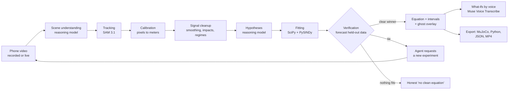

# PhysicsLens

**Point a phone at anything moving. Get the equations that govern it, verified.**

PhysicsLens turns a phone video into a verified physics model. SAM 3.1 tracks the moving object, an agent built on Meta's reasoning models proposes candidate equations, and plain numerical simulation tests every candidate against the real motion. Only an equation that predicts held-out data is accepted. When the data can't tell two models apart, the agent asks you for the experiment that will. The result is a calibrated model you can export straight into a robot simulator, or use to watch a machine wear.

> Built for the **Meta Global AI Developer Hackathon** (Indie track, *Push the Frontier*), Oct 27 to Nov 4, 2026.

| | |
|---|---|
| 🎥 **Demo video (3 min)** | _link coming_ |
| 🌐 **Try it** | [physicslens.vercel.app](https://physicslens.vercel.app): real analyses with the ghost overlay, decision trail and exports. Analyzing your own clip needs the hosted backend (judges: the access code is in the submission notes) |

---

## Why this matters

Robots are trained in simulators, and they fail in the real world when the simulator's physics is wrong: the friction, damping or stiffness doesn't match reality (the "sim-to-real gap"). Measuring those parameters today takes lab rigs, sensors and an expert's afternoon of modeling. PhysicsLens does it from a phone video:

- **Robotics engineers** get dynamics parameters with uncertainty, exported as a MuJoCo model that is replayed in MuJoCo and checked against the measured motion.
- **Maintenance engineers** film a machine part today and again next month. PhysicsLens compares natural frequency and damping across recordings and flags drift, an early sign of wear.
- **Anyone building a mechanism** gets a working dynamics model in seconds instead of hours.

It is system identification, normally a specialist task, made as easy as filming something.

## What it does

1. **Record, upload, or go live.** Live mode streams the phone camera; tap the object to lock on.
2. **It reads the scene.** The reasoning model looks at four keyframes, names the moving object, guesses the kind of motion, and finds a reference of known size (A4 or letter sheet, credit card, coin). No reference? Give the pendulum length or the moving object's size, or skip it: frequency, damping and friction need no scale.
3. **It tracks precisely.** SAM 3.1 follows the object, and the reference, through every frame in a single request.
4. **It hypothesizes, then proves.** The agent proposes candidate equations; regular math fits and simulates each one and keeps only what forecasts held-out data. The simplest adequate model wins (BIC).
5. **It asks for better data.** If candidates tie, the agent says which experiment would separate them ("release it from a larger angle and film 20 seconds").
6. **You see the proof.** A simulated "ghost" moves over the real video. Every decision appears in an on-screen decision trail: what was proposed, what was rejected and why, and what the agent decided next.
7. **Ask "what if?" out loud.** "What if the string were twice as long?" The fitted equation is re-simulated from the same starting state and drawn as a second ghost.
8. **Export.** A MuJoCo model, a standalone Python simulation, parameters as JSON, or a shareable MP4 with the equation burned in.

When nothing fits, it says so: *"no clean governing equation found."* It never invents an equation, and it refuses clips it can't measure (a flat pendulum arc, a round spinning object, a spin close to the frame-rate limit, a tracked object that never moves) instead of guessing. One limit it cannot see: a spin faster than a quarter turn per frame aliases into a slower one, so film spins with slow motion.

## Systems it identifies

| System | Models compared | What you get |
|---|---|---|
| Pendulum | simple, small-angle, linear damping, air drag | g, damping, string length (all with intervals) |
| Spring or elastic oscillator | harmonic, damped harmonic | natural frequency, damping ratio |
| Thrown or dropped object | no drag, linear drag, quadratic drag | g, drag coefficient |
| Bouncing ball | free flight plus restitution (hybrid) | g shared by every flight, coefficient of restitution at each bounce |
| Double pendulum | point-mass double pendulum, fitted on short restarted predictions | g, mass ratio, and how chaotic it is: Lyapunov exponent and how many seconds the motion can be forecast |
| Spinning object slowing down | free spin, dry friction, viscous, air drag, dry plus viscous | the friction law and its coefficients |
| **Anything else that moves** (rolling, sliding, braking, a falling leaf) | constant velocity and constant acceleration as controls, plus up to three equations **the agent writes itself** | the law that forecasts the motion, its fitted coefficients, and the same ghost, exports and what-ifs |

**Equations the agent writes itself.** For motion outside the named families the agent proposes the acceleration law as text, for example `-mu*9.81*sign(v) - c*v*abs(v)` for a cart slowed by rolling friction and air drag. A small recursive-descent parser over a closed grammar (numbers, declared parameters, the state variables, `+ - * / ^` and a whitelist of functions) turns it into a model; nothing is ever passed to `eval`. The parsed tree drives the ODE solver, the LaTeX shown in the app and the exported Python script, so what you see is exactly what was fitted. Each law must beat "nothing acts on it" and "a constant force" on held-out motion, and a malformed proposal goes back to the agent with the parser's error. On synthetic data an agent-written air-drag law recovers its coefficient within 5% and a wrong spring law is rejected.

Changes during a clip (say, the string is shortened mid-recording) are detected; each regime is fitted separately, and live mode refits on the new motion.

## How it works



**The design principle: Meta's models perceive and reason; math decides.** The language model reads the scene, proposes hypotheses, plans experiments and explains results. It never accepts an equation: only numerical verification on held-out data does, and the simplest model of each family is always tested as a control, so the agent can't hide the baseline.

## Meta models used

| Model | Where it runs | What it does in PhysicsLens |
|---|---|---|
| **Muse Glimmer 30B** (open weights) | Self-hosted with llama.cpp on a free Kaggle GPU notebook (two T4s) | The agent's reasoning: scene understanding from keyframes (vision), candidate equations, the agent's own free-form laws, experiment requests, explanations, turning what-if questions into parameter changes |
| **SAM 3.1** | Meta Model API | Box-prompted segmentation and tracking of the moving object(s) and the reference object in one request; in live mode, refinement of an on-device tracker in parallel chunks |
| **Muse Voice Transcribe** | Meta Model API | Hands-free what-if questions over the realtime endpoint, with automatic end-of-speech detection |
| **Muse Spark 1.3** | Meta Model API | Development convenience only, with the same prompts and schemas; demo and production refuse to reason on anything but the open-weight model |

**Open-weight status, stated plainly:** every reasoning step behind the published gallery results ran on **Muse Glimmer 30B**, Meta's open-weight model, using the official `meta-models/Muse-Glimmer-30B-GGUF` weights (Q4_K_M plus the vision encoder) on llama.cpp. It ran in a Kaggle GPU notebook, so it cost nothing per call. Each result shows the model behind every step. In demo and production the app refuses to reason on any other model: if the open-weight server is down it shows a "busy" message instead of switching. During early development the same prompts ran on Muse Spark 1.3; those results are not in the gallery.

How the split works: the notebook never holds a Meta key. SAM 3.1 tracking runs through the cost guard on the developer's machine, and its results reach the notebook as cached responses (`PHYSICSLENS_CACHE_ONLY=meta_api` makes the Meta provider answer only from cache). Both sides analyze the same frozen clip and keyframe bytes, so their caches agree. `scripts/glimmer_batch.py` runs the handoff:

```bash
# on the GPU machine, after starting llama-server with the Glimmer GGUF (see the script's docstring)
REASONING_PROVIDER=glimmer PHYSICSLENS_CACHE_ONLY=meta_api \
GLIMMER_BASE_URL=http://127.0.0.1:8080/v1 GLIMMER_API_KEY=<llama-server key> \
python scripts/glimmer_batch.py run --bundles bundles --out out
```

To serve the full app on open weights, point `GLIMMER_BASE_URL` at any reachable llama-server running Muse Glimmer and set `REASONING_PROVIDER=glimmer`.

SAM 3.1 is used as a **scientific measurement instrument**: its masks become position and orientation time series that feed differential-equation fitting.

## Validation

**On real footage** (a 0.5 m pendulum, CC BY-SA clip, see `gallery/README.md`): SAM 3.1 tracked the bob in 164 of 164 frames from a box placed by the reasoning model; every pendulum model gives g between 9.81 and 9.83 m/s²; the ghost stays within about 8 px of a bob about 80 px across. With only 6.5 s of a small swing the candidates tie, and the agent asks for a longer, larger swing.

**Exports:** for every exactly representable model, the MuJoCo export replayed in MuJoCo matches the fitted motion to under 0.1 mm; the generated Python script matches to 1e-9.

**On synthetic data with known answers** (so far; real clips for these are being recorded):

- damped pendulum: g within 0.3%, damping within 2%; tiny swings are refused because the length can't be measured
- bouncing ball: coefficient of restitution within 0.01 and g within about 1% with up to 8 mm tracking noise
- double pendulum: g within 0.4%, mass ratio within 1%, chaos detected (predictable for about 1.6 s at 2 mm noise); random motion is rejected
- spin-down: all four friction laws identified, coefficients within 3%, orientation from masks to 0.004 rad
- free-form laws: an air-drag law written as text recovers its coefficient within 5%; a 2D drag law recovers g within 3%; a wrong law loses to the controls
- machine health: no false alarm when the same system is re-recorded; a 50% rise in damping and a 2% frequency shift are flagged

## Engineering highlights

- **Verified, not generated.** Every accepted equation forecasts held-out data; ties lead to experiment requests, not guesses.
- **Chaos handled honestly.** Chaotic systems are fitted on short predictions restarted from the measured state, and the app shows a single long prediction drifting away.
- **Live mode that keeps up.** SAM 3.1 answers a 2 s chunk in several seconds, so an on-device template tracker drives the overlay instantly; SAM refines every second frame in parallel chunks and re-anchors the tracker when it drifts.
- **Uncertainty everywhere.** Parameters come with bootstrap intervals; machine-health drift is flagged only past 3 standard errors and a practical threshold, with a repeatability allowance.
- **Cost-safe by construction.** Every paid call goes through one guard: hard budget caps, a model allowlist, rate limits, retries in our own code only, a response cache (re-processing a clip is free) and a kill switch.

## Tech stack

Python 3.11+ · FastAPI · NumPy / SciPy · PySINDy · OpenCV · MuJoCo · matplotlib (equation rendering) · SQLite · ffmpeg · Next.js + TypeScript · KaTeX · Canvas

## Getting started (Linux)

### Prerequisites

- Python 3.11+, Node.js 20.17+ (or 22.9+), ffmpeg (`sudo apt install ffmpeg`)
- A Meta Model API key ([dev.meta.ai](https://dev.meta.ai)) for SAM 3.1 and Muse Voice Transcribe
- For open-weight reasoning: a GPU machine with about 20 GB of GPU memory running llama.cpp `llama-server` (b10353 or newer) with `meta-models/Muse-Glimmer-30B-GGUF`; a free Kaggle notebook with two T4 GPUs works

### Setup

```bash
git clone <this-repo-url> physicslens
cd physicslens
cp .env.example .env          # fill in your keys; never commit .env
make setup                    # creates .venv and installs backend dependencies
(cd frontend && npm install)  # frontend dependencies
make test                     # unit tests with mocked models (no API spend)
```

### Run

```bash
make dev-backend              # FastAPI on http://localhost:8000
make dev-frontend             # Next.js on http://localhost:3000
```

Open `http://localhost:3000` for the gallery and uploads, `/live` for the camera, `/health` for machine-health comparisons.

### Cost controls

```bash
make report                   # spend so far per provider/model/day and per audience, remaining budget
make kill                     # instantly block every paid API call
make unkill                   # re-enable
make smoke                    # one cheap real call per model (asks before spending); checks Glimmer if configured
```

Budget caps live in `config/budget.yaml` (created from `config/budget.example.yaml` by `make setup`); prices in `config/prices.yaml`.

### Public deployment settings

| Variable | Effect |
|---|---|
| `APP_ENV=demo` or `prod` | Reasoning only on the open-weight model, no development fallback; mocks refused at startup |
| `REASONING_PROVIDER=glimmer`, `GLIMMER_BASE_URL`, `GLIMMER_API_KEY` | The llama-server running Muse Glimmer |
| `DEMO_ACCESS_CODE` | Judges append `?code=...` to the URL for uploads, live mode and voice |
| `PUBLIC_TRY_ENABLED=1` | Visitors without a code may analyze a few short clips per day; otherwise gallery only |
| `TURNSTILE_SITE_KEY`, `TURNSTILE_SECRET_KEY` | Optional Cloudflare Turnstile check on public uploads |
| `NEXT_PUBLIC_API_BASE` | Backend URL for the frontend; `npm run build:static` writes a static site to `frontend/out/` |

## Project structure

```
config/        model allowlist, prices, budget example, rate limits
backend/       FastAPI app: costguard, perception, sigproc, physics, agent, voice, export, live mode
frontend/      Next.js web app (works in a mobile browser): analyze, live, machine health
gallery/       curated real analyses shown to visitors (clip licenses in gallery/README.md)
samples/       short public test clips
scripts/       smoke-clip generator, gallery promotion
tests/         unit tests (run with mocked models; recorded real responses as fixtures)
```

## What we built during the hackathon

All code in this repository was written during the hackathon building period (Oct 27 to Nov 4, 2026).

- [x] Cost guard: budgets, allowlist, rate limiting, caching, kill switch, persistent spend ledger
- [x] Recorded mode: video → SAM 3.1 tracking → calibrated trajectory
- [x] Hypothesis generation and agent decisions with validated structured outputs, running on Muse Glimmer (open weights, self-hosted)
- [x] Equations the agent writes itself, parsed by a closed math grammar (no eval) and verified like any built-in model
- [x] Scale from a known object size, slow-motion clips in real time, and a hint for what to track
- [x] Fitting (SciPy) with BIC model selection, held-out forecasts and bootstrap uncertainty that includes the scale's own error; PySINDy shown separately as unverified model-free regression
- [x] Verification with simulate-and-compare on held-out data
- [x] Ghost overlay on the real video, and an on-screen decision trail showing who decided what
- [x] Live camera mode with converging equations (instant on-server tracking, refined by SAM 3.1 in parallel chunks; tap the object to lock on)
- [x] Experiment requests for ambiguous data
- [x] Regime-change detection (live and recorded)
- [x] Voice what-ifs with Muse Voice Transcribe (spoken question, parameter change, re-simulated ghost; typing works too)
- [x] Shareable MP4 with the measured trail, the simulated ghost and the typeset equation burned in
- [x] Exports: MuJoCo MJCF (replayed in MuJoCo and checked against the fitted motion), standalone Python simulation, parameters as JSON
- [x] Machine-health drift comparison and trend view across up to 12 recordings
- [x] Bouncing objects: hybrid model with per-impact coefficient of restitution
- [x] Double pendulum: two tracked bobs, short-horizon fitting, chaos measured
- [x] Spin-down of rotating objects: friction law identified, exported to MuJoCo with native dry friction
- [x] Public access: free gallery of real analyses, judge access code, per-visitor limits, optional bot check

## Limitations

- 2D motion in the camera plane; best results with the camera side-on and held still.
- One object, or two for a double pendulum. Live mode follows one object.
- Deformable and fluid motion (cloth, water, smoke) is reported as "no clean equation," not modeled.
- Accuracy depends on frame rate, lighting and a visible reference of known size (or a known pendulum length).
- The double pendulum assumes point masses on light rods; solid-bar pendulums may fit worse.

## Roadmap

3D reconstruction from two phones, more coupled multi-body systems, export to more simulators (Isaac Sim, Gazebo), and on-device inference with Muse Glimmer.

## Acknowledgements

- Meta's Muse Glimmer, SAM 3.1, Muse Voice Transcribe and Muse Spark models, and the `meta-sam-parser` library.
- llama.cpp for serving the open-weight model, and Kaggle for the free GPU notebook it ran on.
- Pendulum footage in the gallery: Rhetos / Mathe-AC Lernwerkstatt (CC BY-SA 4.0), via Wikimedia Commons.

## License

Code: [MIT](LICENSE). Gallery clips keep their own licenses, listed in `gallery/README.md`.
